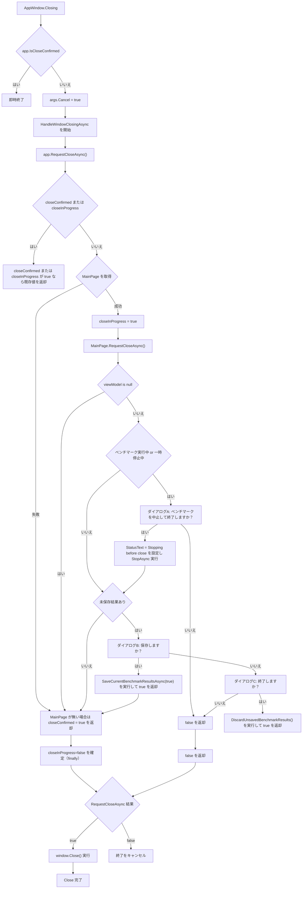

# 終了ダイアログ フローチャート

### 参照元
- [Benchmark/MauiProgram.cs](G:\GitHub\Seamless\Benchmark\MauiProgram.cs)
- [Benchmark/App.xaml.cs](G:\GitHub\Seamless\Benchmark\App.xaml.cs)
- [Benchmark/MainPage.cs](G:\GitHub\Seamless\Benchmark/MainPage.cs)
