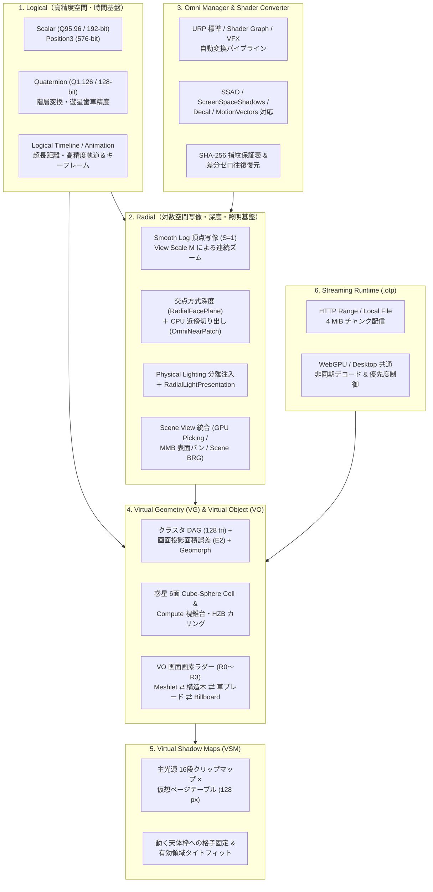
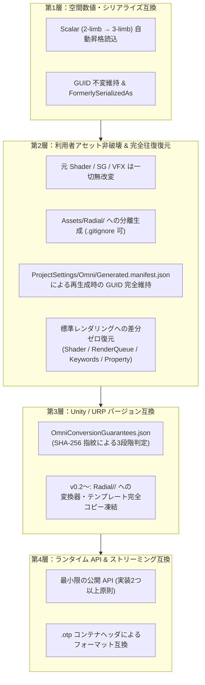

# Argon Omni ロードマップ・戦略

- **策定日**: 2026-11-14
- **対象ブランチ / バージョン**: `0.1.0`（Omni Core `com.omni.rendering` `0.1.0`）
- **対象環境（v0.1.0 基準）**: Unity `6000.6` 系（最低版 `6000.6.0f1`、現行受入版 `6000.6.8f1`）、URP `17.6.0`、Input System `1.20.1`
- **位置づけ**: 本書は Omni プロジェクトの「最終到達点」「v0.1.0 のスコープ」「段階的ロードマップ」「戦略的妥協（非目的と Fail Closed 境界）」「後方互換性戦略」「競合に対する優位性」を定義する意思決定正本である。

---

## エグゼクティブサマリー（6つの問いへの結論）

| 論点 | 結論の要旨 |
| :--- | :--- |
| **1. 最終的に何をやろうとしているのか？** | **量子・陽子（$10^{-15}\text{ m}$）から惑星・恒星系・観測可能な宇宙（$\pm 3.96 \times 10^{28}\text{ m}$）まで**のあらゆる空間・時間スケールを、原点シフト（Floating Origin）やマルチカメラ合成に頼らず、**単一の論理座標空間（192-bit 固定小数点）と1台のカメラ（対数空間写像＋仮想ジオメトリ＋仮想シャドウ＋ストリーミング）**でシームレスに保持・編集・描画・配信できる Unity 向け次世代空間レンダリング＆ワールド基盤を完成させる。 |
| **2. 0.1 では何をやろうとしているのか？** | **Unity `6000.6` 系（URP `17.6.0`）の単一環境**に集中し、**Windows (`Direct3D 12`) と Web (`WebGPU`)** を正式ターゲットとして、署名済み UPM Core パッケージ（`com.omni.rendering`）を初回リリースする。Logical（Timeline 段7含む）、Radial（Smooth Log $S=1$、交点方式＋CPU近傍切り出し）、Omni Manager（標準/SG/VFX変換＋Grass間接描画統合）、Virtual Geometry (VG)、Virtual Shadow Maps (VSM) をすべて **0.1 正式機能**として仕上げ、Quick Start（UPM Samples）と3大デモ（`EarthToMoon`, `SolarSystem`, `CosmicScale` の `.unitypackage`）および 29 サンプルのクリーン受入（R1〜R12）を完遂する。 |
| **3. ロードマップは？** | **v0.1.0（基盤確立と初回公開）** → **v0.2.0（版別変換器の凍結分離による Unity 6.7/7.0 対応、DOTS / Entities Graphics 統合、2D/UI/Terrain Tree 拡張、VG/VO/Streaming アーキテクチャ再編）** → **v0.3.0〜v1.0.0（Asteria 惑星降下デモ・Moon 単体デモの公開、macOS Metal / コンソール等のマルチプラットフォーム拡大、Asset Store 正式展開）** の3段階で進める。 |
| **4. 何を妥協するべきか？** | **「もっともらしい嘘の描画」を一切許さない（Fail Closed 原則）**。0.1 では、(1) 写像曲線の選択自由度（Smooth Log $S=1$ のみに固定）、(2) 木星・土星級の巨大単一球への極端な近接時の角張り、(3) WebGPU / Metal における長大三角形の近傍ラスタ崩れ（`barycentrics` 非対応環境での対数補間フォールバック）、(4) Deferred / 2D Renderer / DOTS / モバイル / WebGL 2、(5) 独自の品質プロファイル keyword（Shader Variant 爆発防止）、(6) 複数 Unity バージョンの同時サポートを明確に割り切る。 |
| **5. 後方互換性の戦略は？** | **「数値データの維持」「元アセット非破壊と完全往復復元」「変換器の版別凍結」「最小公開 API」**の4層で守る。`Scalar` の 2-limb → 3-limb 拡張時も旧シリアライズ互換を維持し、`ProjectSettings/Omni/Generated.manifest.json` により生成物の再生成でも GUID を不変に保つ。標準レンダリングへの切り替え時は差分ゼロで元に戻す。Unity / URP の更新に対しては SHA-256 指紋台帳で検証し、0.2 以降は `Radial/<Unity完全版>/` ごとに旧版変換器をコピー凍結して既存動作を絶対に壊さない。 |
| **6. 類似ソフト・アセットに対する優位性は？** | **Floating Origin 系アセット**と異なりシーン書き換えゼロで超遠景と足元を1フレーム・1カメラで同時描画・Scene View 直接編集できる。**単純な対数深度シェーダー**と異なり 192-bit 固定小数点座標・UV 歪み補正・長大三角形の交点深度・物理照明分離・SSAO/Shadow/Decal/MotionVector・自動 Shader 変換器を持つ。**UE5 (LWC + Nanite + VSM)** の 64-bit double（有効53 bit）や線形カメラ視錐台の限界を超え、Unity 6 URP 上かつブラウザ（WebGPU）で宇宙〜ミクロの連続空間を実現する。 |

---

## 第1章：最終的に何をやろうとしているのか？（最終到達点・ビジョン）

### 1.1 解決する根本課題：既存ゲームエンジンの「空間の壁」

現代の 3D ゲームエンジン（Unity や標準的なレンダリングパイプライン）は、以下の**2つの根本的な数値・光学上の壁**により、扱える空間スケールが数キロメートル〜数千キロメートル程度に分断されている。

1. **座標精度の壁（32-bit / 64-bit 浮動小数点の限界）**:
   - 標準の `float`（IEEE 754 binary32、仮数 24 bit）は原点から約 $10\text{ km}$ を超えるとミリメートル単位の精度を失い、頂点ジッターや物理・カメラ制御の破綻を引き起こす。
   - 仮に `double`（binary64、仮数 53 bit）を採用しても、ミリメートル精度を保てるのは約 $9 \times 10^{12}\text{ m}$（太陽〜海王星軌道の約2倍）までであり、恒星間・銀河・宇宙大規模構造（$10^{20}\sim 10^{26}\text{ m}$）とミクロ・量子領域（$10^{-9}\sim 10^{-15}\text{ m}$）を同じ座標系で連続的に扱うことはできない。
2. **カメラ投影と深度バッファの壁（線形透視投影と Near/Far 比の限界）**:
   - 標準の透視投影行列と Reversed-Z 深度バッファをもってしても、1台のカメラで破綻なく描画できる Near / Far 比は実用上 $10^5\sim 10^8$ 程度が限界である。
   - そのため従来は「近景用・中景用・遠景用のマルチカメラ合成」「スカイボックスへの焼き込み」「カメラ移動に応じた Floating Origin（シーン全体の原点シフト）」といった**空間を偽装・分断するワークアラウンド**に頼らざるを得なかった。

### 1.2 Omni の最終到達点（Ultimate Vision）

Omni が最終的に実現しようとしているのは、**「極小（量子・陽子・ミリメートル）から極大（惑星・恒星系・銀河・観測可能な宇宙）までの全スケールを、偽装や空間分断なしに、単一の論理空間と1台のカメラでシームレスに保持・編集・描画・配信できる次世代の空間基盤」**である。

- **単一の絶対・階層論理空間**:
  - $\pm 3.96 \times 10^{28}\text{ m}$（観測可能な宇宙の直径約 $8.8 \times 10^{26}\text{ m}$ の約45倍）の全域において、場所によらず常に **$1.26 \times 10^{-29}\text{ m}$ の均一な最小分解能**を持つ固定小数点座標系で全オブジェクトを管理する。
- **1台のカメラによる連続スケール描画**:
  - 宇宙空間から大気圏へ突入し、雲を抜け、山脈・都市・街路を経て、地上の1枚の木の葉や小石、さらには分子・陽子スケールに至るまで、**シーンの切り替えもカメラの複数台合成も原点シフトも一切行わずに**連続描画する。
- **通常の Unity ワークフローの完全維持**:
  - 特殊な独自エンジンへ移行するのではなく、**標準の Unity（Scene View での直接選択・移動・フォーカス、Timeline、URP、Shader Graph、VFX Graph、BatchRendererGroup）**の操作感とエコシステムをそのまま保ったまま、裏側の数学とシェーダー・描画経路を対数空間へ透過的に昇華させる。
- **デスクトップから Web ブラウザまでの単一アーキテクチャ配信**:
  - Direct3D 12 / Vulkan のハイエンド環境だけでなく、**WebGPU によるブラウザ上での惑星規模ストリーミング（初期ロード数十 MB＋HTTP Range によるオンデマンド 4 MiB チャンク配信）**までを同一のランタイム設計で成立させる。

### 1.3 最終アーキテクチャを構成する6つの技術柱

---

## 第2章：v0.1.0 では何をやろうとしているのか？（0.1 のスコープ・配布物・完了条件）

### 2.1 v0.1.0 の基本方針：「単一環境・完全品質・Fail Closed」

v0.1.0 は Omni の**初回公開リリース（Initial Public Release）**である。
ここでの最大の戦略判断は、**「対応する Unity バージョンとレンダーパイプラインを 1 系統に絞り込む代わりに、空間数学・対数描画・シェーダー変換・仮想ジオメトリ (VG)・仮想シャドウ (VSM)・タイムライン・エディタ操作のすべてを『実験枠ではなく実用完成品質』として出し切る」**ことにある。

### 2.2 対象環境とプラットフォーム境界（確定仕様）

| 項目 | v0.1.0 の確定仕様 | 備考・境界動作 |
| :--- | :--- | :--- |
| **対象 Unity バージョン** | **Unity `6000.6` 系**（最低版 `6000.6.0f1`、現行開発・受入版 `6000.6.8f1`） | 0.1 は 6000.6 系のみをサポート。版別変換器の分離（6.7 / 7.0 対応）は 0.2 で実施。 |
| **対象レンダーパイプライン** | **URP `17.6.0`**（Forward / Forward+ のみ） | Deferred / Deferred+ / 2D Renderer は非対応（Fail Closed）。 |
| **必須パッケージ** | `com.unity.render-pipelines.universal` `17.6.0` `com.unity.inputsystem` `1.20.1` `com.unity.timeline` `1.8.12` `com.unity.visualeffectgraph` `17.6.0`（VFX変換時） | |
| **ビルド受入ターゲット** | **Windows (`Direct3D 12`)** および **Web (`WebGPU`)** | 正式リリース受入（Player Build & Smoke Test）は Windows D3D12 と WebGPU で実施。 |
| **エディタ対応 API** | Direct3D 12 / Direct3D 11 / Vulkan / Metal / WebGPU（Shader Model 4.5 以上） | |
| **ビルド遮断対象（Fail Closed）** | Android / iOS / visionOS、および WebGL 2 / OpenGL ES 3.0 / OpenGL Core 等の SM 4.5 未満 API | `RadialBuildPreprocessor` によりビルド開始前に明確な理由を出して停止する。 |

### 2.3 配布パッケージとサンプル/デモ構成（確定仕様）

v0.1.0 の配布物は、Core の軽量性と導入のしやすさを両立するため、以下の**3階層**に分けて提供する。

1. **Omni Core パッケージ (`com.omni.rendering-0.1.0.tgz`)**:
   - Unity Package Manager (UPM) の「Add package from tarball...」で導入可能な、Attestation（署名）付きの Core パッケージ。
   - 含まれるモジュール：`Omni.Logical`、`Omni.Radial`、`Omni.VirtualGeometry`（VSM 含む）、`Omni.Streaming`、`Omni.Editor`（Omni Manager / 変換器 / Scene View 統合 / Timeline Editor）。
2. **軽量サンプル (`Quick Start`)**:
   - `com.omni.rendering` パッケージ内の UPM `Samples` タブからワンクリックでインポートする形式。
   - リポジトリ内のコミット済み Quick Start 資産（`Packaging/QuickStart`）を正本とし、導入直後に Omni Manager による Radial 変換・プレビュー・復元を数分で体験できる最小構成。
3. **大型デモ群（別配布 `.unitypackage`）**:
   - リポジトリのサンプル群から生成し、展開先を `Assets/Samples/Omni/<version>/Demos` とする `.unitypackage` として別配布する。
   - **v0.1.0 公開対象デモ（3本）**:
     1. **`EarthToMoon`**: 地球地表から月面までの実寸スケール（約 38.4 万 km）の連続移動・VG 地形・VSM・Logical Timeline デモ。
     2. **`SolarSystem`**: 太陽系全惑星・衛星の実寸配置、Logical Timeline による公転・自転、ワープ航行デモ。
     3. **`CosmicScale`**: 陽子（$10^{-15}\text{ m}$）から観測可能な宇宙（$10^{26}\text{ m}$）まで 41 桁のスケールを 1 シーン・1 カメラで連続ズームする象徴的デモ。
   - **v0.1.0 非公開デモの扱い**:
     - **`Asteria`**（惑星規模 10 分間連続降下デモ）および **`Moon`** 単体デモは **v0.1.0 では非公開**とする。ただし、`EarthToMoon` 等が参照する **`Moon` の共有基盤アセット・ランタイムは維持**する。

### 2.4 v0.1.0 に含める確定機能スコープ

2026-11-14 の仕様決定により、従来 Experimental や次期候補とされていた項目を含め、以下を **v0.1.0 の正式完了スコープ**とする。

#### (1) Logical（高精度空間・回転・Timeline）
- **空間・回転型**: `Scalar`（Q95.96 固定小数点、192-bit）、`Position3`（576-bit）、`Quaternion`（Q1.126 固定小数点、128-bit）による完全なローカル/ワールド階層計算。
- **Logical Timeline の完全実装（段7まで完遂）**:
  - `LogicalPositionTrack` / `LogicalRotationTrack` による軌道・姿勢制御。
  - **段 6.5**: `LogicalAnimationTrack`（キーフレーム・AnimationCurve 編集・Timeline 録画対応）。
  - **段 7**: `Moon` 基盤および `EarthToMoon` サンプルへの Timeline 適用と関連ドキュメントの完全整合。

#### (2) Radial（対数空間写像・長大三角形の深度解決・照明・Scene View）
- **写像方式**: **Smooth Log（$S=1$ 固定）** に一本化。カメラごとの調整パラメータは **View Scale $M$**（`m_ViewScale`）のみとし、Near/Far の手動クリップ調整を不要にする。
- **長大三角形の深度・被覆解決（0.1 完了基準）**:
  - **GPU 交点方式 (`RadialFacePlane.hlsl`)**: Direct3D 12 / Vulkan において、SV_Barycentrics から三角形の平面を復元し、視線との正確な交点距離（物体座標 `floatx2` 精度）から対数深度を計算することで、巨大な床・壁・箱の深度破綻を解消。
  - **CPU 近傍切り出し (`OmniNearPatch`)**: カメラ近傍 100 km（Reach）以内の長大三角形を CPU 側で double-double（約 106 bit）精度でクリップし、近傍の数値破綻を防止。
  - これら「交点方式＋近傍切り出し」をもって 0.1 における長大三角形対応の完了とする。
- **物理照明分離と遠方ライト**:
  - ラスタ位置は対数圧縮しつつ、ライティング計算には物理空間の座標・減衰を注入する。
  - `RadialLightPresentation` により、数千 km〜数百万 km 離れた点光源・スポットライトの有効距離と減衰を正確に描画する。
- **Scene View 統合と Scene BRG**:
  - Scene View Overlay での Radial ON/OFF・View Scale $M$ 調整・比較表示（Split / Wipe）。
  - 対数空間対応の GPU Picking、MMB 表面パン、F キーフォーカス。
  - Scene BRG（`BatchRendererGroup` + Forward+ 一括描画）による大量オブジェクトの高速描画。

#### (3) Omni Manager & Shader / VFX / Grass 変換パイプライン
- **自動変換対象**:
  - URP 標準 Shader 17 本（Lit, SimpleLit, ComplexLit, Unlit, BakedLit, Particles 系, Terrain/TerrainLit, Skybox 系, SpeedTree7/8 等）＋ Decal Shader Graph ＋ SSAO / ScreenSpaceShadows / MotionVectors 内部 Shader。
  - カスタム Shader Graph（Universal Lit / Unlit / Six-Way / TerrainLit / Decal / Fullscreen）。
  - VFX Graph（Particle / Mesh 出力の Radial 変換と カメラ相対 Culling Bound 拡張）。
  - 固定機能 Stencil Mask / Geometry Shader。
- **Grass 間接描画（Compute Culling + Indirect Draw）の Manager 統合**:
  - 29 サンプルの 1 つである `Grass`（Compute による視錐台カリング＋`Graphics.RenderMeshIndirect`）について、`ExternalDrawPaths.Register` を介した **通常の Omni Manager 変換・復元フローへの完全統合と受入**を 0.1 で完遂する。

#### (4) Virtual Geometry (VG) の 0.1 正式機能化
- Experimental 枠から外し、**v0.1.0 の正式機能**として完成させる。
- **完了要件**:
  1. 画面投影面積誤差（**E2**）基準による LOD 選択と **Geomorph**（境界の滑らかな遷移）の統一。
  2. **GPU 選択（Compute ベースの DAG カット選択・HZB カリング）の全面移行**と、全階層 Controller への接続。
  3. 汎用メッシュにおける旧来のスカート（Skirt）方式の撤去と、クラスタ境界の**水密接続（Watertight Meshlet Boundary）**の完成。

#### (5) Virtual Shadow Maps (VSM) の 0.1 正式機能化
- VG と並び、**v0.1.0 の正式機能**として完成させる。
- **完了要件**:
  1. 主光源向けの 16 段クリップマップ × 仮想ページテーブル（128×128 px ページ、4096×4096 物理アトラス）の稼働。
  2. **VG 地形・クラスタが VSM の要求ページへ正確に影を落とす描画経路**の完全接続。
  3. 公転・自転する**動く天体枠（ローカル基準枠）へのクリップマップ格子固定**によるシャドウ水泳（Shadow Swimming）の防止。
  4. 負荷計測および Windows Player（Direct3D 12）での受入合格。

### 2.5 v0.1.0 の正式受入ゲート（完了条件）

`Tools/Invoke-OmniAcceptance.ps1 -Profile OmniRelease` による以下の **R1〜R12 全工程の Passed** をもって v0.1.0 リリース完了とする。

1. **R1〜R3（環境・指紋・代表 Shader 往復）**: Unity `6000.6.8f1` / URP `17.6.0` の完全一致、代表 Shader / Shader Graph / VFX の変換と差分ゼロ復元。
2. **R4〜R6（EditMode / Interaction Stage S00〜S05 / 小規模描画）**: 座標・投影・Picking・BRG・Stage S00〜S05 の全テスト合格。
3. **R7〜R9（全 29 サンプルの Radial 変換・PlayMode・GPU 画像検証・完全復元）**: `Grass`、`EarthToMoon`、`SolarSystem`、`CosmicScale` を含む全サンプルの変換・描画・復元でエラーゼロ。
4. **R10〜R12（パッケージビルド・署名検証・クリーンプロジェクトでの Player 受入）**:
   - `com.omni.rendering-0.1.0.tgz` の生成と署名検証。
   - 別プロジェクトへの `.tgz` 導入、Quick Start サンプルと Demo `.unitypackage` の展開。
   - **Windows Player (`Direct3D 12`)** および **Web Player (`WebGPU`)** のビルド・起動・描画・性能計測の合格。

---

## 第3章：ロードマップ（v0.1.0 → v0.2.0 → v0.3.0 / v1.0.0）

### 3.1 段階的ロードマップ全体像

```mermaid
flowchart LR
    subgraph P1["Phase 1: v0.1.0<br/>(Initial Public Release)"]
        P1A["Unity 6000.6 / URP 17.6 単一環境確立"]
        P1B["Logical (Q95.96 + Timeline段7) 完成"]
        P1C["Radial (Smooth Log + 交点深度 + 近傍切出)"]
        P1D["Manager (標準/SG/VFX + Grass間接描画)"]
        P1E["VG (E2/Geomorph/GPU選択/水密) 正式化"]
        P1F["VSM (16段/VG影/天体枠固定) 正式化"]
        P1G["Core .tgz + QuickStart + 3大デモ受入"]
    end

    subgraph P2["Phase 2: v0.2.0<br/>(Ecosystem & Pipeline Expansion)"]
        P2A["版別変換器の凍結分離<br/>(Unity 6.7 / 7.0・URP 17.7 対応)"]
        P2B["DOTS / Entities Graphics 統合<br/>(SubScene Radial 配布・BRG連携)"]
        P2C["Radial カバレッジ拡張<br/>(2D Renderer / World UI / Terrain Tree)"]
        P2D["Light Probe 物理空間補間<br/>(Legacy 経路対応)"]
        P2E["VG / VO / Streaming 再編完遂<br/>(VO 部分置換・Inspector 完結化)"]
    end

    subgraph P3["Phase 3: v0.3.0 〜 v1.0.0<br/>(Full-Scale World & Asset Store)"]
        P3A["Asteria 惑星降下デモ (10分間) 公開"]
        P3B["Moon 単体高精細デモ公開"]
        P3C["WebGPU / Metal 長大三角形の<br/>高次分割または代替深度解決"]
        P3D["macOS Metal / Linux Vulkan /<br/>コンソール Player 正式受入"]
        P3E["Unity Asset Store 正式リリース"]
    end

    P1 --> P2 --> P3
```

### 3.2 Phase 1: v0.1.0（Initial Public Release — 現在地）

現在のブランチ `0.1.0` で完遂すべき項目と直近のアクションは以下の通りである。

| 領域 | 状態 | 0.1 リリースに向けた完了タスク |
| :--- | :---: | :--- |
| **Logical / 座標・回転基盤** | 完了 | Q95.96 `Scalar` / Q1.126 `Quaternion` 稼働済み。 |
| **Logical Timeline** | 仕上中 | 段 6.5（`LogicalAnimationTrack` キーフレーム・カーブ編集・録画）と段 7（`Moon` 基盤・`EarthToMoon` 拡張・文書更新）を完遂する。 |
| **Radial 深度・照明・Scene View** | 完了 | Smooth Log ($S=1$)、交点方式 (`RadialFacePlane`)、CPU 近傍切り出し (`OmniNearPatch`)、`RadialLightPresentation`、Scene BRG 稼働済み。 |
| **Omni Manager & Grass 統合** | 仕上中 | 28 サンプル変換合格済み。残り 1 サンプルの `Grass`（Indirect Draw）を通常 Manager 導線へ統合し 29/29 合格にする。 |
| **Virtual Geometry (VG)** | 仕上中 | E2 誤差・Geomorph 統一、GPU 選択の全面移行と全階層 Controller 接続、汎用メッシュのスカート撤去・水密接続を完了し、Experimental 表記を撤去する。 |
| **Virtual Shadow Maps (VSM)** | 仕上中 | VG 地形から VSM ページへの影描画接続、動く天体枠への格子固定、負荷計測・Windows Player 受入を完了する。 |
| **パッケージング & 文書整理** | 仕上中 | Quick Start（UPM Samples）と 3 大デモ（`.unitypackage`）の構築、旧 Galaxy 残骸・不要 worktree・履歴文書の整理、`OmniRelease` 最終受入（R1〜R12）。 |

### 3.3 Phase 2: v0.2.0（Ecosystem & Pipeline Expansion）

v0.1.0 で確立した単一環境のコアを、**「複数の Unity バージョン」「DOTS (Entities Graphics)」「2D / UI / 植生などの周辺 URP 機能」**へ安全に拡張するフェーズである（関連計画書: [VersionedConverterIsolation.md](file:///g:/Unity/6.6/Omni/Docs/Plans/VersionedConverterIsolation.md), [OmniEntitiesGraphicsIntegration.md](file:///g:/Unity/6.6/Omni/Docs/Plans/OmniEntitiesGraphicsIntegration.md), [RadialCoverageExpansion.md](file:///g:/Unity/6.6/Omni/Docs/Plans/RadialCoverageExpansion.md), [VirtualGeometryArchitecture.md](file:///g:/Unity/6.6/Omni/Docs/Plans/VirtualGeometryArchitecture.md)）。

1. **Unity / URP 版別変換器の独立化と Unity 6.7 / 7.0 対応**:
   - `Assets/Omni/Core/Editor/Manager/Radial/<Unity完全版>/`（例: `6000.6.8f1/`, `6000.7.x/`）ごとに変換器アセンブリ・テンプレート・SHA-256 指紋台帳を分離。
   - 検証済みの `6000.6` 用変換器を一切変更せず凍結したまま、新しい Unity / URP バージョンへの対応を追加できる体制を確立する。
2. **DOTS / Entities Graphics 本格対応**:
   - SubScene 内の DOTS Entity に対する Logical / Radial カメラ相対位置の配布（`RENDER-EG-001` 解消）。
   - Entities Graphics の SRP Batcher / BRG 描画パスと Radial CBuffer レイアウトの整合（`RENDER-SRPB-001` 解消）。
3. **URP 周辺レンダリング経路の拡張**:
   - **URP 2D Renderer**: Sprite / Mesh2D / Sprite Mask の Radial 変換対応。
   - **World Space UI**: World Space Canvas / UI Default & UI Shader Graph の Radial 描画と、対数空間での `EventSystem` Raycast 一致。
   - **Terrain Tree / Detail 植生**: Terrain の木・草ディテール描画パスへの Radial アダプター接続。
   - **Light Probe 物理空間補間**: Scene BRG 以外の Legacy Renderer 経路における `OmniLightProbeSpace` 補間（`LIGHT-PROBE-SPACE-001`）。
4. **VG / VO / Streaming アーキテクチャの再編完遂**:
   - アセンブリの依存方向整理、用語統一、Inspector 上で完結するオーサリング導線の整備。
   - **Virtual Object (VO)** における「木 1 本だけ」「1 区画の草だけ」を R0〜R3（Meshlet ⇄ 構造メッシュ ⇄ 個別ブレード ⇄ Billboard）でシームレスに差し替える**部分置換機構**の完成。

### 3.4 Phase 3: v0.3.0 〜 v1.0.0（Full-Scale World Production & Asset Store）

1. **フラッグシップデモ `Asteria` および `Moon` 単体デモの完成・公開**:
   - 地球型惑星 Asteria の軌道上から大気・雲・山岳・都市・街路・建造物内部・地上の草木まで 10 分間ノーカットで降下するシネマティックデモ（Windows D3D12 & WebGPU ストリーミング対応）を公開する（[AsteriaDesign.md](file:///g:/Unity/6.6/Omni/Docs/Plans/AsteriaDesign.md), [AsteriaVirtualObject.md](file:///g:/Unity/6.6/Omni/Docs/Plans/AsteriaVirtualObject.md)）。
2. **マルチプラットフォームと WebGPU 長大三角形の改善**:
   - WebGPU / Metal 等で `barycentrics`（交点方式）が使えない環境向けに、CPU 近傍切り出しの適用範囲拡大またはテッセレーション/事前細分化パイプラインを導入し、プラットフォーム間の視覚差を解消する。
   - macOS (Metal)、Linux (Vulkan)、主要コンソール機での Player 受入を正式化する。
3. **Unity Asset Store 正式リリース (v1.0.0)**:
   - Core パッケージと大容量デモ資産の分離配布、ドキュメント・チュートリアル・サポート体制を完備し、Asset Store での商用提供を開始する。

---

## 第4章：何を妥協するべきか？（戦略的割り切り・非目的・Fail Closed 原則）

全スケール描画という前人未踏の領域を実用製品として成立させるため、Omni では**「何をやらないか（何を妥協・制限とするか）」**を明確に定義する。

### 4.1 最高原則：「もっともらしい嘘の描画」を絶対に許さない（Fail Closed）

Omni における最も重要なアーキテクチャ上の規律は、**「部分的にしか動かない機能や、深度・照明・座標が狂ったままなんとなく絵が出る状態を絶対に許容しない（Fail Closed）」**ことである。

- 未対応の Shader、未対応の Renderer（Deferred 等）、未対応のビルドターゲット（モバイルや WebGL 2）に対して、曖昧なフォールバックで「一応ビルドが通るが画面が破綻する」状態を作らない。
- **物理 Lighting Data を注入できない Lit 経路**や、**保証表で変換不能と判定された Shader** は、明確なエラーメッセージまたは診断マテリアル（黄色と黒の斜線＋赤 X）を出して停止させる。

### 4.2 空間写像・幾何における戦略的妥協

| 妥協・割り切り項目 | 採用した決定（仕様） | 妥協の理由（守るべき本質） |
| :--- | :--- | :--- |
| **1. 写像曲線の選択肢の廃止** （旧 `ThresholdLinearLog` 等の撤廃） | **Smooth Log（$S=1$ 固定）のみ**に一本化し、調整項目は **View Scale $M$** のみとする。 | 「近景だけ線形にする」曲線は、線形領域と対数領域の境界でクリップや歪みを引き起こし、さらに近景シェーダーのバグを隠蔽するため。全域で滑らかな単一曲線に統一することで数学的整合性を守る。 |
| **2. 木星・土星級の巨大単一球への極端な近接時の角張り** | 半径数万 km の天体を**単一の球メッシュ**で置き、表面に極端に近づいた際のシルエットの角張りは**既知の仕様制限**とする（[KnownBehaviours.md](file:///g:/Unity/6.6/Omni/Assets/Omni/Core/Documentation/KnownBehaviours.md) に明記）。 | 頂点ごとの Radial ワープでは、視線方向（奥行き）の強い対数圧縮と画面横方向の圧縮率の差により、地平線付近の曲率が変化する。これを強引に球面補正すると「天体間の正確な距離関係」が壊れるため、距離の正確さを優先する（地表面に降りる天体は単一球ではなく VG 地形で構築する）。 |
| **3. WebGPU / Metal 等での長大三角形の近傍ラスタ崩れ** | Direct3D 12 / Vulkan では「交点方式 (`barycentrics`) ＋ CPU 近傍切り出し」で完全解決するが、`barycentrics` 非対応の WebGPU / Metal 等では**奥行き対数補間へのフォールバックに伴う近傍ラスタ崩れを 0.1 の制限事項**とする。 | WebGPU（WGSL）や一部の API ではハードウェア重心座標（`SV_Barycentrics`）が標準利用できないため。0.1 では CPU 近傍切り出し（`OmniNearPatch`）で主要ケースをカバーし、非対応 API の限界は仕様制限として明示する。 |

### 4.3 レンダリング経路・Shader Variant における戦略的妥協

| 妥協・割り切り項目 | 採用した決定（仕様） | 妥協の理由（守るべき本質） |
| :--- | :--- | :--- |
| **4. Deferred / Deferred+ / 2D Renderer の 0.1 非対応** | v0.1.0 は **URP Forward / Forward+ のみ**をサポートする。 | G-Buffer に対数圧縮後の位置や法線を格納すると、Deferred Lighting パス全体で物理空間座標の復元が必要となり、URP 内部パス全面書き換えになるため。Forward+ と Scene BRG の組み合わせで十分な多光源・高密度描画性能が得られる。 |
| **5. Omni 独自の品質プロファイル Keyword の不採用** | Radial シェーダーには **Omni 独自の品質切替 keyword（`OMNI_QUALITY_*` 等）を一切追加しない**（[ShaderVariantPolicy.md](file:///g:/Unity/6.6/Omni/Docs/ShaderVariantPolicy.md)）。 | URP の既存 keyword 群に対して独自の軸を掛け算すると、1 Pass / 1 Stage あたり **8,192 variants の上限**を突破しビルド時間・メモリが爆発するため。Radial の座標写像と深度精度は全品質で不変とし、負荷調整は URP 標準の設定・VG の画面誤差閾値・VSM ページ予算で行う。 |
| **6. 5 レイヤー以上の Terrain Patch と非 SRP Batcher SpeedTree** | Terrain の 5 レイヤー以上のパッチは Native 表示へフォールバックし、SRP Batcher 非互換の旧 SpeedTree は Scene BRG ではなく Legacy Radial 描画へ回す。 | URP TerrainLit の Multi-pass 構造および旧 SpeedTree の CBuffer 構造を無理に単一 BRG パケットへ押し込むと、通常の 4 レイヤー以下の高速経路まで複雑化・低速化するため。 |
| **7. DOTS (Entities Graphics) の 0.1 見送り** | DOTS / SubScene 統合は **v0.2.0 へ延期**し、0.1 では GameObject + Scene BRG + VG 間接描画に集中する。 | Entities Graphics 独自の Graphics Archetype と CBuffer 配信機構への介入は影響範囲が広く、0.1 のリリーススケジュールを遅延させるため。 |

### 4.4 プラットフォーム・対象バージョンにおける戦略的妥協

| 妥協・割り切り項目 | 採用した決定（仕様） | 妥協の理由（守るべき本質） |
| :--- | :--- | :--- |
| **8. v0.1.0 は Unity `6000.6` 系（URP `17.6.0`）のみに限定** | 0.1 では Unity 6.0〜6.5 や 6.7 等への同時対応を行わず、`6000.6` 系単一サポートとする。 | URP の内部 HLSL（`Shadows.hlsl`, `LitInput.hlsl` 等）はマイナーバージョン間で頻繁に変化する。0.1 で複数版を抱えるとテストマトリクスが発散するため、まず `6000.6` で完全な品質を達成し、0.2 で版別分離アーキテクチャを導入する。 |
| **9. モバイル（Android / iOS / visionOS）および WebGL 2 の切り捨て** | モバイルプラットフォームおよび Shader Model 4.5 未満（WebGL 2 等）は **Build Preprocessor で遮断**する。 | 192-bit 固定小数点演算、Compute Culling、Indirect Draw、SSBO / StructuredBuffer、VSM ページテーブルは現代のデスクトップ GPU および WebGPU を前提としており、WebGL 2 やモバイル TBDR への妥協を入れるとコア設計が劣化する。Web 展開は WebGPU に一本化する。 |

---

## 第5章：後方互換性の戦略（データ・アセット・Unity/URP 版・API 契約）

Omni は利用者のプロジェクト全体の座標系とマテリアル/シェーダーに関わる基盤であるため、**「一度作ったシーンやアセットが、Omni の更新や Unity のバージョンアップ、あるいは Omni の取り外しによって壊れないこと」**を最優先の互換性戦略とする。

### 5.1 4層の互換性アーキテクチャ

### 5.2 第1層：空間数値・シリアライズデータの後方互換

1. **`Logical.Scalar` の精度拡張に対するバイナリ/シリアライズ互換**:
   - `Scalar` を従来の Q95.32（`m_Hi`, `m_Lo` の 2 limb、128-bit）から Q95.96（3 limb、192-bit）へ拡張した際も、既存 Scene や Prefab に保存された 2 limb のシリアライズデータをそのまま同じ実数値として読み込める後方互換を維持している。
2. **コンポーネント・フィールド改名時の参照保護**:
   - リファクタリングやアーキテクチャ再編（VG / VO の整理等）においてクラス名やファイル名を変更する場合、**`.meta` ファイルの GUID を絶対に変更せず**、シリアライズフィールドには必ず `[FormerlySerializedAs]` を付与して既存 Scene / Prefab の設定値消失を防ぐ。

### 5.3 第2層：利用者アセットの非破壊と「完全往復復元（Round-Trip Guarantee）」

Omni の最大の安全保証は、**「Omni を適用しても元のプロジェクト資産を一切汚染せず、いつでも 100% 元の標準 URP 状態へ戻せる」**ことである。

1. **元アセットの非破壊原則**:
   - 利用者が作成した Shader、Shader Graph、VFX Graph、Material の元ファイル（Shader ソース）は一切書き換えない。
   - 変換された Radial 用 Shader / Shader Graph / VFX はすべて `Assets/Radial/` 配下へ派生物として出力される。`Assets/Radial/` フォルダ自体は `.gitignore` に登録してリポジトリから除外でき、必要なときにいつでも再生成できる。
2. **GUID 台帳 (`Generated.manifest.json`) による参照不変性**:
   - 生成された Radial 資産の論理キーと GUID の対応は `ProjectSettings/Omni/Generated.manifest.json` に永続化される（旧 `Assets/Radial/Generated.manifest.json` からの自動マイグレーションも維持）。
   - これにより、`Assets/Radial/` を完全に削除してから再生成しても、**同じ論理キーの Shader / VFX には必ず同一の GUID が割り当てられ**、Material や Scene からの参照切れが絶対に起きない。
3. **標準レンダリングへの差分ゼロ復元**:
   - Omni Manager で「Radial レンダリング」を適用する際、`Assets/Radial/Mappings` 配下の台帳および `EditorJsonUtility` スナップショットに、変更前の Material の `shader`、`renderQueue`、`shaderKeywords`、全プロパティ値、および Scene の `RadialCamera` / `RadialBakeBinding` 付加状態を記録する。
   - 「標準レンダリング」へ戻した際は、これらの記録から **Material・VFX・Scene を適用前とビット単位（YAML 差分ゼロ）で同一の状態に復元**する。この往復復元は受入テスト（R3 / R9）で常時自動検証される。

### 5.4 第3層：Unity / URP バージョンアップに対する互換性戦略（指紋検証と版別凍結）

Unity や URP のバージョンアップによって 내부 HLSL が変化した際、「気づかないうちにシェーダー変換結果が壊れる」ことを防ぐため、以下の2段階の仕組みを採る。

1. **SHA-256 指紋による変換保証表 (`OmniConversionGuarantees.json`)**:
   - 変換対象の Shader / Shader Graph / VFX とその `#include` 依存閉包全体の SHA-256、および生成出力の SHA-256 を照合し、各アセットを以下の3段階で判定する。
     - **保証済み (Guaranteed)**: 入力・出力ともに検証済み指紋と完全一致。無警告で変換。
     - **検査のみ合格 (Validated with Warning)**: 未登録または新バージョンの入力だが、構文・契約・コンパイル検査に合格。警告を出しつつ変換を継続。
     - **変換不能 (Unsupported / Fail Closed)**: 必須フックの欠落や未対応構文。推測変換を行わず安全に停止。
2. **v0.2.0 からの「版別変換器の完全コピー凍結」([VersionedConverterIsolation.md](file:///g:/Unity/6.6/Omni/Docs/Plans/VersionedConverterIsolation.md))**:
   - 新しい Unity / URP バージョン（例: Unity 6.7 や 7.0）に対応する際、既存の変換器に `#if` 分岐を足して複雑化させることを禁止する。
   - 代わりに `Assets/Omni/Core/Editor/Manager/Radial/<Unity完全版>/`（例: `6000.6.8f1/`）として**変換器コード・テンプレート・指紋台帳を丸ごと凍結保存**し、新バージョン用には新しいフォルダを複製してそこで改修を行う。
   - 実行時は「現在の Editor 完全版 ＋ 解決済み URP の版と実体指紋」から適合する変換器を **1 つだけ自動選択**する（適合が 0 個または 2 個以上の場合は Fail Closed で停止）。
   - 同系列（例: `6000.6.x`）内では最新のバグフィックス版（例: `6000.6.8f1`）のみを保持し、異なるマイナー/メジャー系統間で過去バージョンの動作が絶対に退行しない構造を保証する。

### 5.5 第4層：拡張 API・データフォーマットの互換性方針

1. **公開インターフェースの最小化**:
   - 外部描画経路の登録（`ExternalDrawPaths.Register`）や Streaming の差し込み口（`IContentCatalog`, `IPayloadSource`, `IPayloadDecoder`, `IResidencyTarget`）など、**「実際に 2 つ以上の実装で裏付けられた最小限の契約」**のみを公開 API とし、不要な抽象クラスや将来予想だけのフックは公開しない。
2. **`.otp`（Omni Tile Package）コンテナのフォーマット互換**:
   - VG / VO のストリーミング配信に用いる `.otp` コンテナは、先頭ヘッダにマジックナンバー・フォーマット版・チャンクディレクトリを持ち、将来のペイロード圧縮方式や属性拡張時もリーダー側でバージョン識別が可能な構造を維持する。

---

## 第6章：類似ソフト・アセットに対する優位性（競合比較とポジショニング）

### 6.1 競合ソリューションとの比較マトリクス

| 評価軸 | **Omni (Logical + Radial + VG/VO + VSM)** | Floating Origin 系アセット (World Streamer 等) | 対数深度シェーダー単体 (Logarithmic Depth Buffer) | Unreal Engine 5 (LWC + Nanite + VSM) | 地球儀 / GIS プラグイン (Cesium for Unity 等) |
| :--- | :--- | :--- | :--- | :--- | :--- |
| **座標表現と最大空間範囲** | **Q95.96 固定小数点 (192-bit)** $\pm 3.96 \times 10^{28}\text{ m}$（宇宙全域） | `float32` + 原点シフト （シフト単位でチャンク管理） | `float32` のまま （約 $10\text{ km}$ 超で頂点ジッター） | `double` (64-bit float, 53-bit) 約 $8.8 \times 10^{12}\text{ m}$ でミリ精度限界 | ECEF `double` (64-bit) （地球・特定楕円体近傍に特化） |
| **最小分解能（場所によらない均一性）** | **全域で均一に $1.26 \times 10^{-29}\text{ m}$** （陽子 $10^{-15}\text{ m}$ も余裕で表現） | 原点付近のみサブミリ、離れると劣化する不均一精度 | 原点付近のみサブミリ、離れると劣化する不均一精度 | 原点から離れるほど指数的に精度が劣化する浮動小数点 | 地球表面付近でミリ〜センチ単位 |
| **超遠景と超近景の「1カメラ同時描画」** | **◎ 可能** （38万km先の月・銀河と足元の1cmの石を1フレーム・1カメラで同時描画） | **× 不可** （原点を足元に合わせると遠景が float 限界を超え、別カメラや縮小モデルが必要） | **△ 深度のみ** （座標が float32 のため遠景メッシュ自体が桁落ちで崩壊する） | **△ カメラ投影は線形** （極端な Near/Far 比では視錐台・深度精度が不足しマルチパス等が必要） | **△ 惑星〜地表まで** （恒星間・宇宙大規模構造〜ミクロ領域の連続描画は対象外） |
| **長大三角形・UV補間・照明の正確性** | **◎ 完全対応** （物理 clip-W 補間、交点深度＋CPU近傍切出、物理照明分離注入） | ○ 近傍のみ標準描画 | **× 破綻する** （巨大ポリゴンで深度が潜り、テクスチャ UV が歪み、SSAO/影が壊れる） | ◎ 線形空間として正確 | ○ タイル分割された地表メッシュに限定 |
| **既存アセット（Shader / SG / VFX）の活用** | **◎ 自動変換器 (Omni Manager)** （既存 URP Lit / SG / VFX を非破壊で対数対応へ自動変換＆完全復元） | ○ 標準シェーダーのまま（ただし全スクリプトが原点シフト対応必須） | **× 手動書き換え必須** （全シェーダーを手動改造する必要があり、SSAO や Decal は動かない） | －（UE5 専用マテリアル体系） | ○（Cesium 独自タイルマテリアル＋一部標準） |
| **Scene View での直接マルチスケール編集** | **◎ 完全統合** （Scene View で宇宙から地表まで直接 Picking・移動・MMB パン・比較表示） | **× 困難** （EditMode で数億 km 先にオブジェクトを直接置いて編集できない） | × 遠方で座標桁落ち | ○（LWC 範囲内のみ） | ○（地球儀アンカー配置に特化） |
| **仮想ジオメトリ & 多段階オブジェクト表現** | **◎ VG (Meshlet DAG) + VO (R0〜R3)** （連続 LOD 地形＋木・草・建物の画面画素基準ラダー切替） | × 従来の離散 LODGroup のみ | × なし | **◎ Nanite + MegaLights/VSM** （ただし Web ブラウザ動作は不可） | ○ 3D Tiles (HLOD) のみ |
| **Web ブラウザ（WebGPU）での大規模配信** | **◎ 正式対応** （WebGPU + `.otp` HTTP Range 4MiB チャンク配信） | △ 小規模のみ | △ 小規模のみ | **× 非対応** （UE5 Nanite / VSM は WebGPU 非対応） | ○ 3D Tiles ストリーミング |

### 6.2 vs. Floating Origin（原点シフト）系 Unity アセットに対する優位性

Unity で大規模空間を扱う際の従来の定番手法は、カメラが一定距離動くたびにシーン内の全 Transform を逆方向へ移動させる「Floating Origin（原点シフト）」である。しかし、この手法には構造的な欠陥がある。

1. **「遠くにある巨大な天体」と「目の前の微小な物体」を同時に実寸で置けない**:
   - カメラの足元を原点 $(0,0,0)$ にシフトしても、38 万 km 先の月や 1.5 億 km 先の太陽は依然として `float32` の精度限界やカメラの Far Clip の遥か外側にあり、結局「縮小した偽物の天体モデル（Scale Space）」や「複数カメラのレイヤー合成」を別途組む羽目になる。
   - **Omni の優位性**: Omni はオブジェクトを一切移動させず、Logical（Q95.96）の絶対・階層座標を正本として保持したまま、Radial 写像でカメラ相対の対数空間へ圧縮して GPU に送る。そのため、**縮小モデルもマルチカメラも原点シフトイベントも一切使わずに**、実寸の太陽系と足元の小石を 1 台のカメラで同時に描画できる。
2. **物理・パーティクル・ナビゲーション・Scene View 編集が壊れない**:
   - 原点シフトは発動するたびに全オブジェクトのワールド座標が書き換わるため、Trail Renderer、VFX、Rigidbody、Light Probe、さらにはマルチプレイの同期座標に多大な副作用を及ぼす。また EditMode の Scene View ではそもそも遠方の実寸座標を編集できない。
   - **Omni の優位性**: Scene View 自体が Radial 化されており、GPU Picking、MMB 表面パン、F フォーカス、Timeline 編集がすべて実寸の論理空間上でシームレスに動作する。

### 6.3 vs. 一般的な Logarithmic Depth Buffer（対数深度シェーダー単体実装）に対する優位性

「頂点シェーダーやフラグメントシェーダーで `gl_FragDepth = log(...)` を書くだけ」の一般的な対数深度バッファ実装は、実用プロダクションでは必ず以下の壁にぶつかって破綻する。Omni はそれらをすべて体系的に解決している。

1. **「座標の桁落ち」を解決できない問題**:
   - シェーダーで深度だけを対数にしても、Unity の `Transform.position` やワールド行列が `float32` のままでは、原点から 10 km 離れた時点で頂点座標自体がガタガタに揺れる。Omni は **192-bit 固定小数点 `Logical` とカメラ相対オフセット供給**をセットで持つことでこの問題を根絶している。
2. **「長大三角形の深度潜り」と「テクスチャ UV の歪み」**:
   - 頂点だけを対数ワープさせると、カメラ近くを横切る巨大なポリゴン（建物の壁、滑走路、地面の大きな箱など）の内部で線形ラスタライズが行われ、**本来手前にあるべき面が奥へ潜り込む致命的な深度破綻**や、**テクスチャ UV の激しい滑り**が起きる。
   - Omni は、**物理空間の clip-W を保持して全 varying 補間を補正する仕組み**に加え、**SV_Barycentrics を用いた平面交点方式 (`RadialFacePlane.hlsl`)** と **CPU 側の double-double 近傍切り出し (`OmniNearPatch`)** を組み合わせることで、長大三角形でも正確な深度とテクスチャ補間を実現している。
3. **「ライティング・SSAO・シャドウ・デカールが全滅する」問題**:
   - 頂点位置を対数圧縮したまま URP のライティングを通すと、距離減衰・法線・視線ベクトル・SSAO・Screen Space Shadows・Decal・Motion Vectors がすべて狂う。
   - Omni は **ラスタライズ用の Radial 座標と照明計算用の Physical Lighting Data を厳密に分離注入**し、さらに URP の SSAO / ScreenSpaceShadows / Decal / MotionVectors / VSM の内部シェーダーまで一括して Radial 空間対応へ変換する。
4. **「手作業でのシェーダー書き換えコスト」**:
   - Omni Manager の**自動変換パイプライン**により、利用者は URP 標準 Shader や自作の Shader Graph / VFX Graph を手で書き換えることなく、ワンクリックで Radial 化・標準復元できる。

### 6.4 vs. Unreal Engine 5（LWC + Nanite + VSM）に対する優位性

ハイエンド大規模空間の代表格である UE5 と比較しても、Omni には明確な独自の強みがある。

1. **扱える空間スケールの桁が違う（53-bit float vs. 192-bit fixed-point + 対数投影）**:
   - UE5 の Large World Coordinates (LWC) は `double`（有効 53 bit）であり、太陽系外縁〜銀河〜観測可能な宇宙（$10^{26}\text{ m}$）から量子・陽子（$10^{-15}\text{ m}$）までの **41 桁を超える連続スケール**は表現できない。また UE5 のカメラ投影自体は通常の線形透視投影であるため、宇宙から地表までを 1 台のカメラの単一パスでクリップなしに収めることはできない。
   - Omni は **Q95.96（192-bit）＋ Radial 対数投影**により、UE5 でも不可能な「陽子から宇宙大規模構造までの単一空間・単一カメラ連続ズーム」を実現している。
2. **Unity エコシステムとの親和性と WebGPU ブラウザ動作**:
   - UE5 の Nanite + VSM は巨大なランタイムサイズとハイエンドデスクトップ/コンソール専有を前提としており、**Web ブラウザ（WebGPU）上では動作しない**。
   - Omni の VG + VO + VSM + Streaming (`.otp`) は、Windows Direct3D 12 での高品位描画と同時に、**WebGPU 上で初期数十 MB の軽量ロードから惑星規模のシーンをブラウザストリーミング再生できる**という圧倒的なポータビリティを持つ。
3. **Virtual Object (VO) による異種表現の連続ラダー**:
   - 単一メッシュのクラスタ簡略化（Nanite / VG）だけでなく、Omni の VO は画面上の投影画素サイズに応じて **R0（Meshlet 高精細）⇄ R1（構造メッシュ）⇄ R2（個別ブレード/幹枝）⇄ R3（地平線チャンク/Billboard）** という異なる描画表現をヒステリシス付きでシームレスに繋ぎ替える設計を持つ。

### 6.5 vs. 地球儀 / GIS プラグイン（Cesium 等）および専用宇宙エンジンに対する優位性

- **Cesium for Unity との違い**: Cesium は地球（WGS84 楕円体）の 3D Tiles 地理空間データをストリーミング表示するための特化型プラグインであり、任意の複数天体の公転・自転（Logical Timeline）、ミクロ〜宇宙スケールの対数カメラ投影、既存 URP Shader Graph / VFX の自動対数変換、VSM による天体枠固定シャドウといった汎用空間エンジン機能は持たない。
- **SpaceEngine 等の専用ソフトとの違い**: 専用宇宙シミュレータはゲームエンジンとしての汎用的なカスタマイズ性（C# スクリプト、Timeline 演出、カスタム Shader Graph / VFX、UI、アセットストア資産の流用）を持たない。Omni は **「Unity 6 URP そのもの」の上で動くパッケージ**であるため、あらゆる Unity アセットやゲームロジックと直接結合できる。

---

## 第7章：付録・関連設計文書および検証導線

本ロードマップおよび戦略の各詳細仕様・実装計画・受入手順は、リポジトリ内の以下の正本文書と連動している。

### 7.1 プロジェクト中核仕様・不変条件
- 全体入口・文書索引: [Docs/README.md](file:///g:/Unity/6.6/Omni/Docs/README.md)
- アーキテクチャ概要: [Docs/Architecture.md](file:///g:/Unity/6.6/Omni/Docs/Architecture.md)
- 普遍的不変条件（座標・描画・照明・Picking・BRG・復元）: [Docs/OmniUniversalInvariants.md](file:///g:/Unity/6.6/Omni/Docs/OmniUniversalInvariants.md)
- Radial 変換器仕様と保証表: [Docs/RadialGenerator.md](file:///g:/Unity/6.6/Omni/Docs/RadialGenerator.md)
- Shader Variant 予算・方針: [Docs/ShaderVariantPolicy.md](file:///g:/Unity/6.6/Omni/Docs/ShaderVariantPolicy.md)
- 既知の仕様制限（利用者向け）: [Assets/Omni/Core/Documentation/KnownBehaviours.md](file:///g:/Unity/6.6/Omni/Assets/Omni/Core/Documentation/KnownBehaviours.md)
- パッケージビルド・配布構成: [Packaging/README.md](file:///g:/Unity/6.6/Omni/Packaging/README.md)

### 7.2 進行中タスク・個別計画書 (`Docs/Plans/`)
- 現在の作業一覧と優先順位: [Docs/CurrentWork.md](file:///g:/Unity/6.6/Omni/Docs/CurrentWork.md)
- v0.1.0 リリース受入計画（Unity `6000.6.8f1` / URP `17.6.0`）: [Docs/Plans/OmniUrp668ReleaseAcceptance.md](file:///g:/Unity/6.6/Omni/Docs/Plans/OmniUrp668ReleaseAcceptance.md)
- Grass 間接描画の通常 Manager 統合: [Docs/Plans/GrassIndirectDrawConversion.md](file:///g:/Unity/6.6/Omni/Docs/Plans/GrassIndirectDrawConversion.md)
- Virtual Geometry (VG) アーキテクチャ・Nanite 級移行: [Docs/Plans/VirtualGeometryArchitecture.md](file:///g:/Unity/6.6/Omni/Docs/Plans/VirtualGeometryArchitecture.md), [Docs/Plans/VirtualGeometryNaniteMigration.md](file:///g:/Unity/6.6/Omni/Docs/Plans/VirtualGeometryNaniteMigration.md), [Docs/Plans/VirtualGeometryNaniteTechniques.md](file:///g:/Unity/6.6/Omni/Docs/Plans/VirtualGeometryNaniteTechniques.md)
- Virtual Shadow Maps (VSM) 設計: [Docs/Plans/VirtualShadowMaps.md](file:///g:/Unity/6.6/Omni/Docs/Plans/VirtualShadowMaps.md)
- Streaming Runtime (`.otp`) 設計: [Docs/Plans/StreamingRuntime.md](file:///g:/Unity/6.6/Omni/Docs/Plans/StreamingRuntime.md)
- 版別変換器の凍結分離（v0.2.0 向け）: [Docs/Plans/VersionedConverterIsolation.md](file:///g:/Unity/6.6/Omni/Docs/Plans/VersionedConverterIsolation.md)
- Radial カバレッジ拡張（2D / UI / Terrain Tree / Light Probe）: [Docs/Plans/RadialCoverageExpansion.md](file:///g:/Unity/6.6/Omni/Docs/Plans/RadialCoverageExpansion.md)
- DOTS / Entities Graphics 統合（v0.2.0 向け）: [Docs/Plans/OmniEntitiesGraphicsIntegration.md](file:///g:/Unity/6.6/Omni/Docs/Plans/OmniEntitiesGraphicsIntegration.md), [Docs/Plans/DotsRadialDevelopmentSwitch.md](file:///g:/Unity/6.6/Omni/Docs/Plans/DotsRadialDevelopmentSwitch.md)
- Asteria / Virtual Object 構想（v0.3.0〜 向け）: [Docs/Plans/AsteriaDesign.md](file:///g:/Unity/6.6/Omni/Docs/Plans/AsteriaDesign.md), [Docs/Plans/AsteriaVirtualObject.md](file:///g:/Unity/6.6/Omni/Docs/Plans/AsteriaVirtualObject.md)
- 2026-11-14 文書棚卸し・確定仕様記録: [Docs/MarkdownInventory_Argon.md](file:///g:/Unity/6.6/Omni/Docs/MarkdownInventory_Argon.md), [Docs/MarkdownInventory_Fable5.2.md](file:///g:/Unity/6.6/Omni/Docs/MarkdownInventory_Fable5.2.md)

### 7.3 検証・受入スクリプト
- 配布 Core 受入手順: [Docs/CoreAcceptance.md](file:///g:/Unity/6.6/Omni/Docs/CoreAcceptance.md)
- 段階別検証・コマンド一覧: [Docs/Verification.md](file:///g:/Unity/6.6/Omni/Docs/Verification.md)
- リリース受入実行コマンド: `Tools/Invoke-OmniAcceptance.ps1 -Profile OmniRelease`
- Unity アップグレード受入実行コマンド: `Tools/Invoke-OmniAcceptance.ps1 -Profile UnityUpgrade`
