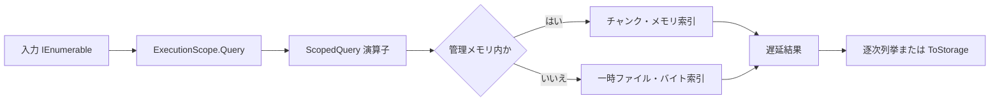
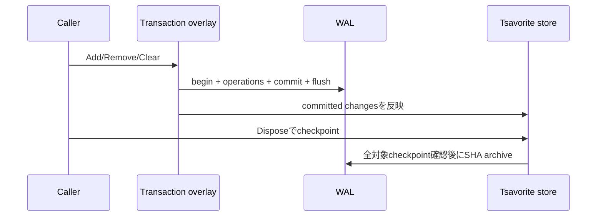
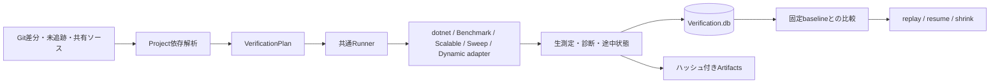

# Data Flow Overview

## スコープ付きクエリ

すべての予約は一つの `ResourceBudget` へ集約する。比較子省略時のキーは決定的Codecのバイト列である。外部ソートは元位置を保持し、GroupBy／Joinは入力順契約を維持する。

## DB commitと復旧

起動時はcommit済みWALだけを冪等に再生する。未commit、切断末尾、未openテーブルを含むactive WALを成功済みとして消去しない。

## 変更後の検証

CLIとMAUIは同じ `VerificationWorkspace` を使う。計画時のソース指紋、ケース入力、意味論、Codec、測定方法、環境、CPU、構成を保存し、比較条件が違う結果を性能判定へ混ぜない。
