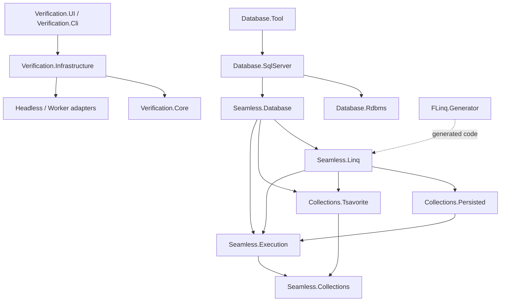

# Layer Mapping

依存方向は上から下ではなく、次の矢印だけを許す。

## ガードレール

- `Seamless.Execution` はUI、Verification、Database、具体的な永続ストアへ依存しない。
- `Seamless.Linq` はDB状態やUI状態を持たない。
- Persisted／Tsavoriteは検証計画やLINQ実行方針を持たない。
- FLinqが最適化するスコープ外のSystem.Linqは.NET意味論を維持する。
- Verificationの型をBenchmark UI固有のViewModelへ依存させない。
- ランタイム配布パッケージにVerification UI、SQLite結果DB、テストassemblyを含めない。
- DBの保存形式変更は明示バックアップと明示初期化で行い、起動時の自動削除・自動移行を追加しない。
- 共有ソースを追加・移動するときは `.projitems`、同じ場所の `.shproj`、`Seamless.slnx` を同時に更新する。
