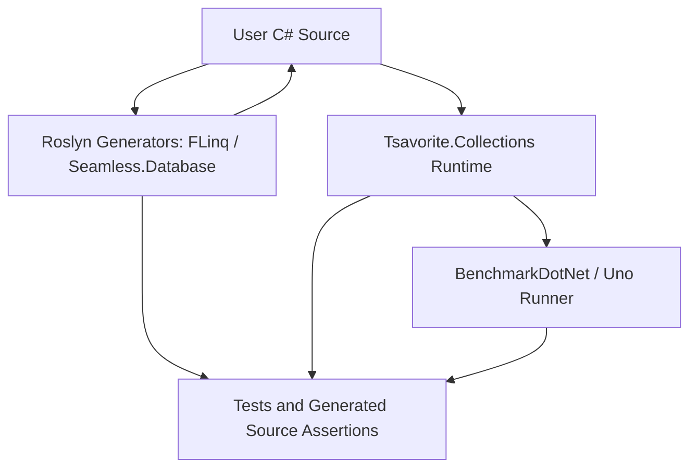

# Core Architecture Pattern

## 中核パターン

このコードベースは、compile-time optimization と runtime collection library を組み合わせるアーキテクチャである。

## 設計パターン

| パターン | 説明 | 実装証拠 |
|---|---|---|
| Compile-time code generation | LINQ と schema record を source generator で生成する。 | `FLinq/SourceGenerator/interceptor.cs:55`, `Seamless.Database/SourceGenerator/GenerateDatabase.cs:9` |
| Fragment pipeline | LINQ 演算子を fragment class 群に分解して rendering する。 | `FLinq/SourceGenerator/Linq/Fragments/Fragment.cs:1`, `FLinq/SourceGenerator/Linq/Fragments/Root.cs:7`, `FLinq/SourceGenerator/Linq/Fragments/Where.cs:2` |
| Store factory | `HashStore` が設定と serializer/device overload を集約する。 | `Tsavorite.Collections/Stores/HashStore.cs:38`, `Tsavorite.Collections/Stores/HashStore.cs:146`, `Tsavorite.Collections/Stores/HashStore.cs:247` |
| Session function | collection 操作を Tsavorite session function へ分離する。 | `Tsavorite.Collections/SessionFunctions/Upsert.cs:11`, `Tsavorite.Collections/SessionFunctions/Read.cs:10`, `Tsavorite.Collections/SessionFunctions/Remove_TKey_TValue.cs:8` |
| Instrumentation scope | `AsyncLocal` counter scope で logical/physical work を計測する。 | `Tsavorite.Collections/LinqCounter.cs:142`, `Tsavorite.Collections/LinqCounter.cs:148` |
| Worker process isolation | benchmark を UI から分離した worker process で実行する。 | `Benchmark.Runner.Uno/Benchmark.Runner.Uno/BenchmarkWorkerHost.cs:17`, `Benchmark.Runner.Uno/Benchmark.Runner.Uno/MainPage.xaml.cs:688` |

## Review Gate: Code Concept

### Confirmed
- compile-time generator と runtime library の相互補完が中核である。
- benchmark/test がアーキテクチャの検証面に強く組み込まれている。

### Inferred
- confidence: medium。中核品質属性は performance、allocation/iteration 削減、generated-code correctness である。

### Unknown
- DI、plugin、package 境界などの明示的アーキテクチャ方針は確認できない。
