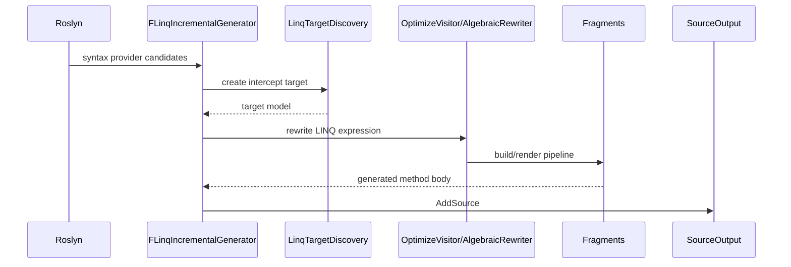
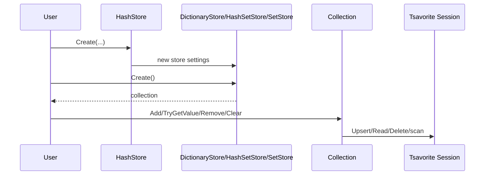
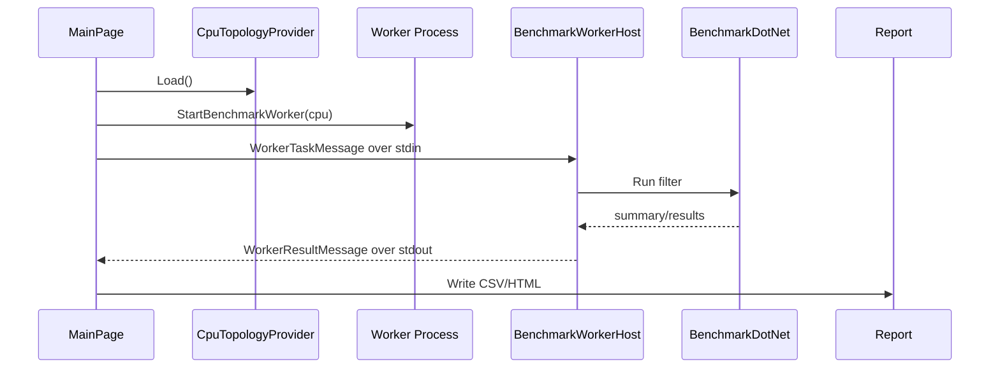

# Interaction Diagrams

## LINQ Interception 生成

根拠: `FLinq/SourceGenerator/interceptor.cs:57`, `FLinq/SourceGenerator/LinqTargetDiscovery.cs:22`, `FLinq/SourceGenerator/OptimizeVisitor.cs:294`, `FLinq/SourceGenerator/interceptor.cs:102`。

## Tsavorite Collection 作成と操作

根拠: `Tsavorite.Collections/Stores/HashStore.cs:38`, `Tsavorite.Collections/Stores/HashStore.cs:146`, `Tsavorite.Collections/Collections/Collection.Tsavorite.cs:131`, `Tsavorite.Collections/Collections/Collection.Tsavorite.cs:256`。

## Benchmark Runner 実行

根拠: `Benchmark.Runner.Uno/Benchmark.Runner.Uno/CpuTopologyProvider.cs:7`, `Benchmark.Runner.Uno/Benchmark.Runner.Uno/MainPage.xaml.cs:688`, `Benchmark.Runner.Uno/Benchmark.Runner.Uno/MainPage.xaml.cs:752`, `Benchmark.Runner.Uno/Benchmark.Runner.Uno/BenchmarkWorkerHost.cs:90`, `Benchmark.Runner.Uno/Benchmark.Runner.Uno/MainPage.xaml.cs:1153`。

## Review Gate: Code Internal

### Confirmed
- generator、collection runtime、benchmark runner の代表的相互作用を実装から確認した。

### Inferred
- confidence: medium。collection の session function 詳細は図では抽象化している。

### Unknown
- すべての LINQ fragment の相互作用詳細。
