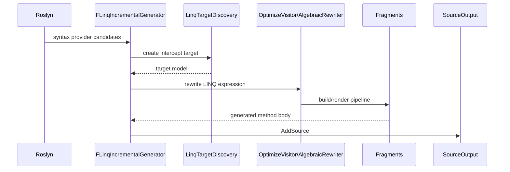
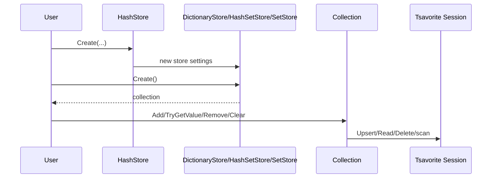
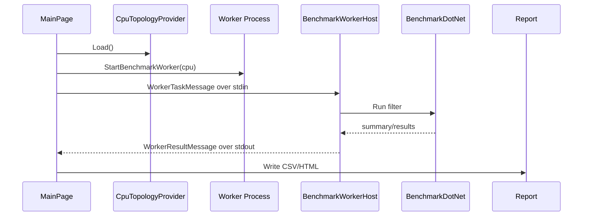
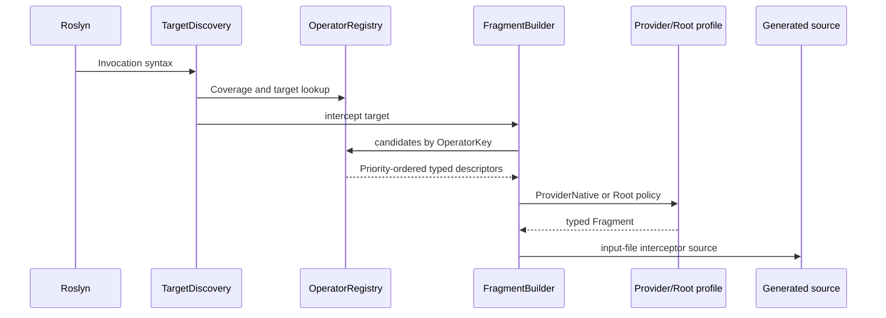
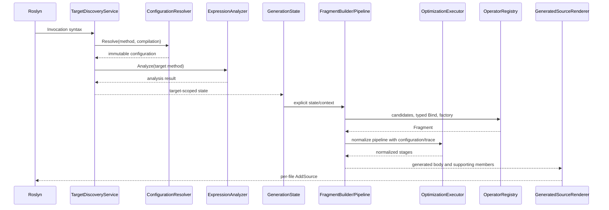
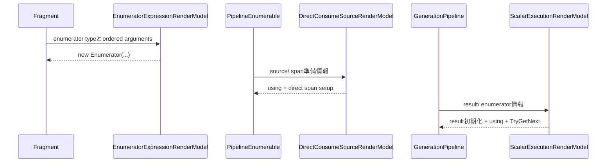
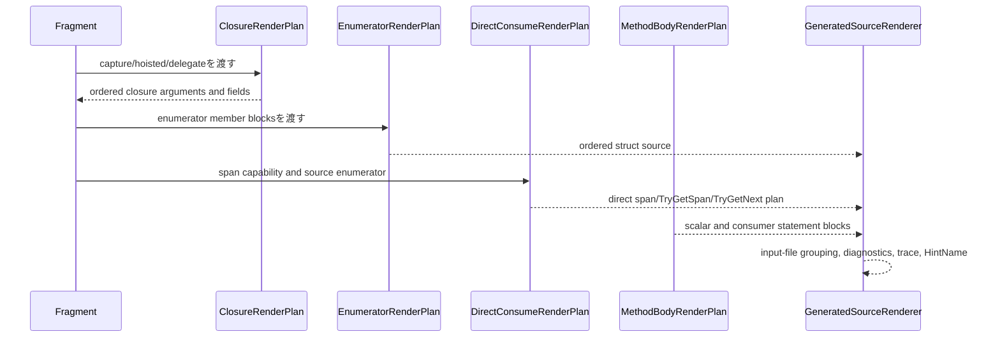

# Interaction Diagrams

## LINQ Interception 生成

根拠: `FLinq/SourceGenerator/interceptor.cs:57`, `FLinq/SourceGenerator/LinqTargetDiscovery.cs:22`, `FLinq/SourceGenerator/OptimizeVisitor.cs:294`, `FLinq/SourceGenerator/interceptor.cs:102`。

## Tsavorite Collection 作成と操作

根拠: `Benchmark.Tsavorite.Collections/Stores/HashStore.cs:38`, `Benchmark.Tsavorite.Collections/Stores/HashStore.cs:146`, `Benchmark.Tsavorite.Collections/Collections/Collection.Tsavorite.cs:131`, `Benchmark.Tsavorite.Collections/Collections/Collection.Tsavorite.cs:256`。

## Benchmark Runner 実行

根拠: `Benchmark/CpuTopologyProvider.cs:7`, `Benchmark/MainPage.xaml.cs:688`, `Benchmark/MainPage.xaml.cs:752`, `Benchmark/Shared/UI/BenchmarkWorkerClient.cs:90`, `Benchmark/MainPage.xaml.cs:1153`。

## Review Gate: Code Internal

### Confirmed
- generator、collection runtime、benchmark runner の代表的相互作用を実装から確認した。

### Inferred
- confidence: medium。collection の session function 詳細は図では抽象化している。

### Unknown
- すべての LINQ fragment の相互作用詳細。

## Registry-driven FLinq interception

## FLinq 第1段階: 対象単位の生成

closure/enumerator/文字列組立の詳細な描画は第2段階で独立契約へ移す。第1段階では既存Fragmentの評価順、例外、Dispose、Provider順を保持する。

## GeneratedSourceRenderModelを介したRenderer境界

Mermaid sequence:
Output Coordinator -> GeneratedSourceRenderModel: targets/diagnosticsを入力ファイル単位で固定
GeneratedSourceRenderModel -> GeneratedSourceRenderer: Render(model)
GeneratedSourceRenderer -> Fragment: Fragment構築結果とRenderContextを描画
Fragment -> GeneratedSourceRenderer: source/trace
GeneratedSourceRenderer -> AddSource: Hint名を維持してAddSource

Fragmentの子VisitorとRenderContextは対象単位で完結し、並列対象へ状態を渡さない。

## 第2段階初期実装の描画境界

これらは既存の評価順、例外、Dispose、Counter instrumentationを保持する描画境界であり、closure・enumerator本体のIR化は次の段階に残す。

## 第2段階 Render契約の相互作用

各Planは対象メソッドの状態だけを参照し、別対象の採番・closure・Dispose情報を共有しない。第3段階のRegistry整理はこの描画契約の後に独立して実施する。