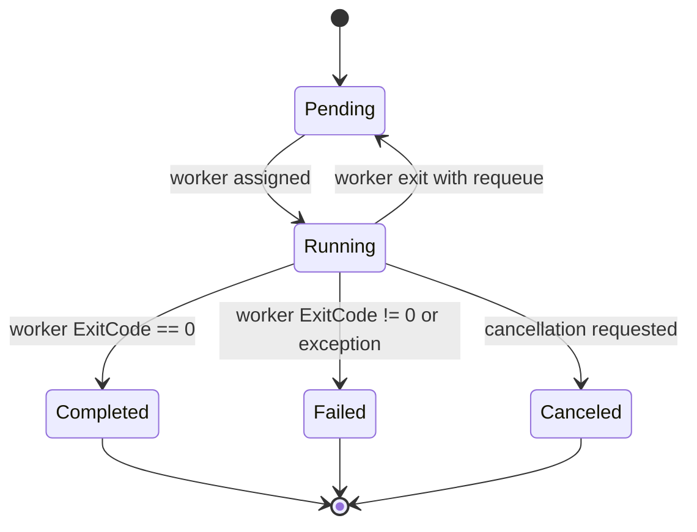
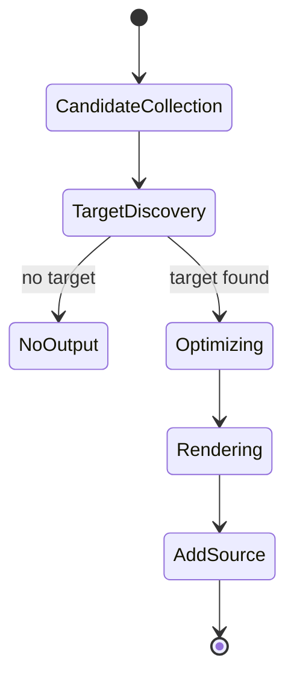

# State Machine Diagram

## Benchmark Run Item 状態

根拠: `Benchmark/BenchmarkRunnerModels.cs:154`, `Benchmark/MainPage.xaml.cs:610`, `Benchmark/MainPage.xaml.cs:636`, `Benchmark/MainPage.xaml.cs:652`, `Benchmark/MainPage.xaml.cs:680`。

## Generator 出力状態

根拠: `FLinq/SourceGenerator/interceptor.cs:57`, `FLinq/SourceGenerator/interceptor.cs:69`, `FLinq/SourceGenerator/interceptor.cs:74`, `FLinq/SourceGenerator/interceptor.cs:102`。

## Review Gate: Code Internal

### Confirmed
- benchmark run status は `Pending`、`Running`、`Completed`、`Failed`、`Canceled` を持つ。
- generator は candidate collection から source output へ進む。

### Inferred
- confidence: medium。generator の `NoOutput` は候補なしまたは対象外メソッドの場合をまとめた抽象状態。

### Unknown
- runner 全体の UI busy state と CPU 選択 state の完全な状態遷移。
