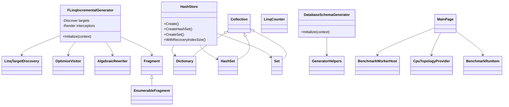

# Class Diagram

## 概要
主要クラス群は、source generator 系、collection runtime 系、benchmark runner 系に分かれる。`Seamless.slnx` では `FLinq`、`Seamless.SourceGenerator`、`Tsavorite.Collections`、`Seamless.Database`、`Benchmark` と複数の test/benchmark project が接続されている（`Seamless.slnx:13`, `Seamless.slnx:26`, `Seamless.slnx:27`, `Seamless.slnx:29`, `Seamless.slnx:30`）。

## 根拠
- `FLinqIncrementalGenerator` は incremental generator の入口である（`FLinq/SourceGenerator/interceptor.cs:13`, `FLinq/SourceGenerator/interceptor.cs:55`）。
- `HashStore` は Dictionary/HashSet/Set store factory を持つ（`Tsavorite.Collections/Stores/HashStore.cs:146`, `Tsavorite.Collections/Stores/HashStore.cs:240`, `Tsavorite.Collections/Stores/HashStore.cs:280`）。
- `DatabaseSchemaGenerator` は schema generated source を追加する（`Seamless.Database/SourceGenerator/GenerateDatabase.cs:8`, `Seamless.Database/SourceGenerator/GenerateDatabase.cs:21`）。
- Benchmark runner は `MainPage`、`BenchmarkWorkerHost`、model 群で構成される（`Benchmark/MainPage.xaml.cs:688`, `Benchmark/BenchmarkWorkerHost.cs:14`, `Benchmark/BenchmarkRunnerModels.cs:162`）。

## Review Gate: Code Internal

### Confirmed
- 主要 class family と依存方向を実装から確認した。

### Inferred
- confidence: medium。図は全クラス網羅ではなく、アーキテクチャ把握用に主要クラスを抽出している。

### Unknown
- 全 fragment class と全 test class の網羅図は未生成。
