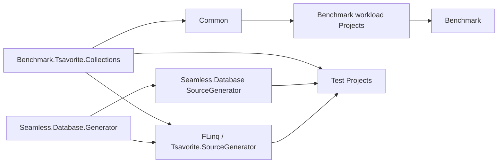
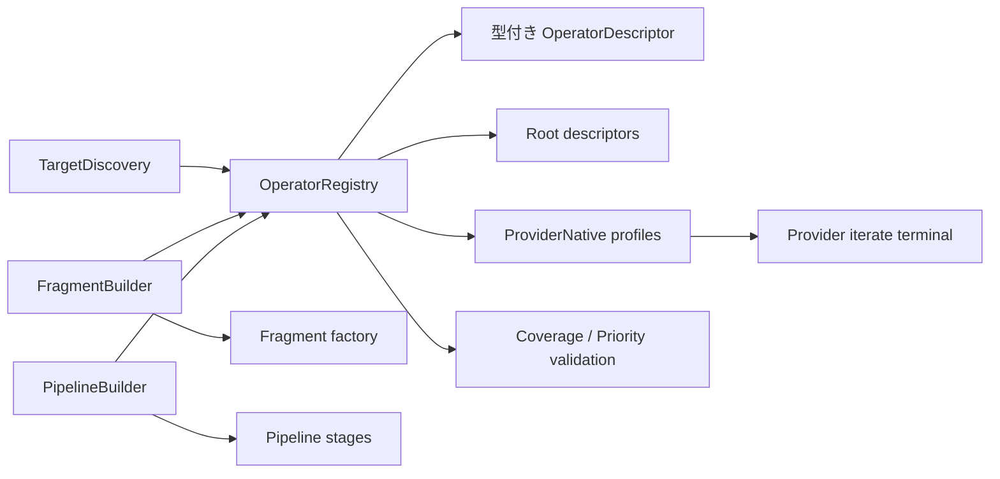
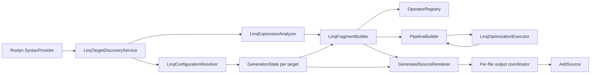
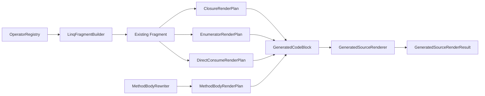

# Component Diagram

## 概要

## コンポーネント

| コンポーネント | 役割 | 実装証拠 |
|---|---|---|
| `Seamless.Database.Generator` | generator 共通ヘルパー。 | `Seamless.Database.Generator/Seamless.Database.Generator.csproj:3`, `Seamless.Database.Generator/SourceGenerator/GeneratorHelpers.cs:3` |
| `FLinq` | LINQ interceptor source generator。 | `FLinq/FLinq.csproj:8`, `FLinq/FLinq.csproj:14`, `FLinq/FLinq.csproj:19` |
| `Seamless.Database` | schema source generator。 | `Seamless.Database/Seamless.Database.csproj:8`, `Seamless.Database/Seamless.Database.csproj:14`, `Seamless.Database/Seamless.Database.csproj:19` |
| `Benchmark.Tsavorite.Collections` | collection runtime と LINQ/counter runtime。 | `Benchmark.Tsavorite.Collections/Benchmark.Tsavorite.Collections.csproj:4`, `Benchmark.Tsavorite.Collections/Benchmark.Tsavorite.Collections.csproj:14`, `Benchmark.Tsavorite.Collections/Benchmark.Tsavorite.Collections.csproj:15` |
| `Benchmark` | benchmark UI/worker host。 | `Benchmark/Benchmark.UI/UI.csproj:1`, `Benchmark/Benchmark.UI/UI.csproj:33`, `Benchmark/Benchmark.UI/UI.csproj:34` |
| `Test.*` | xUnit と生成コード検証。 | `Seamless.slnx:28`, `Seamless.slnx:31`, `Seamless.slnx:40` |

## Review Gate: Code Internal

### Confirmed
- solution は source generator、runtime collection、benchmark、test に分割される。
- `FLinq` と `Seamless.Database` は `Seamless.Database.Generator` を参照する。

### Inferred
- confidence: medium。benchmark project は System LINQ / FLinq / ZLinq / Tsavorite LINQ の比較実行を目的とする。

### Unknown
- NuGet package として公開される最終単位。

## FLinq Operator Registry

## FLinq 第1段階の責務分離

## Renderer境界

Mermaid component diagram:
State(GenerationState) --> Model(GeneratedSourceRenderModel)
Model --> Renderer(GeneratedSourceRenderer)
Renderer --> Coordinator(Per-file output coordinator)
Renderer --> Source(AddSource)
Fragment(Fragment) --> Context(FragmentRenderContext)
Context --> Renderer
## 第2段階のRender層

