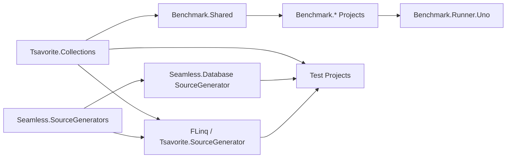

# Component Diagram

## 概要

## コンポーネント

| コンポーネント | 役割 | 実装証拠 |
|---|---|---|
| `Seamless.SourceGenerators` | generator 共通ヘルパー。 | `Seamless.SourceGenerators/Seamless.SourceGenerators.csproj:3`, `Seamless.SourceGenerators/SourceGenerator/GeneratorHelpers.cs:3` |
| `FLinq` | LINQ interceptor source generator。 | `FLinq/FLinq.csproj:8`, `FLinq/FLinq.csproj:14`, `FLinq/FLinq.csproj:19` |
| `Seamless.Database` | schema source generator。 | `Seamless.Database/Seamless.Database.csproj:8`, `Seamless.Database/Seamless.Database.csproj:14`, `Seamless.Database/Seamless.Database.csproj:19` |
| `Tsavorite.Collections` | collection runtime と LINQ/counter runtime。 | `Tsavorite.Collections/Tsavorite.Collections.csproj:4`, `Tsavorite.Collections/Tsavorite.Collections.csproj:14`, `Tsavorite.Collections/Tsavorite.Collections.csproj:15` |
| `Benchmark.Runner.Uno` | benchmark UI/worker host。 | `Benchmark.Runner.Uno/Benchmark.Runner.Uno/Benchmark.Runner.Uno.csproj:1`, `Benchmark.Runner.Uno/Benchmark.Runner.Uno/Benchmark.Runner.Uno.csproj:33`, `Benchmark.Runner.Uno/Benchmark.Runner.Uno/Benchmark.Runner.Uno.csproj:34` |
| `Test.*` | xUnit と生成コード検証。 | `Seamless.slnx:28`, `Seamless.slnx:31`, `Seamless.slnx:40` |

## Review Gate: Code Internal

### Confirmed
- solution は source generator、runtime collection、benchmark、test に分割される。
- `FLinq` と `Seamless.Database` は `Seamless.SourceGenerators` を参照する。

### Inferred
- confidence: medium。benchmark project は System LINQ / FLinq / ZLinq / Tsavorite LINQ の比較実行を目的とする。

### Unknown
- NuGet package として公開される最終単位。
