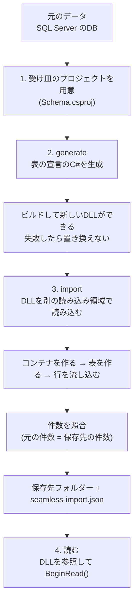
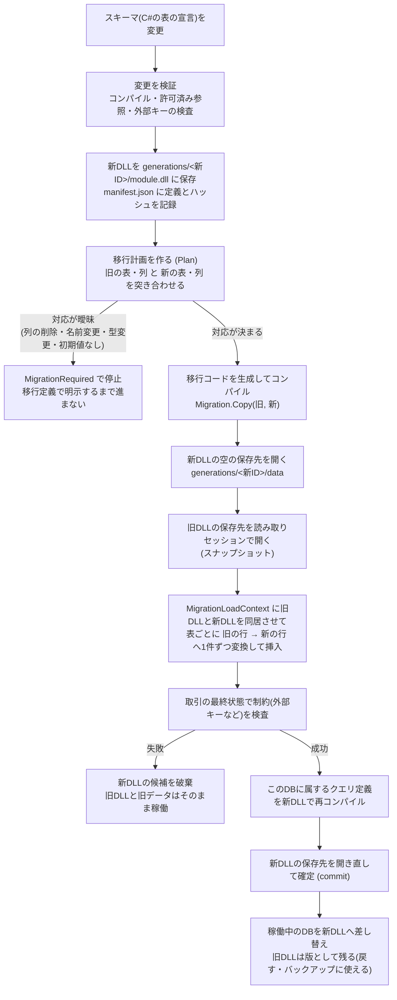

# 新しいDLLを作り、そこから読めるデータへ変換する流れ

既存のデータを、Seamless の宣言(表の型)を持つ新しい DLL と、その DLL から読める保存先(Tsavorite の保存フォルダー)へ変える手順をまとめる。
ここに書いた内容は、2026-11-16 時点のコード(`Seamless.Database.Tool`、`Seamless.Database` など)を読んで確かめたもの。手順書としての通し実行はまだしていない。

## 全体の流れ



## 手順

### 1. 受け皿のプロジェクトを用意する

- 新しいDLLになる `.csproj` を1つ用意する。ひな形は `G:\GitHub\Seamless\Template\Seamless.Application\Schema\Schema.csproj`(表の行の型だけを置く)と `G:\GitHub\Seamless\MultiProjectTemplate\Database\MultiProjectTemplate.Database.csproj`(DBを置く)。
- DBのDLLは `Seamless.Database` と DB生成器 `Seamless.Database.Generator` を参照する。
- SDK は .NET 10 / C# 14。リポジトリの `global.json` に合わせる。
- 接続文字列は `ConnectionStrings:<名前>` として用意する。置き場は、プロジェクトの `appsettings.json`、`appsettings.<環境>.json`、ユーザーシークレット、環境変数 `ConnectionStrings__<名前>` のどれか(後ろのものが優先)。`--connection <名前>` がこれを引く。

### 2. generate: 表の宣言を生成して、新しいDLLを作る

```bash
seamless database sqlserver generate --project <project.csproj> --connection <名前> [--configuration Debug|Release]
```

- 複数のDBを一度に生成するときは `--database <名前>` を並べる。
- 出力先は、プロジェクト直下の `Database.Generated\<DB名>\`。
- 生成したC#は、一度ステージング領域でビルドする。コンパイルが通ったときだけ本来の場所へ置き換える。失敗したときは既存の生成物を壊さない。
- 画面に出る「スキーマ指紋(Schema fingerprint)」を控える。手順3で照合に使う。

SQL Server を使わず、定義の文章から作る場合は次の2つがある。

```bash
seamless database sql convert --sql <definition.sql> --name <DB名> --vendor sqlserver|mysql --output <新しいフォルダー>
seamless database csharp export --snapshot <snapshot.json> --type <型> --vendor sqlserver|mysql --output <新しいフォルダー>
```

出力先は新しいフォルダーに限る(既にあるとエラー)。

### 3. import: DLLを読み込んで、データを保存先へ流し込む

```bash
seamless database sqlserver import --project <project.csproj> --connection <名前> --storage <保存フォルダー> [--configuration Debug|Release]
```

内部では次の順に進む(`DatabaseImporter`)。

1. プロジェクトをビルドし、できた DLL のパスを取る。
2. DLL を専用の読み込み領域(`ProjectLoadContext`)へ読み込む。本体のプロセスに居座らせないため、終われば `Unload` する。
3. DLL の中から、`DatabaseContainer` を継いだコンテナ型を探す。
4. DLL に埋まっている `GeneratedSchemaFingerprint` と、SQL Server 側の指紋を比べる。違えば止まる(「先に generate をやり直す」)。
5. 表ごとの大きさを SQL Server から測り、保存先の設定(索引・ページ・メモリの大きさ)を決める。
6. 保存先は本番の場所ではなく、`<保存フォルダー>.staging.<ID>` という仮の場所に作る。
7. `EnsureTablesCreated` で表を作り、`ImportTables(IDatabaseImportSource)` で行を流し込む。
8. 仮の場所を開き直し、表ごとの件数(`LongCount`)が、読み込んだ件数と一致するか確かめる。
9. `seamless-import.json`(版・元DB名・指紋・取り込み日時・表ごとの件数・保存設定)を書く。
10. 仮の場所を本来の `--storage` へ置き換える。すでにあったフォルダーは退避(バックアップ)として残し、その場所を画面に出す。途中で失敗したら仮の場所は消える。

### 4. 読む

- 利用する側は、手順2のDLLを参照する。
- コンテナを `DatabaseContainerOptions.OnStorage(<保存フォルダー>)` で開く。
- 読み取りは `using var r = db.BeginRead();` で取得する `IReader` から行う。ビュー・関数は `IReader` の拡張メンバーとして呼ぶ。
- 更新は `using var tx = db.BeginTransaction(); … tx.Commit();`。
- 別プロセスから読むときは、クライアントDLLと Gateway を通す。そのひな形は `G:\GitHub\Seamless\Template\Seamless.Application\`(ServerSchema / ClientSchema)にある。

## SQL Server 以外のデータから取り込むとき

- 取り込みの差し込み口は `IDatabaseImportSource`(`ReadTable<TRecord>(DatabaseObject key)` で表の行を返す)ひとつだけ。
- SQL Server 用の実装は `SqlServerImportSource`。CSV・JSON・他のDB用の実装は**まだない**。
- 作るなら、`IDatabaseImportSource` を実装したクラスを書き、手順3の7と同じく `ImportTables(source)` へ渡す。何を元データとして扱うか(列の対応・型の変換・欠損値の扱い)は決めてから作る。

## 守ること・落とし穴

- 保存先の置き換えは、自動の移行や起動時の処理に任せず、明示的にバックアップを取って行う(`AGENTS.md` の Database Change Policy)。`import` が残す退避フォルダーを消す前に、中身を確かめる。
- 行の型は `new Tables.X(new(キー列…), 残りの列…)` の形。キーは `[Key]` を付けた列から決まる。
- 指紋が違うDLLと保存先を組み合わせない。表の宣言を変えたら、generate と import をやり直す。
- 別の開発環境で作った DLL が、サーバー側の成果物と同じ内容とは限らない(`Document/DB定義のCSharpプロジェクト連携.md`)。
- 流し込み中の取引は WAL の上限(既定4MB)がある。大量の行は件数ごとに確定する。
- 版付きの保存は表1つあたり約8MBを先に確保する。表が多いDBはメモリを見積もる。

## 未確認の点

- 手順を最初から最後まで実行して確かめてはいない。コードから読み取った内容である。
- 「読めるデータ」が、保存先フォルダーのことか、別の形(CSV・JSON など)のことかは、利用者の意図を確かめる必要がある。この文書は保存先フォルダーとして書いた。

## スキーマを変えたとき、旧DLLのデータを新DLLへ移す流れ

Manager が稼働中のDBの定義を変えて公開(適用)するときの流れ。実装は `Seamless.Management.Server\NativeRuntime.cs` の `Publish` と `TypedMigration.cs` / `TypedMigration.Plan.cs`。



### 変換の規則(`TypedMigration.Plan`)

| 変更 | 扱い |
| :--- | :--- |
| 表を追加 | 空の表を作る |
| 表の名前変更 | 移行定義の `Tables`(Source → Target)で明示 |
| 表の削除 | 移行定義の `DroppedTables` で明示。書かないとエラー |
| 列を追加 | 値型なら既定値(`default`)。参照型は初期値の式が必要 |
| 列の名前変更・型変更 | 変換式(`Expression`)で明示。型が違うのに式がないとエラー |
| 列の削除 | `DroppedColumns` で明示。書かないとエラー |
| 変化なし | `row.<列名>` をそのまま新しい行へ渡す |

### ポイント

- 旧DLLのデータは**書き換えない**。新DLL用の別フォルダー(`generations\<新ID>\data`)へ複製しながら変換する。
- 旧DLLと新DLLは同じプロセスに入るが、専用の読み込み領域(`MigrationLoadContext`、あとで破棄できる)に置く。
- 失敗した場合は候補を捨てるだけで、稼働中のDBは変わらない。
- 適用前に `backupPath` を指定すると、旧版のバックアップを取ってから進む。
- 状態の保存形式が `CanonicalV1` のときは、新側を「未公開のスナップショット」として作り、成功後に公開する。それ以外は新側の取引の中で挿入する。
- 値の変換(列の型変更)は `MigrationValueConverter` が受け持つ。

## 移行の速さの計測(2026-11-16)

計測用の試験 `G:\GitHub\Seamless\Tests\Management.Tests\MigrationTimingProbe.cs` で測った。環境変数 `SEAMLESS_MIGRATION_TIMING=件数,…` があるときだけ動く。表1つ(キー int、列 int 2つ)、Manager と同じ保存設定(`CanonicalV1`、索引1024バイト、メモリ16MB、ページ1MB、セグメント16MB)。CPUは8個までに抑えた。生の結果は `F:\Seamless\migration-timing\data\migration-timing-*\timing.csv`。

### 結果(秒)

| 件数 | 移行のコピー全体 | 旧側を読むだけ | 旧側を読むだけ(旧側のメモリ64MB) | 新側へまとめて書くだけ | 取引で書く(1万件ごとに確定) | 保存フォルダーのファイル複製 |
|---:|---:|---:|---:|---:|---:|---:|
| 10万 | 0.38 | 0.10 | 0.08 | 0.77 | 1.2 | 0.06 |
| 20万 | 3.6 | 3.3 | 0.14 | 1.1 | 2.6 | 0.19〜0.37 |
| 40万 | 20.2 | 20.2 | 0.20 | 1.5 | 5.0 | 0.27〜0.83 |

- 移行コードのコンパイル(Roslyn)は、2回目以降は約5〜35ミリ秒。準備の区間全体(コンパイル・読み込み・読み取りセッション開始)は約20〜40ミリ秒。
- 確定(`snapshot.Complete`)は約0.4〜0.9秒。
- 旧DLLと新DLLのアセンブリ名が同じ場合(値の橋渡しの経路)も、スキーマが変わらない場合も、全体の時間はほぼ同じ。

### 分かったこと

- **移行の時間の大半は、旧側を読む時間。** 書く側でも、コンパイルでもない。
- **読み取りが遅いのは、ディスクにある行を1件ずつ確かめているため。** `Seamless.Collections.Tsavorite\Scans\Lookup.cs` は、ログの行ごとにキーで引き直し、それが最新の版かを確かめる。行がディスクにあると、この確認がディスク読みになり、1件ずつ完了を待つ。1件あたり約50マイクロ秒かかる(メモリにある行は約1マイクロ秒)。
- 件数の2乗のように見えたのは、件数が増えるとディスクにある行の割合が増えるため。10万件はほぼ全件がメモリにあり、40万件はほぼ全件がディスクにある。
- **メモリの上限を上げても直らない。** 16MBで書いた保存を64MB・128MBで開き直しても、40万件の全件読みは17〜20秒のままだった。開き直した直後は行がディスクにあり、メモリへは載ってこない。最初の計測で「64MBなら0.2秒」だったのは、書いた時点から64MBで、行がメモリに残っていただけだった。
- この遅さは移行だけの問題ではない。開き直した後の大きな表を全件読む処理は、すべて同じ影響を受けるはず(移行以外は未計測)。
- 索引の大きさは原因ではなかった。コピー中も索引は自動で広がっていた(20万件で4MB、40万件で8MB)。

### 設定を替えたときの落とし穴

- 新側だけメモリとセグメントを大きくして書き、運用の設定(16MB)で開き直すと、`TsavoriteException: Error reading page 0 from device` で開けなかった。セグメントの大きさは、書いたときと開くときで揃える必要がある。メモリの上限だけを替えて開き直すのはできた。
- DBが共通ストアを開くとき(`Seamless.Database\DatabaseTransactions.cs` の `ExecutionStore.Open`)、上限(`StoreLimits`)を渡していない。そのため、ストア全体のメモリ上限は既定の256MBに固定され、`ManagedMemoryLimitBytes` を上げても効かない。表のメモリ上限を256MBにすると開けなかった。
- メモリの予約は「使った量と表の上限の小さい方」で、予算が足りないと例外になる(ディスクへ逃がす経路は無い)。表ごとの上限だけを上げると、大きなDBで書き込みが失敗する恐れがある(未計測)。

### 確認読みをまとめて出す修正(2026-11-16)

`Seamless.Collections.Tsavorite\Scans\Lookup.cs` を次の形に直した。

- ディスク上の範囲(`HeadAddress` より前)では、1,024行ずつ確認読みをまとめて出し、最後に1回だけ完了を待つ。そのあと同じ範囲を読み直して、最新の版の行だけを渡す。
- メモリ上の範囲は、元どおり1回の走査で1件ずつ確かめる(まとめると、2回目の走査の分だけ遅くなったため)。
- `FixedSpanByteKey` は「固定済み」と名乗るので、Tsavorite は保留の読みでキーを複製せず、指し先だけを持つ(`ConditionallyHoistedKey` の Pinned)。走査の読み込み領域は次の行で上書きされるので、確認読みのキーは、完了を待つまで動かない固定領域へ写してから出す。最初はこれをせず、ディスク上の行がほぼ全部抜けた(回帰試験 `DiskEnumerationPreservesCollidingKeys` が検出)。

結果(秒、40万件。SSD は `D:\CodexTemp`、HDD は `F:`):

| | SSD 元の版 | SSD 新しい版 | HDD 元の版 | HDD 新しい版 |
|---|---:|---:|---:|---:|
| 移行のコピー | 25.1 | 12.4 | 20.2 | 10.5 |
| 旧側を読むだけ | 25.0 | 10.3 | 20.2 | 10.1 |
| 16MBで開き直して読む | 44.6 | 10.9 | 19.1 | 11.4〜45(ばらつき大) |

10万件(ほぼ全部メモリ上)は、元の版と新しい版でほぼ同じ(0.1〜0.4秒)。

- SSD でも HDD でも約10秒で変わらない。残りの時間は、ディスクの速さではなく、保留の読み1件ごとの処理の手間とみている(推測)。
- まとめて出すだけでは2〜4倍が上限。さらに速くするには、確認読みでディスクを読まない方法が要る。Tsavorite の `ReadOptions` には「このアドレスより古い版は探さない」指定が無く、取り込んでいる Tsavorite 本体の変更が要る。

試験の結果(修正前と修正後で同じ):

- `Tests\Seamless.Core.Tests`: 105件中17件が失敗。失敗の顔ぶれは修正前と同じ(`PartitionedLookupBuilder`・`QueryGrouping` の既存の失敗)。走査の回帰試験 `DiskEnumerationPreservesCollidingKeys` は、5万件の場合を足して全部通過。
- `Test.Tsavorite.Collections`: 572件すべて通過。
- `Enumerator.HashSet_AfterFlushAndEvict_Managed_PublicEnumerationAndCopyToEnumerateAll` は、修正前から1件で約9分半かかる(修正前 9分19秒、修正後 9分42秒)。参照を含む値の HashSet をディスクへ追い出してから全件読む試験で、同じ確認読みの重さが原因とみている(未確認)。

### 次に検討すること

1. 確認読みでディスクを読まない方法。行より新しい版だけを探せば足りる(新しい版はたいていメモリ上)。Tsavorite 本体に「探す下限のアドレス」を足すか、索引を直接引く。
2. スキーマが同じなら、保存フォルダーをファイルとして複製する(40万件で1秒未満)。
3. 並列化(表ごと・ディスクごと)は、別のチャットで検討した案がある。書き込みの鍵を表ごとに分けることと、ディスクごとの窓口が前提になる。保存の形に関わるので、設計書に書いてから決める。
