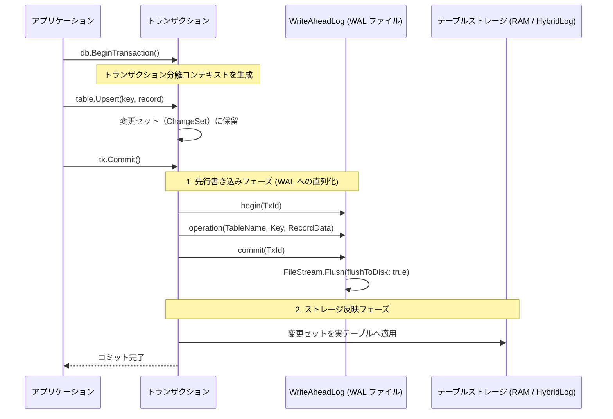

# データベースエンジン内部構造 (Database Engine & WAL)

`Seamless.Database` は、外部の RDBMS サービスに依存せず、単一の .NET プロセス内で完結する軽量・高信頼な組込みデータベースエンジンです。

---

## 1. データベースコンテナの構造

`DatabaseContainer` は、1つのデータベース全体をカプセル化し、その配下にトランザクション管理対象のテーブル（`Table<TKey, TRecord>` / `Table<TRecord>`）および直接操作用のコレクション（`Set<TKey, TRecord>` / `Set<TRecord>`）を保持します。

```text
DatabaseContainer
 ├── Table<long, UserRecord> (BeginTransaction / BeginRead 経由でアクセスするトランザクション表)
 ├── Table<long, OrderRecord>
 ├── Set<AccessLogRecord> (db 直下で直接アクセスする非トランザクション表)
 ├── DatabaseWriteAheadLog (WAL: 日常のコミット記録)
 ├── DatabaseConcurrencyGate (並行トランザクション・スナップショット制御)
 └── ExecutionResource (メモリ/ディスク予算管理)
```

---

## 2. トランザクション処理と WAL (Write-Ahead Log)

データの整合性（ACID 特性）を保証するため、すべての書き込みトランザクションは **先行書き込みログ（Write-Ahead Log: WAL）** プロトコルに従います。



### WAL の特徴と保証
- **`WriteThrough` とディスク強制フラッシュ**:
  コミット時には、OS のバッファだけでなく、物理ドライブ（SSD/HDD）の不揮発領域まで確実にデータが書き込まれたことを保証する `FileOptions.WriteThrough` と `Flush(flushToDisk: true)` を実行します。
- **軽量バイナリレコード**:
  操作ログは冗長な SQL 文ではなく、コンパクトなシリアライズデータとして記録されるため、毎秒数万〜十万件のコミットを低オーバーヘッドで処理できます。

---

## 3. クラッシュリカバリ（障害復旧）

プロセスが電源断やクラッシュによって突然停止した場合、次回 `DatabaseContainer` の初期化時に以下の手順で自動復旧が行われます。

1. **WAL の走査**:
   起動時に WAL ファイルを先頭からスキャンし、各トランザクションの `begin` と `commit` のペアを確認します。
2. **未コミットトランザクションの破棄**:
   `begin` は存在するが `commit` が記録されていない不完全なトランザクションは、復旧対象から除外（自動ロールバック）されます。
3. **コミット済みデータの再適用（Redo）**:
   正常に `commit` されたレコード操作のみを順次テーブルストレージへ適用し、クラッシュ直前の完全な状態へ復元します。

---

## 4. ビューと関数のコンパイル時インライン展開

Seamless のビューおよび関数は、生成される `IReader` に対する拡張プロパティ・拡張メソッドとして定義します。
呼び出し元のクエリ式でビューや関数を参照すると、FLinq Source Generator が定義本体を呼び出し元のクエリへコンパイル時にインライン展開し、外側の `Where` 条件や `Join` と単一ループへ融合します（展開できない構成は `FLINQ007` コンパイルエラーとして検出されます）。

---

## 関連項目

- [型付きDBアクセス入門](../guides/型付きDBアクセス入門.md) : トランザクションの基本利用法
- [ORマッパーとの根本的相違](ORマッパーとの相違.md) : EF Core とのトランザクションオーバーヘッド比較
- [開発で得られた技術的知見](../performance/技術的知見と落とし穴.md) : WAL 書き込みと非同期回収の協調動作
