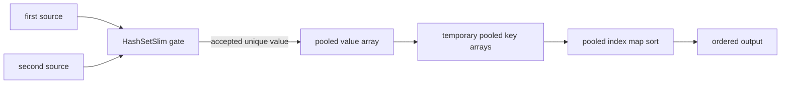

# FLinq 仕様書統合

# Source: Document\Code\Internal\FLinqSourceGeneratorInternalDesign.md

---
phase: code-internal-reverse
reverse_document: true
canonical_target: FLinq.md
evidence_sources:
  - FLinq/FLinq.csproj
  - FLinq/SourceGenerator/interceptor.cs
  - FLinq/SourceGenerator/LinqTargetDiscovery.cs
  - FLinq/SourceGenerator/LinqGeneratorModels.cs
  - FLinq/SourceGenerator/OptimizeVisitor.cs
  - FLinq/SourceGenerator/AlgebraicRewriter.cs
  - FLinq/SourceGenerator/Linq/Fragments/
confidence: medium
review_status: draft
---

# FLinq Source Generator 内部設計

## 対象
`FLinq` は Roslyn source generator / interceptor として、LINQ 呼び出しを検出し、最適化済みのローカルメソッドまたは計測用メソッドへ置き換えるコードを生成する。プロジェクト自体は `net10.0`、`LangVersion latest`、`IsRoslynComponent true` として構成されている（`FLinq/FLinq.csproj:3`, `FLinq/FLinq.csproj:4`, `FLinq/FLinq.csproj:8`）。

## 主要クラス

| クラス/領域 | 責務 | 実装証拠 |
|---|---|---|
| `FLinqIncrementalGenerator` | incremental generator の入口。属性ソースと interceptor ソースを生成する。 | `FLinq/SourceGenerator/interceptor.cs:13`, `FLinq/SourceGenerator/interceptor.cs:55`, `FLinq/SourceGenerator/interceptor.cs:64`, `FLinq/SourceGenerator/interceptor.cs:69`, `FLinq/SourceGenerator/interceptor.cs:102` |
| `LinqTargetDiscovery` | LINQ 呼び出しを含むメソッドを interception target として生成する。 | `FLinq/SourceGenerator/LinqTargetDiscovery.cs:22`, `FLinq/SourceGenerator/LinqTargetDiscovery.cs:52` |
| `LinqGeneratorModels` | target、parameter、per-file group、比較器、診断定義などの内部モデルを保持する。 | `FLinq/SourceGenerator/LinqGeneratorModels.cs:65`, `FLinq/SourceGenerator/LinqGeneratorModels.cs:79`, `FLinq/SourceGenerator/LinqGeneratorModels.cs:140`, `FLinq/SourceGenerator/LinqGeneratorModels.cs:175` |
| `OptimizeVisitor` | query syntax 変換、extension/static 化、anonymous struct record 変換、式最適化を段階的に実行する。 | `FLinq/SourceGenerator/OptimizeVisitor.cs:5`, `FLinq/SourceGenerator/OptimizeVisitor.cs:294`, `FLinq/SourceGenerator/OptimizeVisitor.cs:301`, `FLinq/SourceGenerator/OptimizeVisitor.cs:310` |
| `AlgebraicRewriter` | `Count` 比較などの代数的な書き換えを行い、anchor を含む式を避ける。 | `FLinq/SourceGenerator/AlgebraicRewriter.cs:23`, `FLinq/SourceGenerator/AlgebraicRewriter.cs:33`, `FLinq/SourceGenerator/AlgebraicRewriter.cs:104`, `FLinq/SourceGenerator/AlgebraicRewriter.cs:176` |
| `AnchorAnalysis` | `.Anchor` または `AnchorExtensions.Anchor` の検出を行い、最適化境界を判断する。 | `FLinq/SourceGenerator/AnchorAnalysis.cs:6`, `FLinq/SourceGenerator/AnchorAnalysis.cs:15`, `FLinq/SourceGenerator/AnchorAnalysis.cs:33` |
| `Fragments` | LINQ 演算子ごとのコード生成単位。`Root`、`Where`、`Select`、集合演算、Tsavorite 専用 scan terminal などを持つ。 | `FLinq/SourceGenerator/Linq/Fragments/Root.cs:7`, `FLinq/SourceGenerator/Linq/Fragments/Where.cs:2`, `FLinq/SourceGenerator/Linq/Fragments/Select.cs:2`, `FLinq/SourceGenerator/Linq/Fragments/Tsavorite/TsavoriteHashSetScanTerminal.cs:5` |

## 処理アルゴリズム

1. generator は syntax provider で候補ノードを収集する（`FLinq/SourceGenerator/interceptor.cs:57`）。
2. `LinqTargetDiscovery` がメソッド呼び出し、属性指定、対象メソッド形状を解析し、interception target を作る（`FLinq/SourceGenerator/LinqTargetDiscovery.cs:22`）。
3. target は `Distinct` で重複排除され、source path 単位に group 化される（`FLinq/SourceGenerator/interceptor.cs:74`, `FLinq/SourceGenerator/interceptor.cs:96`）。
4. `OptimizeVisitor` と `AlgebraicRewriter` が式を正規化し、fragment pipeline で出力コードを構築する（`FLinq/SourceGenerator/OptimizeVisitor.cs:294`, `FLinq/SourceGenerator/AlgebraicRewriter.cs:33`）。
5. per-file group ごとに generated source が `AddSource` される（`FLinq/SourceGenerator/interceptor.cs:102`）。

## 状態と例外

- `LinqInterceptAttribute` は generator が生成する属性で、`OptimizeLinq`、`Intercept`、`Instrumentation` を保持する（`FLinq/SourceGenerator/interceptor.cs:29`, `FLinq/SourceGenerator/interceptor.cs:38`, `FLinq/SourceGenerator/interceptor.cs:48`）。
- fragment 生成不能な場合は実行時失敗用ヘルパーへ落とす設計がある（`FLinq/SourceGenerator/LinqGeneratorModels.cs:65`, `Benchmark.Tsavorite.Collections/GeneratedCodeHelpers.cs:3`）。
- Tsavorite `HashSet` scan は `Count`、`Any`、`First` などに限定して直接実行 terminal を構築する（`FLinq/SourceGenerator/Linq/Fragments/Tsavorite/TsavoriteHashSetScanTerminal.cs:29`, `FLinq/SourceGenerator/Linq/Fragments/Tsavorite/TsavoriteHashSetScanTerminal.cs:32`）。

## Review Gate: Code Internal

### Confirmed
- Roslyn incremental generator として構成されている。
- LINQ target discovery、最適化 visitor、fragment rendering、per-file source output の段階がある。
- anchor は最適化境界として扱われる。

### Inferred
- confidence: medium。主な設計意図は、LINQ の反復・delegate 呼び出し・中間列挙を減らすことだと推測できる。
- confidence: medium。`Counter` instrumentation は性能比較と最適化効果検証のために実装されていると見られる。

### Unknown
- 生成コード互換性の正式な公開保証範囲。
- fragment 未対応時に実行時例外へ落とす方針が利用者向け契約か内部保険か。

### Questions
- 通常設計書へ反映する場合、interceptor を公開 API として扱うか、内部最適化機構として扱うかを確認する。
# Source: Seamless.FLinq\SourceGenerator\README.md

# FLinq SourceGenerator Notes

このドキュメントは、以前 `interceptor.cs` 冒頭に置かれていた仕様メモ、TODO、編集方針を退避したものです。
実装本体は `FLinqIncrementalGenerator` の partial ファイルへ責務別に分割しています。

2026/05/23
# interceptor.cs の仕様まとめ

`FLinqIncrementalGenerator`（`IIncrementalGenerator` 実装）の主要な仕様を以下にまとめます。

---

## 1. 全体的な役割

**「`System.Linq.Enumerable` を呼び出しているメソッド」をコンパイル時にインターセプトし、LINQ チェーンをアロケーションゼロ・delegate呼び出しなしのインライン展開コードに置き換えるソースジェネレーター。**

---

## 2. インクリメンタルジェネレーターの初期化（`Initialize`）

2つのパイプラインを持つ。

| パイプライン | 役割 |
|---|---|
| `interceptTargets` | `InvocationExpressionSyntax` を検出し、LINQ を含むメソッドをインターセプト対象化 |
| `typeTargets` | `TypeDeclarationSyntax` を検出し、DBスキーマ等の型情報を生成 |

- `InterceptsLocationAttribute` の定義を `PostInitializationOutput` で必ず出力する。
- インターセプト先は呼び出し元ソースファイル単位でグループ化し、`{FileName}.g.cs` として出力。

---

## 3. インターセプト対象の選定条件（`TryCreateLocalMethodInterceptionTarget`）

以下を **全て満たす** メソッド呼び出しが対象。

### 包含するメソッドの条件
| 条件 | 理由 |
|---|---|
| `MethodKind.Ordinary` のみ | partial/ctor/operator は対象外 |
| 非ジェネリックメソッド | 型引数再構成が未整備 |
| 非ジェネリック含有型 | 型パラメータ漏れを防ぐ |
| `abstract`/`virtual`/`override` のインスタンスメソッドは除外 | 動的ディスパッチを壊さないため |
| `private`/`protected` な入れ子型を含まない | 生成コードから参照できないため |
| `ref struct` でない | 寿命制約 |
| 値型のインスタンスメソッドは除外 | receiver コピー差異 |
| ソース構文がある | LINQ 有無を判定するため |
| 戻り値・引数に匿名型を含まない | 生成署名に出せない |
| 戻り値・引数に型パラメータを含まない | 生成側で閉じられない |
| 引数に `ref`/`out`/`in` を含まない | aliasing 破壊を防ぐ |
| **メソッド内部に `System.Linq.Enumerable` 呼び出しがある** | 最重要条件 |

> ⚠️ 「Fragment に落とせるかどうか」でここでは絞らない。未対応は後段で例外にして見える化する。

---

## 4. Fragment の仕組み（`フラグメント候補一覧構築`）

- `Fragments/` フォルダ下の `Fragment` 継承クラスをリフレクションで自動列挙。
- 型名の命名規則: `{MethodName}_{VariantName}` 形式
  - 例: `Aggregate_func`, `Where_indexPredicate`, `Join`
- コンストラクタの第1引数は必ず `int`（一意な番号）
- パラメータ数の多い（より特化した）オーバーロードを優先して試行
- 新しい Fragment クラスを追加するだけで辞書が自動更新される

---

## 5. Fragment の選択・生成フロー

`呼び出し式からフラグメント生成` は **拡張メソッド呼び出し**（`source.Method(...)`）のみを対象とする。
静的呼び出し（`SystemEnumerable.Method(source, ...)`）は `呼び出しソース式取得` が false を返し、
`列挙式フラグメント生成` が `単独列挙ソースフラグメント生成` にフォールバックして不透明な Root として扱う。

```
呼び出し式からフラグメント生成()  ※拡張メソッド呼び出しのみ
  ├─ 呼び出しソース式取得() → source を抽出（ReducedFrom が null なら false を返す）
  ├─ Any → Any述語フラグメント生成()（Where + Any に変換）
  ├─ SelectMany のインライン化可能ならSelectManyインライン化を試行()
  └─ その他 → 登録済みフラグメント生成()
                 └─ フラグメント候補一覧から MethodName で候補を検索
                    └─ 各候補を試行（登録済みフラグメント生成を試行）

列挙式フラグメント生成()
  ├─ invocation かつ 呼び出し式からフラグメント生成 が成功 → Enumerable fragment
  └─ それ以外（静的LINQ呼び出し含む） → 単独列挙ソースフラグメント生成()（不透明な Root として扱う）
```

例:
- `source.Where(...).ToList()` → `.Where()` `.ToList()` ともに struct 展開
- `Enumerable.Select(source, ...).Where(...).ToList()` → `Enumerable.Select(...)` は不透明 Root、`.Where()` `.ToList()` を struct 展開
- `Enumerable.Select(source, ...).ToList()` → `Enumerable.Select(...)` は不透明 Root、`.ToList()` を struct 展開

---

## 6. ラムダ式 / FuncFragment の処理（`関数式フラグメント生成`）

| 種類 | 処理 |
|---|---|
| `static` ラムダ / キャプチャなしラムダ | 補助 `static` メソッドとして生成（`CanGenerateMethod=true`） |
| キャプチャありラムダ | `struct` primary constructor にキャプチャ変数を閉じ込めてインライン代入のみ許可 |
| ラムダ内に LINQ がある | `InlinedScalarFunc` として再帰的に Fragment 化 |
| `delegate` ローカル変数 | 宣言時 initializer がラムダの場合のみインライン化 |
| delegate 変数・メソッドグループ | **フォールバック生成しない（例外）** |
| `AnonymousMethodExpression`（`delegate {}` 形式） | 単一 `return` 文のみ対応 |

---

## 7. コード生成ループ（`文を生成コードへ変換`）

対応する文の種類：
`Block`, `Try`, `Using`, `LocalDeclaration`, `ExpressionStatement`, `For`, `ForEach`, `While`, `Do`, `If`, `Switch`、それ以外

LINQ 呼び出しを含む文に対しては `LINQ呼び出し差し替え文生成` が走り：
1. 文の中の **拡張メソッド** LINQ 呼び出し式を抽出（静的呼び出し・ラムダ内部・ネストした LINQ は除外）
2. 各呼び出しを Fragment で展開し、`__linq0`, `__linq1`... などのローカル変数に一時保存
3. 元の文のテキストを一時変数名で置換して出力

---

## 8. Enumerator の実行方式（`フラグメント実行文追加`）

| 条件 | 出力コード |
|---|---|
| `SupportsFlatLoop == true`（かつ `Tsavorite_ENUMERATOR_MODE` 未定義） | フラットループ（`GetFlatLoopCode`）展開 |
| それ以外 | `using var e = fragment.GetEnumeratorExpression; while(e.TryGetNext(out var c)) {...}` |

---

## 9. プライベートメンバーへのアクセス（UnsafeAccessor）

生成コードは元コードと別 namespace に置かれるため、非 `public` メンバーへのアクセスには `UnsafeAccessor` を自動生成する。

| 対象 | `UnsafeAccessorKind` |
|---|---|
| 非 public インスタンスフィールド | `Field` |
| 非 public 静的フィールド | `StaticField` |
| 非 public インスタンスメソッド | `Method` |
| 非 public 静的メソッド | `StaticMethod` |
| 非 public インスタンスプロパティ getter | `Method` (`get_X`) |

---

## 10. 匿名型の取り扱い（Tsavorite001 警告）

- LINQ 呼び出しに匿名型が含まれる場合、完全なフラグメント最適化は不可。
- 代わりに型パラメータ化した汎用ヘルパーメソッドを生成し `IEnumerable<T>` 経由で System.Linq.Enumerable を再呼び出しする部分最適化に切り替える。
- 同時に `Tsavorite001` 診断警告を発行し、ValueTuple または struct record 使用を促す。

---

## 11. 補助クラスへの退避（衝突回避）

- 生成した `Struct0`, `Struct1`, ... などの補助型は、メソッド単位の補助クラス `{MethodName}_補助0_Struct0` 等へリネームして衝突を避ける。
- 補助クラス内の `Compute`/`Build` で始まるメソッドには `AggressiveInlining` 属性を自動付与。

---

## 12. 失敗時の挙動（フォールバックなし）

インターセプト対象だが展開に失敗した場合、**静かに元実装へ戻す経路を作らず**、全て例外（`GeneratedCodeHelpers.LinqInterceptorFailure`）を throw するコードを生成して、未対応・展開失敗を明示する。

---

## 13. 生成コードの名前空間

元の型の namespace が `Foo.Bar` なら、生成インターセプタは `Intercept.Foo.Bar` に配置される。
    Join_keySelectors_resultSelector_InstanceImplでSGで生成したコードにエラーが出る。
    これはresultSelectorという引数と一致するキャプチャ変数があるからである。this.で参照することで回避できるだろう。
    Fragments
        innkeyKeySelector,resultKeySelector,outerKeySelectorもインライン化して
            Join.GetEnumeratorConstructorの中にデリゲートのまま使っているがインライン展開できる時はそうして。他のメソッドでもやっていればインライン化して
    Fragmentsフォルダ以下のクラスの全メンバーの意味をコメントに書いて
    FirstOrDefault.csには3つのクラスがある。LastOrDefault.csには1つのクラスしかない。System.Linq.Enumerableメソッドは対照的なメソッドがあるはずなので3つ定義するようにして
        コードを別のファイルに分離するのは違うメソッド名のフラグメントである
        同じオーバーロードなら同じファイルに入れて
    EnumerableMethod1.cs
        定義していないlinqメソッドがいくつかある。例えばUnion,Exept,ExceptBy,Intersect,IntersectBy。他にも色々ある。全てのテストコードを書いて
            Fragmentで展開できるかできないかは考えなくていい。エラーになればFragmentを実装していないということだからそれから実装すればいい
        テストが通らないものはFragmentを実装ていないので実装して。
        Fragmentsフォルダ以下の1つのファイルに複数のクラスが定義して居るものがある。同じメソッド名と同じファイル名にする。異なるオーバーロードは同じファイルに残すようにして。
        UnionやSelectManyも別オーバーロードになって居るのをSelectManyメソッド1つでImplメソッドを呼び出すようにして。キャプチャ変数ありとなしの別メソッド呼び出すようにして
    コード生成で完全修飾名刺なくてもいいようにusingしてそれ前提のコードにして
        例えばglobal::System.Colletion.Generic.ListではなくListだけでやれるように
        コード生成は注意して書けばほぼ衝突しないはず
    Fragment継承クラスで変更してもらうこと
        以下はJoinの例である
            global::System.Collections.Generic.IEnumerable<{{outer.ElementType}}> outer,
            global::System.Collections.Generic.IEnumerable<{{inner.ElementType}}> inner,
        このようにIEnumerableを使っているがouterの具体的なIEnumerable継承クラスを指定して
        同じようにIEnumeratorも具象型、値型ならそのまま使うようにして
        型パラメータは匿名型が入ってくることを考えて維持したほうが良い
このファイルをAIに編集してもらうときの指示
	コード生成方法
		Fragmentsフォルダの下のクラスが各メソッドをためのコード片になる。ここにコード生成のルールのほとんどを書く。interceptor.csに特殊処理はできるだけ書かない。
		linqメソッドでIEnumerable<T>を返すメソッドはstruct Enumeratorを実装してコンストラクタ、MoveNext,Resetをコード片から作る
	インターセプターするべきもの
		linqメソッドを使っているメソッドX全体をインターセプトする。インターセプト先メソッドYを生成する。
		Xを呼んでいる部分をYを呼ぶようにする。
		仮想関数呼び出しならそのままにしておく
	インターセプト先メソッドの変更点
		メソッドX内部のlinqメソッドチェーンをループも含めてインライン展開する
		キャプチャ変数もメソッドX内部全てをインライン展開することでラムダ式を非デリゲート化する。
		ラムダ式ではないデリゲートはデリゲート呼び出しのまま
		インライン展開方法はFragments以下のクラスを使いメソッドに対応するコード片から組み立てる
		メソッドチェーンの末尾メソッドで処理するメソッドを生成する。
		末尾以外のメソッドチェーンはキャリアメソッドにより末尾にデータを送る。生成するコードは構文エラーや足りないものはあるが概ね以下のような意図である
			outer.Join(inner,o=>o-1,i=>i+i,(o,i)=>o+i).Where(q=>q%2==0)ならば
			struct Enumerator<TOuter,TInner,TKey,TResult,TOuterEnumerator,TInnerEnumerator>where struct,TOuterEnumerator<TOuter>where struct,TInnerEnumerator<TInner>{
				TOuterEnumerator OuterEnumerator:
				TInnerEnumerator InnerEnumerator
				public Enumerator(TOuterEnumerator OuterEnumerator,TInnerEnumerator InnerEnumerator){
					this.OuterEnumerator=OuterEnumerator;
					this.InnerEnumerator=InnerEnumerator;
					this.State=0;
				}
				public int State;
				public TResult Current{get;private set;}
				private
				public bool MoveNext(Join<TOuter,TInner,TKey,TResult>source,Func<TResult,bool>predicate){
					switch(state){
					case 0:{
						goto Start;
						Head:
                        var i=InnerEnumerator.Current;
						d.Add(i+i);
						Start:
						if(InnerEnumerator.MoveNext())goto Head;
						goto Start;
							goto case 1;
					}
					case 1:{
						if(OuterEnumerator.MoveNext()){
                            var o=OuterEnumerator.Current;
							if(d.TryGetValue(o-1,out var r)){
                                var(o0,i0)=(OuterEnumerator.Current,InnerEnumerator.Current);
                                var Current=o0+i0;
								if(!predicate(Current))goto Skip2;
								this.Current=Current;
								return true;
							}
						}
						return false;
					}
						return false;
				}
			}
			Enumerable<TResult>WhereInline(Join<TOuter,TInner,TKey,TResult>source,Func<TResult,bool>predicate){
				return new Enumerable<TResult>(new Enumerator<TOuter,TInner,TKey,TResult>(source.outer.GetEnumerator(),source.inner.GetEnumerator()));
			}
	インターセプター先コード生成でやるべきこと
        インターセプトメソッド内部にデリゲートがあった場合
            linqメソッドの引数であってもなくてもデリゲート内部にlinqメソッドがあったらそれをインライン化する
		privateメンバーにアクセスする場合があるのでUnsafeAccessorを使ってアクセスする
		全てはFragment継承クラスで定義してあるものに従い、interceptor.csで例外的な処理は入れない。
		EnumeratorベースのFragmentでは、static/capturing lambdaを安易にFunc delegateとしてprimary constructorに渡さない。
		Where/Select/TakeWhile/SkipWhileなどのループ展開で式として安全に展開できるLambdaFuncは、
		TryGetNext内へFuncInvoke/FuncAssignで直接埋め込み、生成g.cs上でもselector(item)ではなくitem * 2のような元ラムダ式が見える形を優先する。
		GeneratedMethodFragments的なSystem.Linq.Enumerable.Xxx(...)再呼び出し経路は追加しない。
		LINQメソッドごとに専用Fragmentを作り、enumeratorの状態遷移として意味を表現する。
        /// <summary>コメントタグで <see cref="MyNamespace.AdvancedProcessor"/> を参照してください。または、特定のメソッド <see cref="ProcessData(int)"/> へジャンプします。</summary>というインターセプト元へのリンクを書いて
    thin orchestrator 不変条件（litmus test）
        interceptor.cs のメソッドが「LINQ 演算子名で分岐して C# ソース文字列を builder.AppendLine する」なら、それはコード片であり Fragment 側の責務。interceptor.cs には置かない。
        逆に「構文/意味モデル → Fragment 構築（PipelineStage/Fragment 選択）」だけを行うものは orchestration として許容（例: PipelineBuilder.TryAppendStage の method 名 switch は new PipelineStage(...) という"データ"を作るだけ）。
        正典例: expr.Consume(consumer) の展開。以前は interceptor 側に Reverse/Where/Select/Index/Append/Prepend ごとの span ループ生成（ReverseConsumeループ文生成… 等）が並んでいたが、
                Enumerable.GetConsumeExecutionStatement（TraversalSupport で span fast path 込み）へ一本化し、直接Consumeループ文生成 は演算子非依存の薄いディスパッチャになった。
        既知の残routing（thin adapter。コード片は Fragment 側 = Any.cs / SelectManyBase / AnonymousExitToList にある）:
            methodName=="Any"（Any.TryBuildWithPredicate）/ "SelectMany"（SelectManyBase.TryBuildInlined + 匿名型出口 Select）/ "ToList"（AnonymousExitToList）。
            いずれも匿名型レジストリ(Pin/Suspend)に強く結合しているため、registry 一本化する場合は匿名型機構ごと慎重に。
# Source: Seamless.FLinq\SourceGenerator\Linq\Fragments\PipelineBufferingCharacteristics.md

# Pipeline Buffering Characteristics

この文書は FLinq の `PipelineEnumerable` が特殊扱いする LINQ stage の特性を定義する。目的は、どのメソッドが中間バッファ、結果バッファ、集合判定用バッファを持つかを明確にし、融合時にどのバッファを共有できるかを判断できるようにすること。

## Buffer Classes

| 分類 | 意味 | 主な対象 |
| --- | --- | --- |
| Streaming | 入力を 1 要素ずつ処理し、全件バッファを持たない | `Where`, `Select`, `Skip`, `Take`, `Cast`, `OfType` |
| Stateful streaming | 全件は持たないが、カウンタや小さい状態を持つ | index 付き `Where`/`Select`, `SkipWhile`, `TakeWhile` |
| Set buffer | 重複判定や集合演算のために `HashSetSlim<TKey>` を持つ | `Distinct`, `Union`, `Except`, `Intersect` 系 |
| Result buffer | 後で列挙するため、結果要素そのものを保持する | `OrderBy`, `Reverse`, `TakeLast`, `GroupBy` |
| Temporary sort buffer | ソート中だけ使い、列挙開始後は不要な補助配列 | `OrderBy`/`ThenBy` の key array |

`Distinct` や `Union` は結果として重複を出さないが、これは `HashSetSlim` による判定であり、結果要素リストを持つとは限らない。逆に `OrderBy().Distinct()` のような順序では、最終結果は重複なしでも、Order の結果バッファ内には重複要素が残る。

## Stage Characteristics

| メソッド | 中間バッファ | 結果バッファ | 重複の扱い | Pipeline 上の扱い |
| --- | --- | --- | --- | --- |
| `Where`, `Select`, `Cast`, `OfType` | なし | なし | 変更なし | 通常 loop に inline |
| `Skip`, `Take`, `SkipWhile`, `TakeWhile` | 小さい state | なし | 変更なし | loop 制御へ inline |
| `Distinct`, `DistinctBy` | `HashSetSlim<TKey>` | なし | 出力は重複なし | streaming set stage |
| `Union`, `UnionBy` | `HashSetSlim<TKey>` | 通常なし | 出力は重複なし | BinarySet 専用 loop |
| `Except`, `ExceptBy` | right-side `HashSetSlim<TKey>` + emitted `HashSetSlim<TKey>` | 通常なし | 出力は重複なし | BinarySet 専用 loop |
| `Intersect`, `IntersectBy` | right-side `HashSetSlim<TKey>` + emitted `HashSetSlim<TKey>` | 通常なし | 出力は重複なし | BinarySet 専用 loop |
| `OrderBy`, `OrderByDescending` | sort key array | pooled value array + index map | 入力の重複を保持 | Order 専用 loop |
| `ThenBy`, `ThenByDescending` | sort key array | 親 Order の value array + index map を共有 | 入力の重複を保持 | Order group 内で comparator に融合 |
| `Reverse`, `TakeLast`, `TakeRange` | なし | `List<T>` | 入力の重複を保持 | buffering loop |
| `GroupBy` | `Dictionary<TKey,List<T>>` | group list | group 内は重複保持 | GroupBy 専用 loop |
| `AggregateBy`, `CountBy`, `ToLookup` | dictionary/lookup | terminal/result object | key は重複なし、値は保持 | fragment/terminal 側で処理 |

## Fusion Rules

```mermaid
flowchart TD
    A[Source] --> B{Streaming stage?}
    B -->|yes| C[Inline into current loop]
    C --> B
    B -->|Set stage| D[HashSetSlim gate]
    D --> E{Order follows?}
    E -->|no| F[Yield accepted values]
    E -->|yes| G[Append accepted values to pooled value array]
    G --> H[Build pooled key arrays]
    H --> I[Sort pooled index map]
    I --> J[Yield valueArray[indexMap[i]]]
    B -->|Order group| H
```

### BinarySet -> Order/ThenBy

`Union().OrderBy().ThenBy()` のような chain では、BinarySet は採用可否を `HashSetSlim` で判定し、採用された値だけを Order の `value[]` に積む。Order は同じ `value[]` と `indexMap[]` を使うため、BinarySet の採用結果リストと Order の結果リストを別々に作らない。



残る `HashSetSlim` は削れない。`Union` の equality comparer と `OrderBy` の comparer/key は一般に別の規則であり、sort 後 unique に置換すると意味が変わるため。

### Order/ThenBy

Order group は値を `value[]` に 1 回だけ materialize し、`ThenBy` は同じ `value[]` に対する追加 key array として扱う。列挙中に保持するのは `value[]` と `indexMap[]` だけで、key array は sort 後に `ArrayPool` へ返す。

```mermaid
flowchart TD
    A[accepted values] --> B[pooled value array]
    B --> C[primary key array]
    B --> D[then key array]
    C --> E[index comparer]
    D --> E
    E --> F[sort indexMap]
    F --> G[key arrays returned]
    F --> H[yield valueArray[indexMap[i]]]
```

## Optimization Techniques

- `HashSetSlim` は集合判定専用、`value[]` は列挙結果専用として役割を分ける。
- BinarySet の後に Order がある場合、accepted value を Order の `value[]` に直接積み、結果バッファを共有する。
- `ThenBy` は別の結果バッファを作らず、同じ `indexMap[]` の comparator に追加 key を重ねる。
- key array は `ArrayPool<TKey>` から借り、sort 後に返す。列挙期間中は保持しない。
- 既に sorted な `int` span の identity order は、既存の sorted-span fast path でソートバッファ自体を回避する。
- capacity hint は入力件数が結果件数に近い場合だけ有効。BinarySet は重複で大きく縮むため、結果バッファは小さく始めて必要時に grow する。

## Current Limits

- BinarySet と Order の融合は、BinarySet の後に Order group が来る形だけを対象にする。
- BinarySet と Order の間に置けるのは streaming/set gate として inline できる stage に限る。
- `SelectMany`, `Concat` 系、`Reverse`/`TakeLast` など別の全件 buffering stage との複合融合は対象外。
- equality comparer と order comparer/key が同一と証明できる場合の sort+unique 置換は未実装。これは意味論のリスクがあるため、別最適化として扱う。
# Source: Seamless.FLinq\SourceGenerator\Linq\Fragments\匿名型LINQのdelegate保持Enumerator化.md

# 匿名型LINQのdelegate保持Enumerator化 実装計画

## 背景

現在、匿名型を含むLINQ式に対しては interceptor.cs 内に以下の特殊パスがある：
- `匿名型LINQ実行文追加52` → `匿名型Select生成53` / `匿名型GroupBy生成54`
- Select/GroupBy は foreach + List/Dictionary 即時評価（ループ展開）
- その他のLINQメソッドは System.Linq.Enumerable に委譲（部分最適化）

しかし匿名型を返すラムダでも、**デリゲートを Enumerator のフィールドに保持すれば struct Enumerator による遅延評価が可能**である。この方針で Fragment 側に統合する。

## 統一方針：FlatLoop を削除し Enumerator に一本化

現在のコード生成パスは2つ存在する：

| パス | 使用箇所 | 問題 |
|------|---------|------|
| **Enumerator** | `フラグメント実行文追加` → `TryGetNext` 状態機械 | 全Fragmentの基本パス |
| **FlatLoop** | `GetFlatLoopCode()` → foreach/for 直接ループ展開 | 一部Fragmentのみ（`SupportsFlatLoop=true`）|

これらは同一ロジック（Whereならフィルタ、Selectなら射影）を異なる方法で実装しており、**DRY違反**かつメンテナンスコスト増大の原因。

**対応**: `SupportsFlatLoop` と `GetFlatLoopCode()` を削除し、Enumerator に統一する。

## コアアイデア：汎用的なdelegate保持モード

特定のメソッドだけを special-case するのではなく、
**すべての Fragment で FuncFragment が匿名型を返す場合に自動的に delegate保持モードへ切り替わる**ようにする。

```csharp
// Fragment.cs の FuncAssign/FuncInvoke 内
if (func.CanInvokeAsDelegate) {
    // デリゲート保持: Enumerator フィールドに Func<TSource, TResult> として保持
    // 匿名型は TResult の型推論で解決される
    return func.DelegateInvokeExpr;  // "this._selector.Invoke(item)"
}
if (func.CanInlineAssign) {
    return func.RenderInlineExpression(arguments);  // 従来のインライン展開
}
throw LambdaInlineUnsupported(func, methodName);
```

これにより Fragment 側のコードは一切変更不要になる（Fragment.cs の基底メソッドだけで対応）。

## 変更内容

### 1. FuncFragment（Func.cs）にプロパティ追加

```csharp
// 追加プロパティ（全Fragmentに影響ゼロのデフォルト値）
public virtual bool CanInvokeAsDelegate => false;
public virtual string? DelegateTypeName => null;     // "global::System.Func<TSource, TResult>"
public virtual string? DelegateFieldName => null;    // Enumeratorのフィールド名（一意名）
public virtual string? DelegateInvokeExpr => null;   // "this._field.Invoke(item)"
public virtual string? DelegateConstructorArg => null; // Enumeratorコンストラクタに渡す式
```

### 2. AnonymousDelegateFuncFragment（新規ファイル）

```csharp
internal sealed class AnonymousDelegateFuncFragment : LambdaFunc {
    public string DelegateTypeName { get; init; }
    public string DelegateFieldName { get; init; }
    public string DelegateInvokeExpr { get; init; }
    public string DelegateConstructorArg { get; init; }

    public override bool CanInlineAssign => false;  // インライン化しない
    public override bool CanInvokeAsDelegate => true;
}
```

### 3. 関数式フラグメント生成() に匿名型検出分岐追加（interceptor.cs）

ラムダが匿名型を返す場合、AnonymousDelegateFuncFragment を生成する。
判定は「ラムダ本体が new { ... } を含む」または「delegateType に匿名型が含まれる」。

```csharp
// 関数式フラグメント生成() 内での分岐
if (ラムダが匿名型を生成する) {
    // デリゲート保持モードの FuncFragment を生成
    // ラムダ本体をインライン展開せず、Func<TSource, TResult> として保持
    fragment = new AnonymousDelegateFuncFragment {
        ReturnTypeName = ...,        // 匿名型だが型推論で解決される
        ParameterTypeNames = ...,
        DelegateTypeName = $"global::System.Func<{argTypes}, {retType}>",
        DelegateFieldName = $"_anonDel{uniqueNumber}",
        DelegateInvokeExpr = $"this.{field}.Invoke({args})",
        DelegateConstructorArg = ラムダ式.ToString(),
    };
    return true;
}
```

これにより、**FuncFragment を引数に取るすべての Fragment**（Select, Where, Join, GroupJoin, OrderBy, DistinctBy, GroupBy, AggregateBy, CountBy, ExceptBy, IntersectBy, UnionBy, SelectMany 等）が自動的に delegate保持モードに対応する。

### 4. Fragment.cs の FuncAssign/FuncInvoke/FuncAssignCurrent 変更

現在のメソッド群は `CanInlineAssign` のみをチェックしている。
`CanInvokeAsDelegate` を先にチェックするように変更する。

```csharp
private protected string FuncInvoke(FuncFragment func, string methodName, params string[] arguments) {
    if (func.CanInvokeAsDelegate) {
        return func.DelegateInvokeExpr;
    }
    if (func.CanInlineAssign) {
        return func.RenderInlineExpression(arguments);
    }
    throw LambdaInlineUnsupported(func, methodName);
}
```

同様に `FuncAssign`, `FuncAssignCurrent`, `FuncInvokeCondition`, `FuncAssignFlat` も修正。
※ `FuncAssignFlat` は FlatLoop パス専用だが、Enumerator 統一後も削除されるまでは残存するため同様に対応。

### 5. Fragment.cs の Enumerator フィールド/コンストラクタ生成変更

現在の Enumerator struct 生成では閉包変数（CapturedLocals）のみをフィールドに持つ。
`CanInvokeAsDelegate == true` の FuncFragment がある場合、
**デリゲートフィールドとコンストラクタ引数を動的に追加する**。

変更対象メソッド：
- `GetEnumeratorFields` → 閉包変数フィールド + デリゲートフィールド
- `GetEnumeratorPrimaryConstructorParameters` → 閉包変数引数 + デリゲート引数
- `GetEnumeratorConstructor` → 閉包変数代入 + デリゲート代入（primary constructor でない場合）
- `ClosureArgsSuffix` → 閉包変数引数 + デリゲート引数（コンストラクタ呼び出し側）
- `ClosurePrimaryCtorSuffix` → 閉包変数引数 + デリゲート引数（primary constructor 宣言側）
- `ClosureFields` → 閉包変数 + デリゲートフィールド
- `ClosureFieldAssignments` → 閉包変数代入 + デリゲート代入

これらは現在の ClosureXxx メソッドと同様のパターンで、FuncFragment の配列から `CanInvokeAsDelegate == true` なものをフィルタして追加する。

### 6. Fragment.cs の PrimaryConstructor 対応

```csharp
// コンストラクタ引数
$"TEnum {e}{ClosurePrimaryCtorSuffix(funcs)}, {func.DelegateTypeName} {func.DelegateFieldName}"

// フィールド代入
$"this.{func.DelegateFieldName} = {func.DelegateFieldName};"
```

### 7. FlatLoop の削除

削除するメンバー：

| 削除対象 | ファイル | 理由 |
|---------|---------|------|
| `SupportsFlatLoop` プロパティ | Fragment.cs | Enumerator 統一により不要 |
| `GetFlatLoopCode()` 仮想メソッド | Fragment.cs | 同上 |
| `FuncAssignFlat()` メソッド | Fragment.cs | FlatLoop専用。`FuncAssign` で代用可能 |
| `FuncInvokeFlat()` メソッド | Fragment.cs | 同上 |
| `GetFlatLoopCode()` の実装 | Join.cs, GroupJoin.cs（各SupportsFlatLoop=trueなFragment） | 同上 |
| フラグメント実行文追加 の SupportsFlatLoop 分岐 | interceptor.cs | FlatLoop 削除により常に Enumerator パス |

これによりコード生成パスが単一になる。

### 8. interceptor.cs からの削除

削除するメソッド（すべて Fragment 側で自動対応されるため）：

| 削除するメソッド | 理由 |
|---------|------|
| `匿名型Select生成53` 全体 | Fragment 側で delegate保持 + Select Fragment が対応 |
| `匿名型GroupBy生成54` 全体 | Fragment 側で delegate保持 + GroupBy Fragment（BufferedSequence）が対応 |
| `匿名型LINQ実行文追加52` 全体 | 上記削除により不要に。匿名型検出は Fragment 生成時に自動的に対応 |
| `フラグメント実行文追加` の FlatLoop分岐 | SupportsFlatLoop 削除により常に Enumerator パス |

維持するメソッド：

| 維持するメソッド | 理由 |
|---------|------|
| `匿名型警告Descriptor`（SEAMLESS001） | 診断ポリシーはinterceptor側。匿名型検出時に警告を出すのは引き続き価値がある |

### 9. FlatLoopの残置について

`SupportsFlatLoop`, `GetFlatLoopCode()`, `FuncAssignFlat()`, `FuncInvokeFlat()` は
デバッグ・テスト・およびAIへのルーチンヒントのために**当面は残す**が、
長期的には上記の通り削除する。

## 部分インライン化（ラムダ内LINQの再帰的Fragment化）

### 課題

匿名型を返すラムダの内部にさらにLINQ呼び出しが含まれる場合、delegate保持だけでは内側のLINQが `System.Linq.Enumerable` に委譲されたままになる。

```csharp
S.Select(p => new { p, e = S.Select(q => q + q) });
//                       ↑ 内側のLINQ → delegate.Invoke で実行時評価
```

### 目標

内側のLINQもコンパイル時に Fragment 展開し、生成コード上で struct Enumerator に置き換える。

```csharp
// 期待する生成コード（イメージ）
private static TResult Helper<TSource, TResult>(TSource p, TSrc innerSource) {
    var __inner = new ValueEnumerable<SelectEnumerator, int>(
        new SelectEnumerator(innerSource.GetEnumerator(), q => q + q));
    return new { p = p, e = __inner };
}
```

### 既存の類似機構：InlinedScalarFunc

現在はスカラーLINQ（Any, Count, First 等）に対して `InlinedScalarFunc` が存在する。
ラムダ内のLINQがスカラーを返す場合、再帰的にFragment化し、static helper メソッドとして生成している。

### 追加する機構：InlinedSequenceFunc（仮）

スカラー版をシーケンス版にも拡張する。

```csharp
// InlinedSequenceFunc（シーケンスLINQ部分インライン化）
internal sealed class InlinedSequenceFunc : LambdaFunc {
    public bool CanInlineAssign => false;
    public bool CanInvokeAsDelegate => false;  // delegateも使わない
    public bool RequiresStatementInlining => true;  // 複数文が必要

    public override string RenderInlineAssign(string destination, int number, string[] arguments) {
        // ラムダ本体を再帰的に Fragment 展開したコードを返す
        // new { p = p, e = new ValueEnumerable<...>(...) } を構築
    }
}
```

### 実装の流れ（関数式フラグメント生成() の拡張）

```csharp
// 匿名型ラムダの検出時、ラムダ本体にシーケンスLINQ呼び出しがある場合
if (ラムダが匿名型を生成する) {
    if (ラムダ本体にシーケンスLINQ呼び出しを含む) {
        // 部分インライン化：ラムダ本体のLINQを再帰的にFragment化
        // static helper メソッドを生成し、その呼び出しに置き換える
        fragment = new InlinedSequenceFunc {
            // ...
        };
    } else if (ラムダ本体にスカラーLINQ呼び出しを含む) {
        // 既存の InlinedScalarFunc を利用
        fragment = new InlinedScalarFunc { ... };
    } else {
        // 純粋なdelegate保持
        fragment = new AnonymousDelegateFuncFragment { ... };
    }
}
```

### 3段階の実装計画

| 段階 | 内容 | 内側のシーケンスLINQ | 備考 |
|------|------|---------------------|------|
| **第1段階（初期実装）** | 純粋なdelegate保持 | `System.Linq.Enumerable` 呼び出し（非Fragment） | まずすべての匿名型LINQがEnumerator遅延評価で動作 |
| **第2段階** | スカラーLINQの部分インライン化（既存のInlinedScalarFuncを活用） | スカラーのみ Fragment化、シーケンスは委譲 | `p.Any()` 等のみインライン化 |
| **第3段階** | シーケンスLINQの部分インライン化 | すべて Fragment化 | 完全インライン化 |

第1段階のみでも匿名型を含む全LINQメソッドが Enumerator で遅延評価されるようになるため、**第2段階・第3段階は後日追加**で問題ない。

## このアプローチの利点

1. **すべての Fragment が自動的に対応**：FuncFragment を引数に取る **すべての Fragment** が追加コード不要で delegate保持に対応
2. **Fragment 側の変更ゼロ**：条件分岐は Fragment.cs の基底メソッドで完結。各 Fragment.cs に1行も変更不要
3. **コード生成パスが単一**：SupportsFlatLoop/GetFlatLoopCode/FuncAssignFlat/FuncInvokeFlat が不要になりメンテナンス性向上
4. **将来の Fragment 追加にも追従**：新しい Fragment が FuncFragment を引数に取るだけで自動的に匿名型対応
5. **段階的移行可能**：interceptor.cs の特殊パスは削除しないまま、Fragment 側の delegate保持を有効化できる。その後 FlatLoop を削除

## 実装ステップ

1. FuncFragment / Func.cs に `CanInvokeAsDelegate` 系プロパティを追加
2. `AnonymousDelegateFuncFragment` クラスを追加
3. `関数式フラグメント生成()` に匿名型検出分岐を追加
4. Fragment.cs の `FuncInvoke`, `FuncAssign`, `FuncAssignCurrent`, `FuncInvokeCondition`, `FuncAssignFlat` に `CanInvokeAsDelegate` チェックを追加
5. Fragment.cs の `ClosureXxx` メソッド群にデリゲートフィールド/コンストラクタの自動収集を追加
6. Fragment.cs の `DefineEnumeratorStructCore` がデリゲートフィールドを出力するよう修正
7. Fragment.cs から `SupportsFlatLoop`, `GetFlatLoopCode()`, `FuncAssignFlat()`, `FuncInvokeFlat()` を削除（ただし当面は残置）
8. 各 Fragment（Join.cs, GroupJoin.cs 等）から `GetFlatLoopCode()` 実装を削除（ただし当面は残置）
9. interceptor.cs から `匿名型Select生成53`, `匿名型GroupBy生成54`, `匿名型LINQ実行文追加52`, および FlatLoop 関連分岐を削除
10. `匿名型警告Descriptor`（SEAMLESS001）は維持
11. 全テスト通過確認

## 注意点

- **型名を書いてはいけない**: 生成コード上で匿名型の型名（`<>f__AnonymousType0`）が絶対に出現しないこと
- **ValueEnumerable の型引数**: `ValueEnumerable<Enumerator<TEnum>, TResult>` の `TResult` が匿名型になるが、これはメソッドの型推論で解決されるので問題なし
- **既存テストの後方互換**: 匿名型を含まない LINQ の生成コードは全く変わらないこと（CanInvokeAsDelegate が false のまま）
- **閉包変数 + デリゲートの共存**: キャプチャ変数ありのラムダでも delegate保持可能。閉包変数は従来通り struct closure フィールド、デリゲート呼び出しは `this._del.Invoke(item)` で共存
- **GroupBy も Enumerator 統一の対象**: BufferedSequence として既に Enumerator パスを持っているため、delegate保持モードにすることで interceptor.cs の特殊パスなしで動作する
- **部分インライン化は第2段階/第3段階**: 内側のLINQまでFragment展開するのは後日の拡張としても、第1段階だけでも匿名型LINQ全体が Enumerator 遅延評価で動作する

