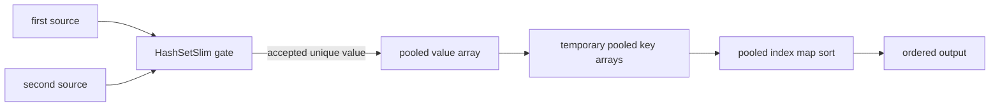

# Pipeline Buffering Characteristics

この文書は FLinq の `PipelineEnumerable` が特殊扱いする LINQ stage の特性を定義する。目的は、どのメソッドが中間バッファ、結果バッファ、集合判定用バッファを持つかを明確にし、融合時にどのバッファを共有できるかを判断できるようにすること。

## Buffer Classes

| 分類 | 意味 | 主な対象 |
| --- | --- | --- |
| Streaming | 入力を 1 要素ずつ処理し、全件バッファを持たない | `Where`, `Select`, `Skip`, `Take`, `Cast`, `OfType` |
| Stateful streaming | 全件は持たないが、カウンタや小さい状態を持つ | index 付き `Where`/`Select`, `SkipWhile`, `TakeWhile` |
| Set buffer | 重複判定や集合演算のために `HashSetSlim<TKey>` を持つ | `Distinct`, `Union`, `Except`, `Intersect` 系 |
| Result buffer | 後で列挙するため、結果要素そのものを保持する | `OrderBy`, `Reverse`, `TakeLast`, `GroupBy` |
| Temporary sort buffer | ソート中だけ使い、列挙開始後は不要な補助配列 | `OrderBy`/`ThenBy` の key array |

`Distinct` や `Union` は結果として重複を出さないが、これは `HashSetSlim` による判定であり、結果要素リストを持つとは限らない。逆に `OrderBy().Distinct()` のような順序では、最終結果は重複なしでも、Order の結果バッファ内には重複要素が残る。

## Stage Characteristics

| メソッド | 中間バッファ | 結果バッファ | 重複の扱い | Pipeline 上の扱い |
| --- | --- | --- | --- | --- |
| `Where`, `Select`, `Cast`, `OfType` | なし | なし | 変更なし | 通常 loop に inline |
| `Skip`, `Take`, `SkipWhile`, `TakeWhile` | 小さい state | なし | 変更なし | loop 制御へ inline |
| `Distinct`, `DistinctBy` | `HashSetSlim<TKey>` | なし | 出力は重複なし | streaming set stage |
| `Union`, `UnionBy` | `HashSetSlim<TKey>` | 通常なし | 出力は重複なし | BinarySet 専用 loop |
| `Except`, `ExceptBy` | right-side `HashSetSlim<TKey>` + emitted `HashSetSlim<TKey>` | 通常なし | 出力は重複なし | BinarySet 専用 loop |
| `Intersect`, `IntersectBy` | right-side `HashSetSlim<TKey>` + emitted `HashSetSlim<TKey>` | 通常なし | 出力は重複なし | BinarySet 専用 loop |
| `OrderBy`, `OrderByDescending` | sort key array | pooled value array + index map | 入力の重複を保持 | Order 専用 loop |
| `ThenBy`, `ThenByDescending` | sort key array | 親 Order の value array + index map を共有 | 入力の重複を保持 | Order group 内で comparator に融合 |
| `Reverse`, `TakeLast`, `TakeRange` | なし | `List<T>` | 入力の重複を保持 | buffering loop |
| `GroupBy` | `Dictionary<TKey,List<T>>` | group list | group 内は重複保持 | GroupBy 専用 loop |
| `AggregateBy`, `CountBy`, `ToLookup` | dictionary/lookup | terminal/result object | key は重複なし、値は保持 | fragment/terminal 側で処理 |

## Fusion Rules

```mermaid
flowchart TD
    A[Source] --> B{Streaming stage?}
    B -->|yes| C[Inline into current loop]
    C --> B
    B -->|Set stage| D[HashSetSlim gate]
    D --> E{Order follows?}
    E -->|no| F[Yield accepted values]
    E -->|yes| G[Append accepted values to pooled value array]
    G --> H[Build pooled key arrays]
    H --> I[Sort pooled index map]
    I --> J[Yield valueArray[indexMap[i]]]
    B -->|Order group| H
```

### BinarySet -> Order/ThenBy

`Union().OrderBy().ThenBy()` のような chain では、BinarySet は採用可否を `HashSetSlim` で判定し、採用された値だけを Order の `value[]` に積む。Order は同じ `value[]` と `indexMap[]` を使うため、BinarySet の採用結果リストと Order の結果リストを別々に作らない。



残る `HashSetSlim` は削れない。`Union` の equality comparer と `OrderBy` の comparer/key は一般に別の規則であり、sort 後 unique に置換すると意味が変わるため。

### Order/ThenBy

Order group は値を `value[]` に 1 回だけ materialize し、`ThenBy` は同じ `value[]` に対する追加 key array として扱う。列挙中に保持するのは `value[]` と `indexMap[]` だけで、key array は sort 後に `ArrayPool` へ返す。

```mermaid
flowchart TD
    A[accepted values] --> B[pooled value array]
    B --> C[primary key array]
    B --> D[then key array]
    C --> E[index comparer]
    D --> E
    E --> F[sort indexMap]
    F --> G[key arrays returned]
    F --> H[yield valueArray[indexMap[i]]]
```

## Optimization Techniques

- `HashSetSlim` は集合判定専用、`value[]` は列挙結果専用として役割を分ける。
- BinarySet の後に Order がある場合、accepted value を Order の `value[]` に直接積み、結果バッファを共有する。
- `ThenBy` は別の結果バッファを作らず、同じ `indexMap[]` の comparator に追加 key を重ねる。
- key array は `ArrayPool<TKey>` から借り、sort 後に返す。列挙期間中は保持しない。
- 既に sorted な `int` span の identity order は、既存の sorted-span fast path でソートバッファ自体を回避する。
- capacity hint は入力件数が結果件数に近い場合だけ有効。BinarySet は重複で大きく縮むため、結果バッファは小さく始めて必要時に grow する。

## Current Limits

- BinarySet と Order の融合は、BinarySet の後に Order group が来る形だけを対象にする。
- BinarySet と Order の間に置けるのは streaming/set gate として inline できる stage に限る。
- `SelectMany`, `Concat` 系、`Reverse`/`TakeLast` など別の全件 buffering stage との複合融合は対象外。
- equality comparer と order comparer/key が同一と証明できる場合の sort+unique 置換は未実装。これは意味論のリスクがあるため、別最適化として扱う。
