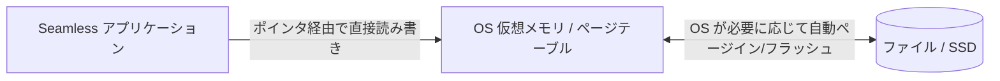

# コレクション内部構造とメモリモデル (Data Structures & Memory Model)

Seamless が提供する各コレクションは、ガベージコレクション（GC）の負担を最小化し、CPU キャッシュラインを最大限に活用するために、メモリレイアウトが徹底的に計算されています。

---

## 1. `BlittableList<T>` (インメモリ・アンマネージド配列)

C# の標準 `List<T>` は内部にマネージド配列（`T[]`）を保持します。`T` に参照型が含まれなくても、要素数が数百万〜数千万件に達すると、GC の Gen2 ヒープが肥大化し、フル GC 時にオブジェクトヘッダの走査コストが増大します。

`BlittableList<T>` は、アンマネージドメモリ領域（`NativeMemory.Alloc` または OS 仮想メモリ）を直接確保します。

```text
+-----------------------------------------------------------+
| BlittableList<T> (Struct / Lightweight Object)           |
|  - Pointer: *T (アンマネージドヒープへの生ポインタ)       |
|  - Count: int                                             |
|  - Capacity: int                                          |
+-----------------------------------------------------------+
        |
        v [Direct Pointer Access]
+-----------------------------------------------------------+
| Unmanaged Memory Buffer (GC 走査対象外)                   |
| [ Item 0 ][ Item 1 ][ Item 2 ][ Item 3 ] ...              |
+-----------------------------------------------------------+
```

### 特徴
- **GC 停止時間 0**: ヒープ走査の対象にならないため、1億件のデータを保持していても GC ポーズ時間は一切増加しません。
- **SIMD / ベクトル化フレンドリー**: 連続した物理メモリに配置されるため、CPU のキャッシュライン（64バイト単位）に効率よく乗っかり、自動ベクトル化（AVX2 / AVX-512）が効きやすくなります。

---

## 2. `AppendOnlyList<T>` (メモリマップト追記リスト)

`Seamless.Collections.Persisted` が提供する `AppendOnlyList<T>` は、OS の **メモリマップトファイル（Memory-Mapped Files）** をバックエンドに採用しています。



### 特徴
- **ファイル IO のシステムコール削減**: `FileStream.Write` などのシステムコールを発行せず、メモリ上のポインタに値を代入するだけで、OS の仮想メモリ管理機構が自動的にディスクへフラッシュします。
- **プロセス間共有とクラッシュ耐性**: プロセスが突然死した場合でも、OS カーネルが管理するページキャッシュ内のデータは保持され、ディスクへ安全に書き戻されます。

---

## 3. Tsavorite HybridLog (RAM と SSD のシームレス統合)

`Seamless.Collections.Tsavorite` は、Microsoft Research の FASTER / Tsavorite アーキテクチャを採用しています。

```text
[ Tsavorite HybridLog のメモリ領域構成 ]

アドレス低 (古いデータ)                                         アドレス高 (新しいデータ)
<----------------------------------------------------------------------------->
[ Disk-only Region ]  |  [ Read-cache Region ]  |  [ In-Memory Region (RAM) ]
(SSD上のログファイル) |  (RAM上の読み出しキャッシュ) |  (RAM上で即時読み書き)
                      |                         |
               ReadOnlyAddress           HeadAddress (最新追記位置)
```

- **In-Memory Region**: RAM 上に保持され、ロックフリーなスレッド安全ハッシュインデックスを通じてナノ秒単位で読み書きされます。
- **Read-cache / Disk Region**: メモリ予算（`ResourceBudget`）に達した古いレコードは、バックグラウンドで自動的にディスク上のログファイルへスピル（退避）されます。
- **透過的なアクセス**: ユーザーコード側からは、データが RAM にあるかディスクにあるかを意識する必要はありません。`TryGetValue` を呼ぶと、エンジンが自動的に RAM キャッシュまたは SSD ログから値を取得して返します。

---

## 4. シリアライゼーション戦略 (`ISerializer<T>`)

Seamless では、データの直列化において以下の2つの戦略を自動的に使い分けます：

1. **`BlittableStrategy`**:
   `int`, `float`, `struct { int X; int Y; }` のような blittable 型に対しては、シリアライズ処理（コピーや変換）を一切行わず、バイト列として直接メモリコピー（`Buffer.MemoryCopy`）を行います。
2. **`MemoryPackSerializerStrategy`**:
   文字列や可変長配列を含む複雑なオブジェクトに対しては、最速のバイナリシリアライザである **MemoryPack** を使用し、UTF-8 変換やフィールド境界のオーバーヘッドを極限まで削ぎ落とします。

---

## 関連項目

- [メモリとゼロアロケーション](../performance/memory-and-zero-alloc.md) : アロケーション排除の実践ノウハウ
- [Tsavorite チューニング](../performance/tsavorite-tuning.md) : HybridLog の詳細パラメータ設計
- [共通ストアと実行スコープ](execution-scope.md) : リソース予約と回収のライフサイクル
