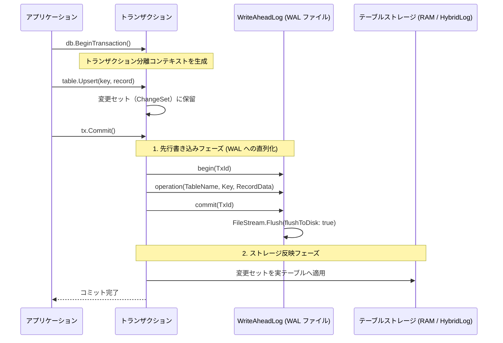

# データベースエンジン内部構造 (Database Engine & WAL)

`Seamless.Database` は、外部の RDBMS サービスに依存せず、単一の .NET プロセス内で完結する軽量・高信頼な組込みデータベースエンジンです。

---

## 1. データベースコンテナの構造

`DatabaseContainer` は、1つのデータベース全体をカプセル化し、その配下に複数のテーブル（`Table<TKey, TRecord>`）やマテリアライズドビュー（`MaterializedView`）を保持します。

```text
DatabaseContainer
 ├── Table<long, UserRecord> (Tsavorite / Persisted バックエンド)
 ├── Table<long, OrderRecord>
 ├── MaterializedView<long, UserSummaryView>
 ├── DatabaseWriteAheadLog (WAL: 日常のコミット記録)
 ├── DatabaseConcurrencyGate (並行トランザクション制御)
 └── ExecutionResource (メモリ/ディスク予算管理)
```

---

## 2. トランザクション処理と WAL (Write-Ahead Log)

データの整合性（ACID 特性）を保証するため、すべての書き込みトランザクションは **先行書き込みログ（Write-Ahead Log: WAL）** プロトコルに従います。



### WAL の特徴と保証
- **`WriteThrough` とディスク強制フラッシュ**:
  コミット時には、OS のバッファだけでなく、物理ドライブ（SSD/HDD）の不揮発領域まで確実にデータが書き込まれたことを保証する `FileOptions.WriteThrough` と `Flush(flushToDisk: true)` を実行します。
- **軽量バイナリレコード**:
  操作ログは冗長な SQL 文ではなく、コンパクトなシリアライズデータとして記録されるため、毎秒数万〜十万件のコミットを低オーバーヘッドで処理できます。

---

## 3. クラッシュリカバリ（障害復旧）

プロセスが電源断やクラッシュによって突然停止した場合、次回 `DatabaseContainer` の初期化時に以下の手順で自動復旧が行われます。

1. **WAL の走査**:
   起動時に WAL ファイルを先頭からスキャンし、各トランザクションの `begin` と `commit` のペアを確認します。
2. **未コミットトランザクションの破棄**:
   `begin` は存在するが `commit` が記録されていない不完全なトランザクションは、復旧対象から除外（自動ロールバック）されます。
3. **コミット済みデータの再適用（Redo）**:
   正常に `commit` されたレコード操作のみを順次テーブルストレージへ適用し、クラッシュ直前の完全な状態へ復元します。

---

## 4. マテリアライズドビューの同期

Seamless は、テーブルの更新に連動して自動更新されるマテリアライズドビュー（`MaterializedView`）をサポートしています。
テーブルへの書き込みトランザクション内でビューのインクリメンタル更新が行われるため、読み出し時には集計計算を一切行うことなく、常に最新のサマリーデータを即座に取得できます。

---

## 関連項目

- [型付きDBアクセス入門](../guides/typed-database-guide.md) : トランザクションの基本利用法
- [ORマッパーとの根本的相違](orm-vs-typed-database.md) : EF Core とのトランザクションオーバーヘッド比較
- [開発で得られた技術的知見](../performance/lessons-learned.md) : WAL 書き込みと非同期回収の協調動作
