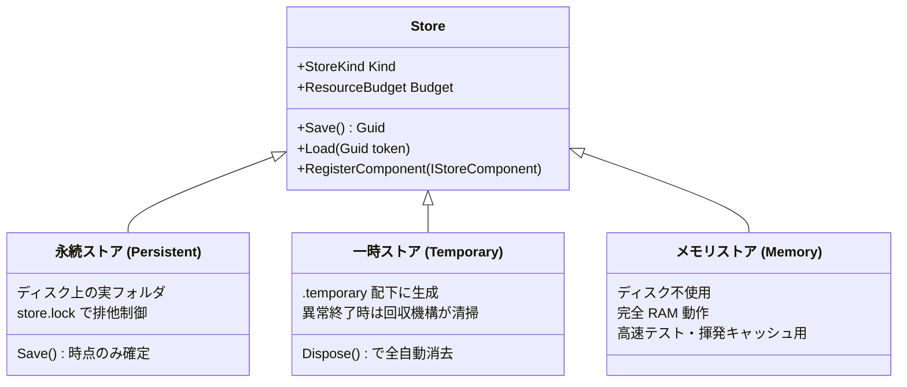

# 共通ストアと実行スコープ (Common Store & Execution Scope)

`Seamless.Execution` は、Seamless 全体の一時資源・永続化ストア・メモリ予算・障害回収を統括するコア基盤です。

データベースやコレクション、LINQ の大規模演算子が勝手気ままにメモリや一時ファイルを作成するのを防ぎ、システム全体として「**絶対に OOM（Out Of Memory）やディスク溢れを起こさない**」堅牢な運用を保証します。

---

## 1. 3つのストア種別 (`Store`)

`Store` は、用途に応じて以下の 3 種類が用意されています。



### 重要な不変条件
1. **永続ストアは `Save()` を明示的に呼んだ時点だけが確定する**:
   `Dispose()` 時に暗黙のコミットは行いません。途中でクラッシュしたり例外が起きた場合は、前回の `Save()` トークンの状態へと安全に復元されます。
2. **多重オープンの禁止**:
   同一の永続フォルダに対しては、`store.lock` を取得して排他オープンします。別プロセスからの不正な多重書き込みを物理的に防止します。
3. **一時ストアの完全回収**:
   一時ストアは破棄時にフォルダごと物理削除されます。

---

## 2. 実行スコープとリソース予算 (`ExecutionScope` & `ResourceBudget`)

大規模な集計処理やトランザクションを実行する際、`ExecutionScope` を通じてリソースを消費します。

```csharp
// 予算を設定（メモリ上限 256MB、一時ストレージ上限 4GB）
var options = new ExecutionOptions
{
    MemoryLimitBytes = 256 * 1024 * 1024,
    TemporaryStorageLimitBytes = 4L * 1024 * 1024 * 1024
};

using var scope = new ExecutionScope(options);

// メモリの予約
using (var reservation = scope.Budget.ReserveMemory(64 * 1024 * 1024))
{
    // 64MB の枠内で安全に一時バッファを確保・計算
    Console.WriteLine($"現在の使用中メモリ: {scope.Budget.MemoryBytes} bytes");
    Console.WriteLine($"ピーク時メモリ: {scope.Budget.PeakMemoryBytes} bytes");
} // Dispose されると自動的に予約枠が返却される
```

### 予算管理のルール
- 予算の上限を超える予約要求が発生した場合、`ResourceLimitException` がスローされ、プロセスクラッシュ（OOM）に至る前にクエリ側で安全に対処（またはスピル処理へ移行）できます。
- 1つのスコープ内では、同時に複数の列挙が走ることを防ぎ、単一スレッドの排他安全性を担保します。

---

## 3. 放置資源の安全な回収機構 (`TemporaryResourceRecovery`)

サーバーが電源断や `kill -9` 等で突然停止した場合、一時ディスク領域（`.temporary`）にゴミファイルが残るリスクがあります。

Seamless は、次回起動時またはバックグラウンドで安全に回収を行う **所有権判定ハンドシェイク（`owner.json`）** を実装しています。

```text
[ 一時フォルダ内の構造 ]
.temporary/
  └── scope-a83f9e21/
        ├── owner.json       <-- プロセスID (PID)、起動時刻、所有者ロック
        └── temp_spill.bin   <-- 一時データ
```

### 回収の不変条件
- 単にファイルが存在するからといって即座に削除はしません。
- `owner.json` に記録された PID とプロセス起動時刻を OS API と照合し、「**本当に元の所有プロセスが消滅しており、かつロックファイルが手放されている**」ことを二重確認できたフォルダのみを安全に削除します。

---

## 関連項目

- [データベースエンジン](database-engine.md) : トランザクションと一時ストアの連動
- [開発で得られた技術的知見](../performance/lessons-learned.md) : 20秒競合問題の解決アルゴリズム
- [永続化ストレージの選び方](../guides/persistence-guide.md) : 各ストアの使い分け
