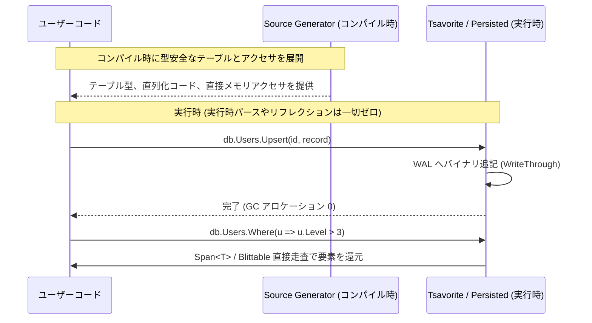

# ORマッパーとの根本的相違 (ORM vs Compile-Time Typed Database)

C# / .NET のエコシステムにおいて、データベースアクセスといえば **Entity Framework Core (EF Core)** や **Dapper** などのオブジェクト・リレーショナル・マッパー（ORM）が長年デファクトスタンダードとして利用されてきました。

しかし、ゲームクライアント、高頻度トレーディング、大規模マイクロサービスなど、ミリ秒単位の低レイテンシとゼロアロケーションが求められる領域では、ORM の内部構造が致命的なボトルネックになります。

Seamless の **型付きDBアクセス（Compile-time Typed Database）** は、従来の ORM とは設計思想・アーキテクチャの根底から異なります。

---

## 1. 根本的なアプローチの比較

| 観点 | 従来の OR マッパー (EF Core / Dapper) | Seamless 型付きデータベース |
| :--- | :--- | :--- |
| **スキーマ・メタデータの解決** | **実行時 (Runtime)** リフレクション、属性走査、モデルビルド | **コンパイル時 (Compile-time)** Roslyn Source Generator により完全解決 |
| **SQL / コマンドの生成** | **実行時文字列組み立て** LINQ 式木（Expression Tree）のパース | **不要** C# の型・メソッド呼び出しとして直接実行 |
| **データ読み出しとバインディング** | `DbDataReader` からの動的マッピング ボクシング・型変換・中間オブジェクト生成 | **Direct Memory Read** `Span<T>` / Blittable ポインタから直接読み出し |
| **Change Tracking (変更監視)** | スナップショット比較・プロキシオブジェクト（二重保持） | **WAL (Write-Ahead Log) 追記** 差分操作の追記ログのみを管理 |
| **ヒープアロケーション** | クエリごとに大量の GC アロケーション発生 | **完全ゼロ〜極小 (Zero-Allocation)** |
| **クライアント動作** | 重厚（モバイルや Unity では GC スパイクの原因） | **超軽量** (ゲームループ内 120fps でも安全) |

---

## 2. なぜ ORM はオーバーヘッドを避けられないのか？

### A. 式木（Expression Tree）の実行時パース
EF Core では、`db.Users.Where(u => u.Age > 20)` を実行する際、ラムダ式はコードではなく **式木（`Expression<Func<User, bool>>`）** として渡されます。
EF Core の内部では、この木構造を実行時に走査し、SQL 文字列（`SELECT ... WHERE Age > 20`）へトランスパイルします。この過程で数十〜数百個の一時オブジェクトがヒープにアロケーションされ、CPU サイクルを浪費します。

### B. `DbDataReader` からの動的抽出とボクシング
ADO.NET の基盤である `DbDataReader` は、カラムデータを `object` や列インデックス経由で返します。値型（`int`, `Guid`, `DateTime`）を読み出すだけでも、ボクシングや実行時型チェックのコストが必ず発生します。

### C. Change Tracker のメモリフットプリント
EF Core の変更追跡機能は、DB から読み出した全エンティティの「元の状態」をバックアップとしてメモリ内に二重保持します。数万件のデータを読み出すだけで、メモリ使用量は一気に跳ね上がります。

---

## 3. Seamless 型付きDBの技術的解決策

1. **コンパイル時静的バインディング**:
   テーブル構造、カラムオフセット、シリアライザはコンパイル時に Roslyn によって生成されます。実行時には単なる具象クラスの通常のメソッド呼び出しとして実行されるため、メタデータ解決コストは **完全に 0** です。
2. **Direct Blittable Read**:
   データはメモリマップトファイルや RAM 上の連続したバイナリバッファに配置されます。値の読み出しは、ポインタ演算または `MemoryMarshal.Cast` を用いた直接メモリ参照となるため、中間コピーすら発生しません。
3. **WAL による軽量トランザクション**:
   変更追跡用の複製インスタンスを持たず、変更操作そのものをコンパクトなバイナリ形式で Write-Ahead Log（WAL）へストリーム書き込みします。

---

## 4. サーバー・クライアント共通化への恩恵

このオーバーヘッドの完全排除は、**「同じコードをクライアント環境（Unity やモバイル）で動かせるか」** を決定づけます。

従来の ORM はメモリ・CPU 負荷が高すぎるため、サーバー側でしか実用的に動かせず、クライアント側には SQLite 等の別ライブラリを入れる必要がありました。
Seamless の型付きDBは、ハードウェアの生性能に近いリソース効率で動作するため、**リソース制約の厳しいモバイル端末や 60fps/120fps を維持しなければならないゲームクライアントでも全く問題なく動作**します。

---

## 関連項目

- [C# の性能限界を引き出す](../performance/csharp-to-the-metal.md) : Unsafe, Span, MemoryPack の詳細
- [データベースエンジンの内部構造](database-engine.md) : WAL とトランザクション
- [サーバー・クライアント共通アーキテクチャ](../guides/universal-architecture.md) : 同一コードによるクロスプラットフォーム開発
