# サーバー・クライアント共通アーキテクチャ (Universal Architecture)

Seamless は、サーバーサイド（クラウド・マイクロサービス）からクライアントサイド（Unity ゲーム、.NET MAUI モバイル、WPF、WebAssembly）まで、**完全に同一の C# データモデル・スキーマ・クエリコードを動作させる**「ユニバーサル・データアーキテクチャ」を実現します。

---

## 従来のクライアント・サーバー開発の分断

従来のアプリケーション開発では、サーバーとクライアントの間で大きな技術的分断と「重複開発」が存在していました：

```mermaid
flowchart LR
    subgraph Server [サーバーサイド (Linux / ASP.NET)]
        ServerDB[(RDBMS / SQL Server)]
        EFCore[EF Core / Dapper]
        ServerLogic[集計・ビジネスロジック]
    end

    subgraph Client [クライアントサイド (Unity / MAUI / Web)]
        ClientDB[(ローカル SQLite / Realm)]
        CustomORM[クライアント用 ORM / マッパー]
        ClientLogic[ローカル検索・フィルタロジック]
    end

    Server <-->|REST / gRPC (二重定義された DTO)| Client
```

この従来アプローチには以下の深刻な課題がありました：
1. **ロジックの二重実装**: サーバー側とクライアント側で同じフィルタリング・検索・計算ロジックを別々の言語や ORM で二重に記述しなければならない。
2. **モデル・同期の不整合**: サーバーの DB スキーマとクライアントのローカル DB で型定義や挙動（丸め誤差、ソート順、浮動小数点比較）に微妙な差異が生じる。
3. **クライアントでの高負荷**: クライアント用 ORM や SQLite のラッパーが大量の GC アロケーションを発生させ、モバイルやゲームのフレームレートを低下させる。

---

## Seamless による統合ユニバーサルモデル

Seamless を導入すると、共通の .NET ライブラリ（クラスライブラリ）にデータモデルとクエリロジックを 1 つ定義するだけで、すべての実行環境で共有できます。

```mermaid
flowchart TD
    SharedLib["SharedDomain.dll (Seamless 共通プロジェクト)<br/>- DatabaseContainer 定義<br/>- テーブル・スキーマ<br/>- FLinq クエリロジック"]

    ServerApp["サーバー (ASP.NET Core / マイクロサービス)<br/>- 高スループット Tsavorite 永続化<br/>- マルチコア / NUMA 最適化<br/>- SQL Server スキーマ直接連動"]

    ClientApp["クライアント (Unity / MAUI / Desktop / WASM)<br/>- インメモリ / ローカル Persisted<br/>- ゼロアロケーション（60fps / 120fps 保証）<br/>- オフライン動作 & 高速ローカル検索"]

    SharedLib --> ServerApp
    SharedLib --> ClientApp
```



### 実装例: 共有されるデータ層コード

以下のようなデータ定義とリポジトリロジックは、クライアントでもサーバーでも 1 文字も変えずにビルド・実行されます。

```csharp
// 【共有プロジェクト】
using Seamless.Database;
using System.Linq;

public sealed record PlayerData(long PlayerId, string Name, int Score, DateTime LastLogin);

public sealed partial class GameDatabase : DatabaseContainer
{
    public GameDatabase(DatabaseContainerOptions options) : base(options) { }
    public Table<long, PlayerData> Players => this.GetTable<long, PlayerData>();

    // 共通のビジネスクエリ
    public IReadOnlyList<PlayerData> GetTopRankers(int count)
    {
        return this.Players
            .OrderByDescending(p => p.Score)
            .Take(count)
            .ToList();
    }
}
```

---

## 環境ごとの起動の切り替え

コードベースは同一のまま、実行環境に応じて `DatabaseContainerOptions` を切り替えるだけで、それぞれのプラットフォームに最適なリソース配分が行われます。

### 1. サーバー環境（Linux / クラウド）
- ディスク永続化（`StorageMode.Storage`）
- 数 GB〜数百 GB の Tsavorite ハイブリッドログ
- NUMA ノードおよび CPU コア Affinity による高スループット最適化

```csharp
var serverOptions = new DatabaseContainerOptions
{
    StorageMode = DatabaseStorageMode.Storage,
    StorageRoot = "/var/data/seamless_master",
    ManagedMemoryLimitBytes = 16L * 1024 * 1024 * 1024 // 16GB
};
using var db = new GameDatabase(serverOptions);
```

### 2. クライアント環境（Unity / モバイル）
- 完全インメモリまたは軽量ファイル永続化（`Persisted`）
- ゼロアロケーションによる GC 停止（GC Pause）の完全抑止
- オフラインでの超高速ローカル検索

```csharp
var clientOptions = new DatabaseContainerOptions
{
    StorageMode = DatabaseStorageMode.Storage,
    StorageRoot = Application.persistentDataPath + "/local_cache",
    ManagedMemoryLimitBytes = 64 * 1024 * 1024 // 64MB 予算
};
using var db = new GameDatabase(clientOptions);
```

---

## 関連項目

- [マルチプラットフォーム展開](../vision/cross-platform.md) : 各 OS やランタイムにおける対応詳細
- [ORマッパーとの根本的相違](../architecture/orm-vs-typed-database.md) : クライアントでの軽量動作が可能な理由
- [メモリとゼロアロケーション](../performance/memory-and-zero-alloc.md) : モバイル・ゲームでのフレーム落ちを防ぐ技術
