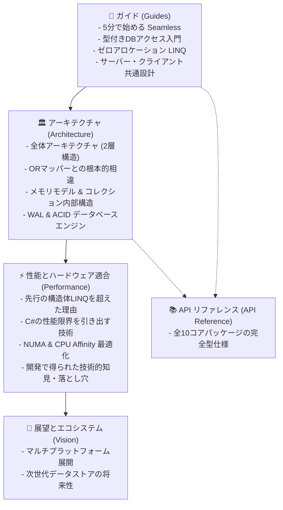

# Seamless ドキュメントポータル (Documentation Portal)

**Seamless** は、.NET 向けの高パフォーマンスなインメモリ／永続化コレクション、ゼロアロケーション LINQ（FLinq）、および型付きインメモリ/ハイブリッド データベース ライブラリです。

「**メモリに載り切らない膨大なデータであっても、.NET 標準のコレクション・LINQ・C# クラスの書き味のまま、極限の性能でストレージへ分散して扱える**」ことを目指して設計されています。

---

## 主要セクション

### 1. [ガイド (Guides)](guides/getting-started.md)
Seamless を初めて触る開発者向けの導入ドキュメントです。
- [はじめに (Getting Started)](guides/getting-started.md) : インストールと 5分で体験する基本機能
- [型付きDBアクセス入門](guides/typed-database-guide.md) : `DatabaseContainer` によるスキーマ定義と ACID トランザクション
- [ゼロアロケーション LINQ (FLinq)](guides/flinq-quickstart.md) : コンパイル時最適化の仕組み
- [サーバー・クライアント共通アーキテクチャ](guides/universal-architecture.md) : サーバーと Unity / モバイルで同一のデータ層を共有
- [永続化ストレージの選び方](guides/persistence-guide.md) : `InMemory`, `Persisted`, `Tsavorite` の特性比較

### 2. [アーキテクチャ (Architecture)](architecture/overview.md)
Seamless の根底にある設計思想とデータライフサイクルを解説します。
- [全体アーキテクチャ](architecture/overview.md) : Roslyn Generator × Runtime Store の 2層構造
- [ORマッパーとの根本的相違](architecture/orm-vs-typed-database.md) : EF Core や Dapper との違いとオーバーヘッド完全排除の理由
- [コレクション内部構造とメモリモデル](architecture/data-structures.md) : Blittable 配列と Tsavorite HybridLog
- [共通ストアと実行スコープ](architecture/execution-scope.md) : リソース予算（`ResourceBudget`）と一時資源回収
- [データベースエンジン内部構造](architecture/database-engine.md) : 先行書き込みログ（WAL）とクラッシュ復旧

### 3. [性能とハードウェア適合 (Performance & Tuning)](performance/beyond-struct-linq.md)
C# の限界に挑み、ハードウェア性能を 100% 引き出すためのディープダイブです。
- [先行の構造体LINQを超えた理由](performance/beyond-struct-linq.md) : 構造体イテレータの連鎖が抱える壁と、FLinq のパイプライン融合
- [C#の性能限界を引き出す技術](performance/csharp-to-the-metal.md) : Interceptor, Unsafe, Span, MemoryPack, SIMD の極限活用
- [ハードウェア適合と NUMA / Affinity](performance/hardware-and-numa.md) : メモリ局所性と CPU コア固定
- [メモリアクセス効率化とゼロアロケーション](performance/memory-and-zero-alloc.md) : GC ポーズをゼロにする設計技法
- [Tsavorite / FASTER チューニング](performance/tsavorite-tuning.md) : ページ・セグメント・メモリサイズの最適設計
- [開発中に得られた技術的知見と落とし穴](performance/lessons-learned.md) : 20秒競合問題や浮動小数点セマンティクス

### 4. [展望 (Vision)](vision/cross-platform.md)
Seamless がもたらすマルチプラットフォーム展開と次世代の可能性です。
- [マルチプラットフォーム展開](vision/cross-platform.md) : Windows, Linux, macOS, モバイル, Unity, WebAssembly
- [将来的な可能性と次世代データストア像](vision/future-possibilities.md) : 分散 KVS、AI エージェント向け組み込みストア

### 5. [API リファレンス (API Reference)](api/index.md)
Seamless の全公開型（クラス、インターフェース、構造体、拡張メソッド）の完全なリファレンスです。
