# FLinq Intercept 最適化コード生成 Pipeline/Fragment 仕様

## 目的

`LinqInterceptAttribute` による intercept 対象メソッド内の LINQ チェーンを、コンパイル時に Fragment または Pipeline IR へ変換し、delegate 呼び出し、中間 iterator、中間 GC allocation を抑えた生成コードへ落とす仕様を定義する。

この文書では特に以下を明示する。

- `Where.Select` は 1 要素ずつ流す streaming pipeline として扱う。
- `Join.Where` は安全に逆解析できる場合、`Where` を outer/inner の葉へ移動する。
- lambda は可能な限り delegate として保持せず、式として `TryGetNext` や direct execution loop に埋め込む。
- lambda の capture 変数は Enumerator の constructor 引数/field として渡す。
- loop invariant な部分式は hoist して Enumerator construction 時に 1 回評価する。
- `.Anchor` は評価回数・評価順を変え得る hoist/merge/reorder の禁止境界にする。
- 匿名型は内部表現で `record struct` 化し、名指し不能な匿名型と GC allocation を避ける。
- 既存実装から自然に拡張できる Pipeline/Fragment 仕様候補を整理する。

## 根拠

主な根拠ファイルは以下。

| 領域 | ファイル |
| --- | --- |
| intercept 入口と source generation | `Seamless.FLinq/SourceGenerator/interceptor.cs` |
| 代数的構文変換 | `Seamless.FLinq/SourceGenerator/AlgebraicRewriter.cs` |
| query lowering / Where 押し下げ | `Seamless.FLinq/SourceGenerator/OptimizeVisitor.cs` |
| carrier 逆解析（共有） | `Seamless.FLinq/SourceGenerator/CarrierAnalysis.cs` |
| 射影融合 | `Seamless.FLinq/SourceGenerator/ProjectionMergeVisitor.cs` |
| Anchor 判定 | `Seamless.FLinq/SourceGenerator/AnchorAnalysis.cs` |
| 匿名型 record struct registry | `Seamless.FLinq/SourceGenerator/AnonymousStructRecord.cs` |
| Pipeline IR / stage fusion | `Seamless.FLinq/SourceGenerator/Linq/Fragments/Pipeline.cs` |
| lambda inline / capture / hoist | `Seamless.FLinq/SourceGenerator/Linq/Fragments/Func.cs`, `Fragment.cs`, `LambdaFunc.cs` |
| buffer 特性 | `FLinq.md` |
| hoist / Anchor テスト | `Test/System/Linq/Intercept/Optimization/InvariantHoisting.cs` |
| Join / anonymous / hashing テスト | `Test/System/Linq/Intercept/Optimization/JoinHashing.cs` |
| 射影融合の意味保存テスト | `Test/System/Linq/Intercept/Optimization/ProjectionMerge.cs`, `JoinSelectFusion.cs` |
| 射影融合の生成形状テスト | `Test/SourceGenerator/ProjectionMergeShapeTests.cs` |
| 集合演算への Where 分配の意味保存テスト | `Test/System/Linq/Intercept/Optimization/SetOperationPushdown.cs` |
| 集合演算への Where 分配の生成形状テスト | `Test/SourceGenerator/SetOperationPushdownShapeTests.cs` |
| 単項演算(Distinct/Reverse/Order)への Where 押し下げの意味保存テスト | `Test/System/Linq/Intercept/Optimization/UnaryPushdown.cs` |
| 単項演算への Where 押し下げと Order 高速パスガードの生成形状テスト | `Test/SourceGenerator/UnaryPushdownShapeTests.cs` |
| PipelineEnumerable の二入力(SecondSources)ジェネリック伝播 | `Seamless.FLinq/SourceGenerator/Linq/Fragments/PipelineEnumerable.cs` |
| 引数位置の列挙ソース(Join の inner / 集合演算の second 等)のフラグメント化 | `Seamless.FLinq/SourceGenerator/FLinqIncrementalGenerator.FragmentBuilder.cs`（`登録済みフラグメント生成を試行` の `Enumerable` パラメータ分岐） |

## 用語

| 用語 | 意味 |
| --- | --- |
| Intercept target | `LinqInterceptAttribute` で最適化対象になった元メソッド。 |
| Generated interceptor | 元メソッド呼び出しを差し替える生成メソッド。 |
| Fragment | 1 つの LINQ 演算子または特殊 root/terminal のコード生成単位。 |
| Pipeline IR | 複数 stage を `PipelineStage[]` として保持し、1 つの `PipelineEnumerable` enumerator へ統合する中間表現。 |
| FuncFragment | predicate/selector/keySelector/resultSelector など lambda の生成表現。 |
| Streaming stage | 入力を 1 要素受け取り、全件バッファなしで次段へ渡す stage。 |
| Buffering stage | `OrderBy`, `GroupBy`, `Reverse`, `TakeLast` など、結果または補助状態を蓄積する stage。 |
| HoistedLocal | lambda 内の要素非依存部分式を Enumerator construction 時に評価して保持する値。 |
| Anchor | `.Anchor` で評価回数・評価順変更を禁止する identity marker。 |

## 全体像

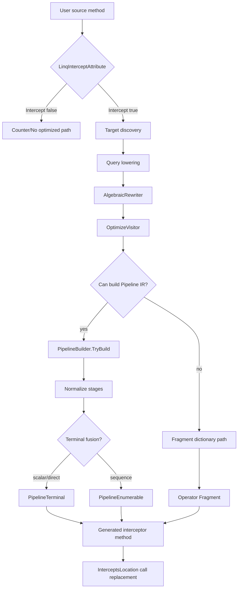

### 生成判断の基本原則

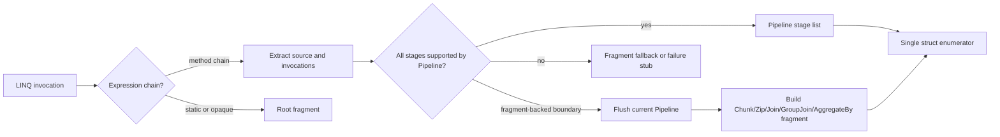

## 変換レイヤ

### 1. AlgebraicRewriter

`AlgebraicRewriter` は `System.Linq.Enumerable` の reduced extension call を対象に、構文上安全な代数変換を行う。

| 入力 | 出力 | 目的 |
| --- | --- | --- |
| `source.Where(p).Count()` | `source.Count(p)` | predicate terminal fusion |
| `source.Where(p).Any()` | `source.Any(p)` | predicate terminal fusion |
| `source.Where(p).First()` | `source.First(p)` | predicate terminal fusion |
| `source.Count()>0` | `source.Any()` | full count scan 回避 |
| `source.Count()==0` | `!source.Any()` | full count scan 回避 |
| `source.OrderBy(k).First()` | `source.MinBy(k)` | sort を scan へ変換 |
| `source.OrderByDescending(k).First()` | `source.MaxBy(k)` | sort を scan へ変換 |
| 中段 `Select(x=>x)` | 削除 | identity stage 削除 |
| 中段 `AsEnumerable()` | 削除 | redundant stage 削除 |
| 連続 `Where` | 選択性/コストで安定整列 | 早期 continue |

`Where` reorder は現在、Anchor を含まず、null-sensitive な member access を含まない predicate に限る。

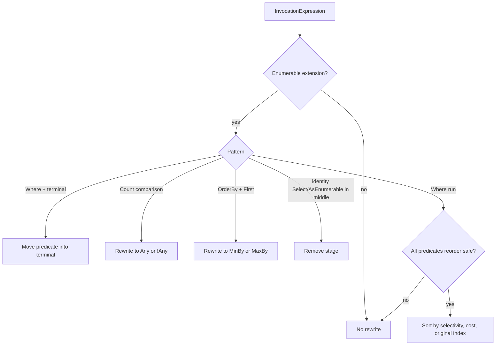

### 2. OptimizeVisitor

`OptimizeVisitor` は query syntax や anonymous carrier を、押し下げしやすい形へ変換する。

処理順は以下。

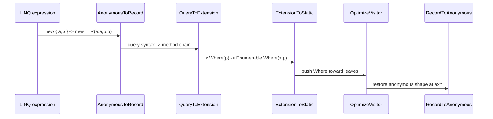

### 3. PipelineBuilder

`PipelineBuilder` は source と invocation list を取り出し、`PipelineStage` を積む。

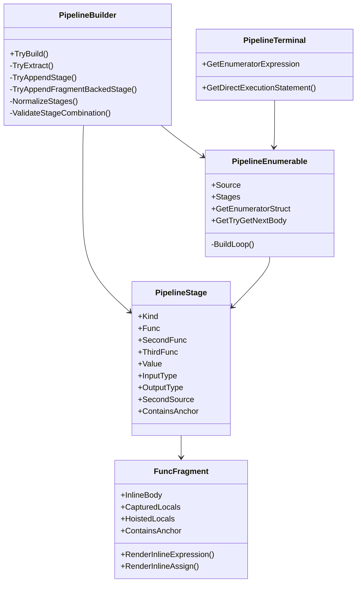

## `Where.Select` Streaming 仕様

`Where` と `Select` はどちらも全件バッファを持たない。`Where.Select` は source から 1 要素を取り、predicate が通れば selector を式として実行して 1 要素返す。

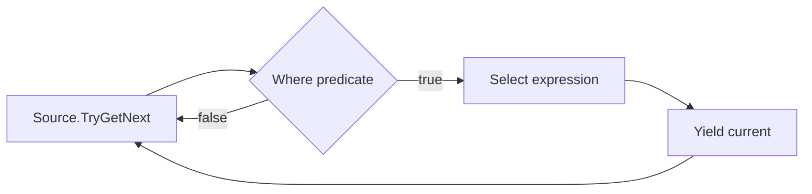

生成される loop の概念形は以下。

```csharp
while(source.TryGetNext(out var item0)) {
    if(!(item0>threshold)) {
        continue;
    }

    var item1=item0*scale;
    current=item1;
    return true;
}

current=default!;
return false;
```

`Where` と `Select` は `PipelineStageKind.Where` / `PipelineStageKind.Select` として保持され、通常 loop の中で順に `AppendStreamingStage` 相当の処理へ展開する。index 付き overload は `StateName(index)` を持つ stateful streaming として扱う。

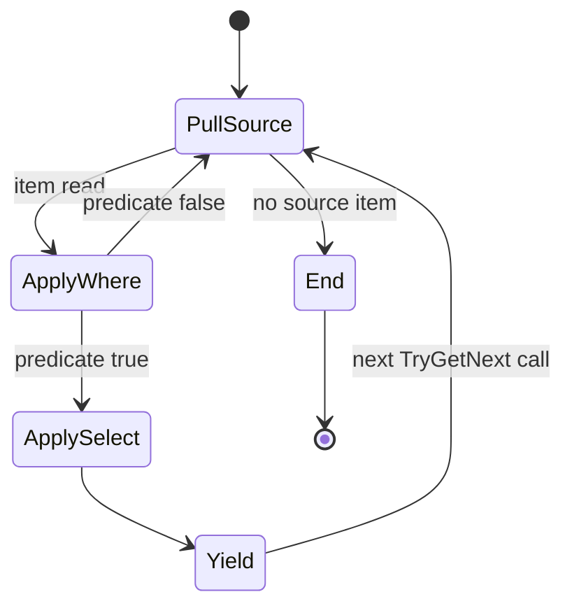

## `Join.Where` の `Where` 葉移動仕様

`Join(... resultSelector).Where(predicate)` は、`predicate` が `resultSelector` の carrier からどの入力へ依存しているかを解析し、片側だけに依存する場合に葉へ移動する。両側に依存する場合は `predicate` をトップレベル `&&` で連言へ分解し、連言ごとに同じ判定を行う（部分押し下げ）。

### 依存分類

| predicate 依存 | 変換 |
| --- | --- |
| outer のみ | `outer.Where(pOuter).Join(inner,...)` |
| inner のみ | `outer.Join(inner.Where(pInner),...)` |
| どちらも参照しない | outer 側へ移動する |
| outer と inner の両方 | 連言へ分解し、片側依存の連言だけ葉へ移動する |
| 分解しても両側参照が残る連言 | その連言だけ Join 後の `Where` に残す |
| carrier 逆解析不可 | 移動しない |
| Anchor を含む | 連言分割しない |

`LeftJoin` は inner 側へ移動すると、その key の inner が空になった outer 行が `default` とペアで残り行数が変わるため、outer 側だけ許可する。

連言分割は `a&&b` の短絡を壊し評価回数・評価順を変えるため、`.Anchor` を含む式では行わない。`&`（非短絡）は両辺を必ず評価させる意図的な記法なので分解対象にしない。1 回の書換で Join 後に残る連言が必ず 1 個以上減るので、再訪ループは有限回で停止する。

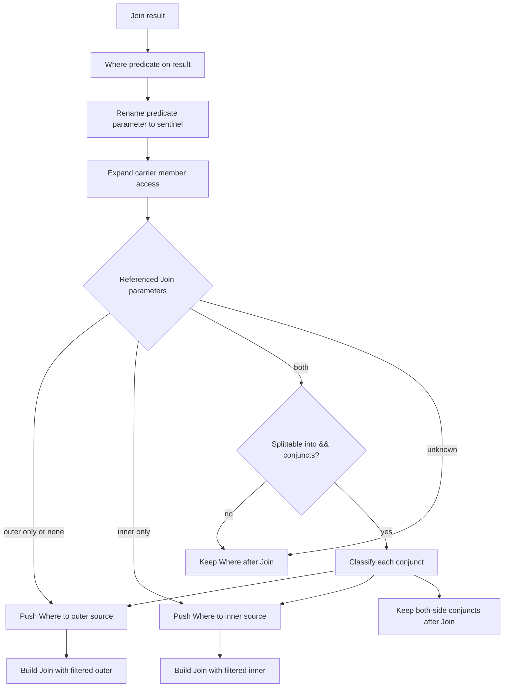

### 例

```csharp
outer.Join(inner,
    o => o.Key,
    i => i.Key,
    (o,i) => new { o,i })
    .Where(x => x.o.Enabled)
```

は概念的に以下へ変換できる。

```csharp
outer.Where(o => o.Enabled)
    .Join(inner,
        o => o.Key,
        i => i.Key,
        (o,i) => new { o,i })
```

一方で以下は両側依存かつ連言へ分解できないので、`Where` は Join 後に残す。

```csharp
.Where(x => x.o.Score>x.i.Score)
```

両側依存でも連言へ分解できる場合は、片側依存の連言だけが葉へ移り、両側参照の連言だけが残る。

```csharp
outer.Join(inner,o => o.Key,i => i.Key,(o,i) => (o,i))
    .Where(x => x.o.Id>1&&x.o.Id<x.i.Id&&x.i.Id<13)
```

は以下へ変換される。

```csharp
outer.Where(o => o.Id>1)
    .Join(inner.Where(i => i.Id<13),o => o.Key,i => i.Key,(o,i) => (o,i))
    .Where(x => x.o.Id<x.i.Id)
```


## 集合演算(Union/Except/Intersect/Concat)への `Where` 分配仕様

`OptimizeVisitor.PushWhereThroughBothSourceMethods`(Concat/Union)と `PushWhereThroughFirstSourceMethods`(Except/Intersect)が対象。要素そのものを比較キーにする集合演算は、選択の分配則

```
σ_p(A∪B) = σ_p(A)∪σ_p(B)
σ_p(A−B) = σ_p(A)−B
σ_p(A∩B) = σ_p(A)∩B
```

がそのまま成り立つ。同じ値の要素は必ず同じ `p` の結果を持つため、どちらが「代表」として残るかに依存しない。

| 演算子 | 押し下げ方向 |
| --- | --- |
| `Union`/`Concat` | 両辺(`TryPushWhereThroughBothSources`) |
| `Except`/`Intersect` | 第1ソースのみ(`PushWhereBeforeSource`)。第2ソース側は集合の意味上そもそも押し下げ不可 |

### By系(`UnionBy`/`ExceptBy`/`IntersectBy`)は対象外(意図的)

By系は「キーで代表を1つ選ぶ」操作(`FIRST_VALUE() OVER (PARTITION BY key ORDER BY 出現順)` 相当)を内包する。キーは値そのものではなく射影(`keySelector`)なので、同じキーでも値・述語の結果が異なる要素が存在しうる。フィルタを先に通すと「どの値が代表になるか」自体が変わるため、押し下げ方向(片側・両側いずれも)に関わらず結果が変わりうる。

反例(`IntersectBy`、キー1が両方の要素に重複し、`p` の結果が割れる場合):

```
A = [(Id:1,Key:1,"a"), (Id:2,Key:1,"b")]、B のキーに 1 を含む、p(x) = x.Name=="b"
現状:     IntersectBy(A,B,key) = [(Id:1,Key:1,"a")] → Where(p) → []
押し下げ後: A.Where(p) = [(Id:2,Key:1,"b")] → IntersectBy(..,B,key) = [(Id:2,Key:1,"b")]
```

両辺へ押し下げても(`UnionBy` で試算)同様に結果が食い違う。唯一の例外は `keySelector` が単射(実質 `x=>x` と等価)な場合で、そのときは By系がそのまま `Union`/`Except`/`Intersect` に退化して安全になるが、単射性は静的に判定できない。したがって `PushWhereThroughFirstSourceMethods` には `Except`/`Intersect` のみを含め、`ExceptBy`/`IntersectBy` は対象から除外する(2026-07-28 に発見・修正した既存バグ。以前は無条件で押し下げており上記の反例で結果が変わっていた)。`UnionBy` も同じ理由で新規実装しない。

### PipelineFusion との相互作用(生成コード形状テストの注意点)

`LinqOptimizations.All`(PipelineFusion 込み)では、Union は「第1ソースの Where を独立した先行段」として残すが、Except は Where を Except 自身の struct 本体へ融合し直すため、生成コードの構造的シグネチャ(struct 宣言順)だけでは Except の ON/OFF を判定できない。`SetOperationPushdownShapeTests.cs` の Except 系テストは、この理由で `PredicatePushdown` の効果を単離して(`LinqOptimizations.Rewrite|LinqOptimizations.PredicatePushdown` 対 `LinqOptimizations.Rewrite`)検証する。

### PipelineEnumerable の SecondSources ジェネリック伝播バグ(2026-07-28 発見・修正)

`PipelineEnumerable`(複数 stage を1つの enumerator へ融合する Fragment)の `SecondSources`(`stages.Select(stage => stage.SecondSource)`)は `stages` フィールドの中に埋もれており、`Fragment.PropagateOuterTypeParameters`/`PropagateContainingTypeName` のリフレクションベースの子伝播(`Fragment` 型の直接フィールドだけを走査)からは不可視だった。そのため、開いたジェネリック型引数(ベンチマーククラスの `T` 等)を持つソースに対して Union/Except 等へ Where が融合されると、第2ソース側の生成 struct が `T` を解決できず `CS0246` になっていた(Union/Except のベンチマーク追加で新規発見)。

`PipelineEnumerable` に `PropagateOuterTypeParameters`/`PropagateContainingTypeName` の override を追加し、`base` 呼び出し後に `this.SecondSources` へも明示的に伝播するよう修正した。あわせて `StructTypeParameters`/`EnumeratorTypeName` が `SecondSources` を含む場合に `OuterTypeParameters` を手動再構築していて `StructTypeParametersWithOuter`/`EnumeratorTypeNameWithOuter`(Join/Concat/Zip/SetBase 等が使う既存ヘルパ)を経由していなかった点も合わせて修正した。

## `Select` 融合と result selector 吸収の仕様

射影（`Select`）を直下の selector / result selector へ吸収し、中間 carrier の構築を丸ごと消す。

```
src.Select(f).Select(g)                    -> src.Select(g∘f)
a.Join(b,ko,ki,(x,y)=>carrier).Select(g)   -> a.Join(b,ko,ki,(x,y)=>g[carrier])
a.SelectMany(cs,(x,y)=>carrier).Select(g)  -> a.SelectMany(cs,(x,y)=>g[carrier])
```

対象は `Select` / `Join` / `LeftJoin` / `RightJoin` / `GroupJoin` / `SelectMany`（2 引数形）の result selector。
`Select` は 1 行 → 1 行なので行数も順序も変えない。したがって述語押し下げで必要だった
「`LeftJoin` の inner 側へ押すと行数が変わる」種類のガードは射影融合には要らない。

### carrier の Tier 規則

carrier の各メンバ式について、後続 selector `g` の本体での参照回数 `n` を数え、次の規則で引き戻しの可否を決める。

| Tier | 該当する式 | 許可条件 | 理由 |
| --- | --- | --- | --- |
| T0 純粋葉 | 識別子 / リテラル / `this` / `base` / `default` / `typeof` | `n` 任意 | 評価が自明に無副作用・無例外。捨ててよく、複製してよい |
| T1 可搬葉 | メンバアクセス / 要素アクセス / キャスト | `n >= 1` | 複製は許すが `n == 0` は禁止。getter の副作用や NRE / IndexOutOfRange / InvalidCast が消えて意味が変わる |
| T2 任意式 | メソッド呼び出しを含むその他すべて | `n == 1` かつ carrier 内に高々 1 個 | `n != 1` は評価回数が変わる。2 個以上あると carrier 構築順と読み出し順が食い違い評価順が入れ替わる |

carrier 式または `g` の本体に `.Anchor` を含む場合は融合しない（評価回数・評価順の変更を禁じる契約）。

この規則により、クエリ式 `join` 句の透過 carrier（両メンバとも T0）は常に融合でき、`let` 句の carrier
（元の range 変数が T0、計算結果が T2 で 1 個）は後続がちょうど 1 回読むときに融合できる。

述語押し下げ側は従来どおり `LiftPolicy.LeafOnly`（carrier メンバを `IsLiftableLeaf` に限る）で動き、挙動は変えていない。

### carrier として認識する形

匿名型 `new{p,q}` / タプル式 `(a,b)` / `ValueTuple`・`Tuple` コンストラクタ /
**record・record struct の位置引数コンストラクタ** / target-typed `new(..)` / 葉式、およびそれらの入れ子。

record 系は「ctor のパラメータ名列がコンパイラ生成 `Deconstruct` の out パラメータ名列と順序込みで一致する」ことを
primary constructor の判定に使う。手書き ctor や引数 0 個の record は一致しないので不可へ倒れる。
target-typed `new(..)` は以前は型を見ずに `Item1..N` 扱いだったが、シンボルで `ValueTuple`/`Tuple`/record を
判別するようになった（型が判別できない `new(..)` は不可）。

### パスの実行順序

```
1. query lowering
2. TryRewriteScalarAlgebra      恒等 Select / 冗長 AsEnumerable を除去して Select を Join に隣接させる
3. TryPushDownPredicates        Where を葉へ動かし、Join と Select の間から Where を退かす
4. TryMergeProjections          射影融合
5. TryRewriteScalarAlgebra      融合結果が恒等 Select になった場合の掃除
```

**3 → 4 の順序は必須。** `Join(..).Where(..).Select(..)` は Join と Select が隣接していないため、
先に Where を葉へ退けないと融合が発火しない。クエリ式の `join` 句は必ず透過 carrier + 末尾 `Select` へ
lowering されるので、この順序でのみ透過 carrier が丸ごと消える。

1 回の書換で構文木中の `Select` 呼び出しがちょうど 1 個減るので、再束縛ループは有限回で停止する。

## lambda 直接式埋め込み仕様

`FuncFragment` は predicate/selector/keySelector/resultSelector を、可能な限り delegate field にせず、式または代入文として生成 loop に埋め込む。

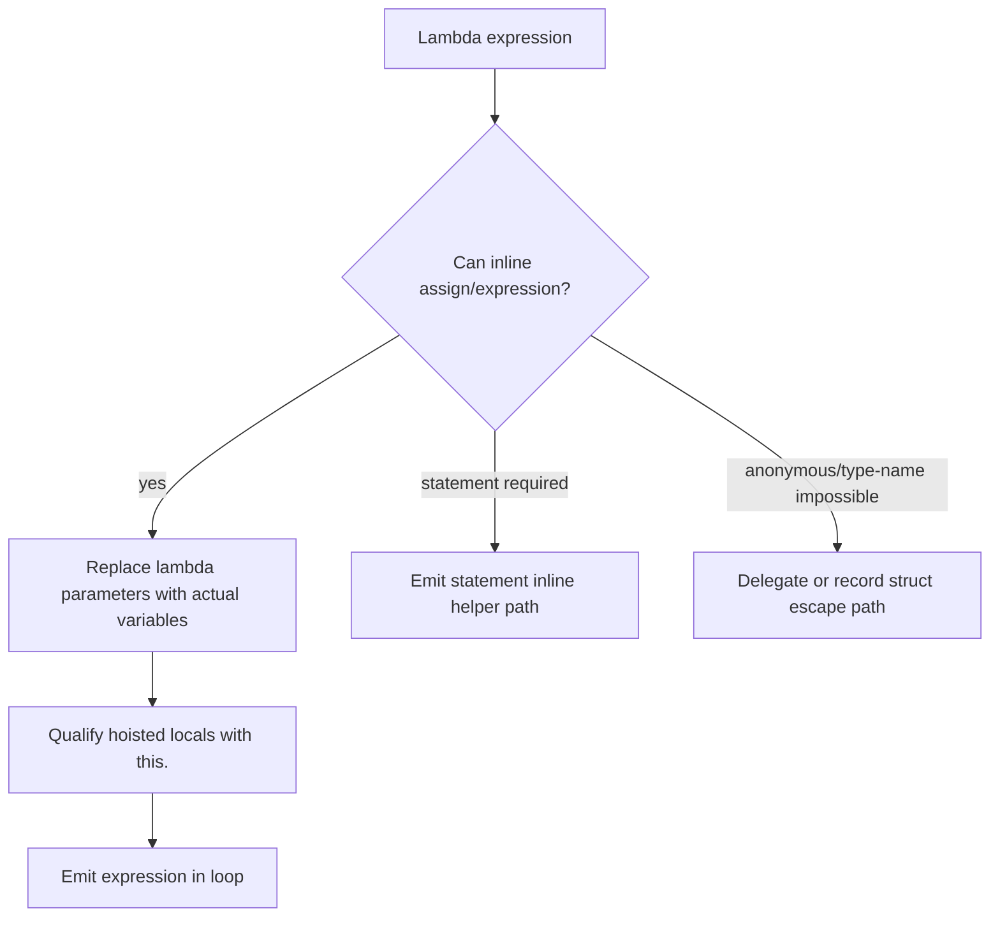

### 引数置換

| lambda | 実引数 | 生成式 |
| --- | --- | --- |
| `x => x+1` | `item0` | `item0+1` |
| `(x,i) => x*i` | `item0`, `index0` | `item0*index0` |
| `x => x+offset` | `item0` | `item0+this.offset` |

式埋め込み時の要点は以下。

- `FuncInvoke` / `FuncAssign` は `RenderInlineExpression` / `RenderInlineAssign` を使う。
- helper method 呼び出しや `Func<T>.Invoke` より、元 lambda body を通常式として JIT に見せる。
- 複雑な実引数は多重評価を避けるため一時変数へ退避する。
- `ContainsAnchor` は inline 後の text に `.Anchor` が残る場合も検出する。

### inline 展開と delegate 呼び出しの分岐

lambda は `FuncFragment` として保持し、生成時に次の優先順位で展開する。

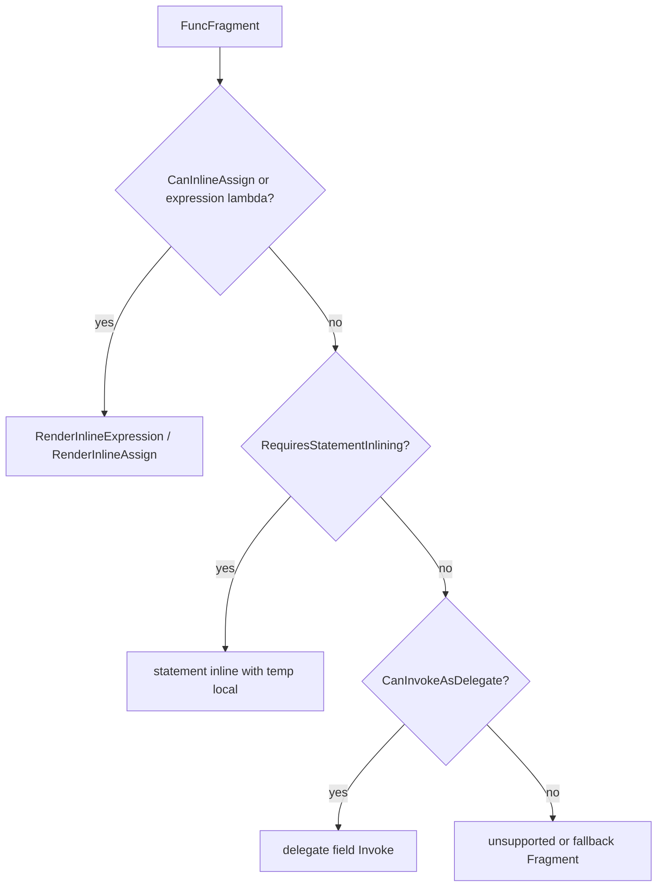

式 lambda の場合、元 lambda body の parameter 参照を生成 loop の実変数へ置換する。

```csharp
// 入力
source.Where(x => x > threshold).Select(x => x * 2)

// 生成 loop 内の概念形
while(sourceEnumerator.TryGetNext(out var item0)) {
    if(!(item0 > this.threshold)) {
        continue;
    }

    var current = item0 * 2;
    yield return current;
}
```

index 付き lambda は、生成 enumerator が持つ index 変数を実引数として直接埋め込む。

```csharp
// 入力
source.Where((x,i) => x > i).Select((x,i) => x + i)

// 生成 loop 内の概念形
while(sourceEnumerator.TryGetNext(out var item0)) {
    var index0 = this.index++;
    if(!(item0 > index0)) {
        continue;
    }

    var current = item0 + index0;
    yield return current;
}
```

直接式にできない lambda、匿名 delegate、式の型を安全に復元できない場合、または delegate として保持する必要がある場合は、Enumerator の field に delegate を持ち `Invoke` する。

```csharp
// 入力
Func<int,bool> predicate = x => x > threshold;
source.Where(predicate)

// delegate fallback の概念形
private readonly global::System.Func<int,bool> predicate0;

public bool TryGetNext(out int current) {
    while(this.source.TryGetNext(out var item0)) {
        if(!this.predicate0.Invoke(item0)) {
            continue;
        }

        current = item0;
        return true;
    }

    current = default;
    return false;
}
```

delegate fallback は正しさ優先の経路であり、最適化の成功条件ではない。可能な場合は `FuncAssign` / `FuncInvokeCondition` が `RenderInlineAssign` / `RenderInlineExpression` を使い、`Func<T>.Invoke` を生成しない。

## capture 変数を Enumerator 引数へ入れる仕様

Enumerator struct 内では元メソッドの local を直接参照できない。capture された値は Enumerator constructor の引数として渡し、field として保持する。

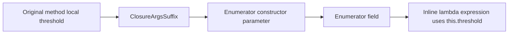

概念形は以下。

```csharp
var threshold=3;
return source.Where(v => v<threshold).ToList();
```

生成側では以下のようになる。

```csharp
new WhereEnumerator<TEnum>(source.GetEnumerator(),threshold);

private struct WhereEnumerator<TEnum> {
    private readonly int threshold;

    public bool TryGetNext(out int current) {
        while(this.e.TryGetNext(out var item)) {
            if(item<this.threshold) {
                current=item;
                return true;
            }
        }

        current=default;
        return false;
    }
}
```

## Hoist 仕様

Hoist は、lambda body のうち source 要素に依存しない部分式を Enumerator construction 時に評価し、`HoistedLocal` として持つ最適化である。

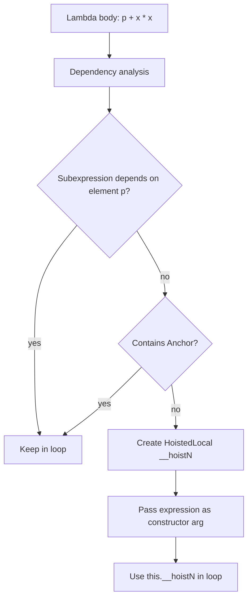

### 評価タイミング

Hoist した式は、source が空であっても Enumerator construction 時に評価され得る。これは意図した最適化仕様であり、既存テストでも `EmptySourceMutatingPartialInvariantOptimized` が 1 回評価されることを確認している。

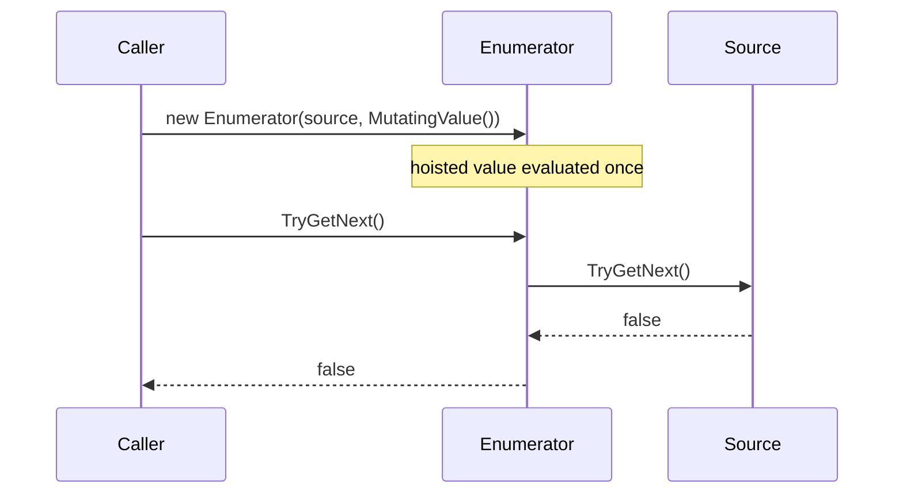

### Anchor で Hoist 禁止

`.Anchor` を含む式は identity として生成コード上では消せるが、評価回数・評価順変更を禁止する境界になる。

```mermaid
flowchart LR
    A[p + MutatingValue()] --> B[Hoist allowed]
    B --> C[MutatingValue evaluated once at construction]
    D[p + MutatingValue().Anchor] --> E[Hoist blocked]
    E --> F[MutatingValue evaluated only when element reaches lambda]
```

## Anchor policy

Anchor は「最適化全停止」ではなく「評価回数・評価順を変え得る変換の局所禁止」である。

| 変換 | Anchor なし | Anchor あり |
| --- | --- | --- |
| lambda inline | 可能 | 可能な範囲で継続 |
| `Where.Select` streaming | 可能 | 継続 |
| hoist | 可能 | 対象式は禁止 |
| `Where` merge/reorder | 可能 | 該当 stage を跨がない |
| `Distinct` / `DistinctBy` 冪等削減 | 可能 | 該当 stage は削減しない |
| `Take` / `Skip` merge | 可能 | 該当 stage は merge しない |
| `Reverse.Reverse` cancel | 可能 | Anchor 付き stage を cancel しない仕様へ寄せる |
| `OrderBy` direct consume | 可能 | 評価順変更を伴う場合は禁止 |

現在の `PipelineStage.ContainsAnchor` は、stage の `FuncFragment`、second/third func、value text から Anchor を集約する。

## 匿名型を record struct に変換する仕様

匿名型は生成コード上で型名を書けない。また通常の匿名型は class であり、中間 carrier として大量に作ると GC pressure が増える。内部最適化では匿名型 shape を `record struct` holder へ登録し、名指し可能な value type に変換する。

```mermaid
flowchart TD
    A[new { O=o.Id, I=i.Id }] --> B[AnonymousStructRecordRegistry]
    B --> C{Shape key: O|I exists?}
    C -->|no| D[Define record struct __Anon2_O_I<T0,T1>]
    C -->|yes| E[Reuse existing shape]
    D --> F[Render factory __New2_O_I(o.Id,i.Id)]
    E --> F
    F --> G[Pipeline/Fragment uses named struct type]
    G --> H{Escapes as anonymous result?}
    H -->|yes| I[Reconstruct new { O=rec.O, I=rec.I }]
    H -->|no| J[Keep record struct internally]
```

### 生成 holder の概念形

```csharp
internal static class __TsavoriteAnonRecords_FileToken {
    internal readonly record struct __Anon2_O_I<T0,T1>(T0 O,T1 I);

    internal static __Anon2_O_I<T0,T1> __New2_O_I<T0,T1>(T0 O,T1 I) =>
        new __Anon2_O_I<T0,T1>(O,I);
}
```

### GC 防止の扱い

内部 chain の carrier として record struct を使う場合、匿名 class instance の allocation を避けられる。最終的に public API として匿名型を返す必要がある出口では、元の匿名型へ再構成する。

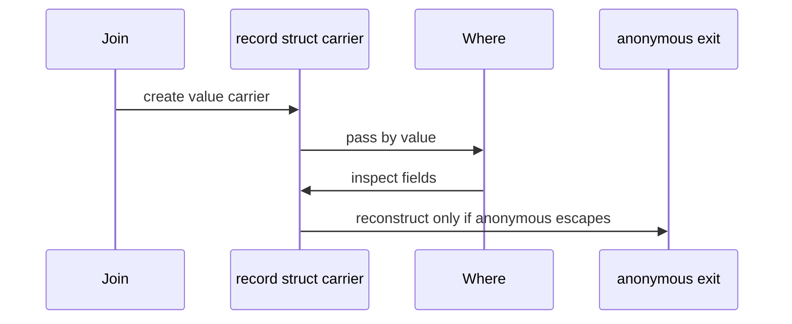

## Pipeline stage 正規化仕様

`NormalizeStages` は生成前に stage list を縮約する。

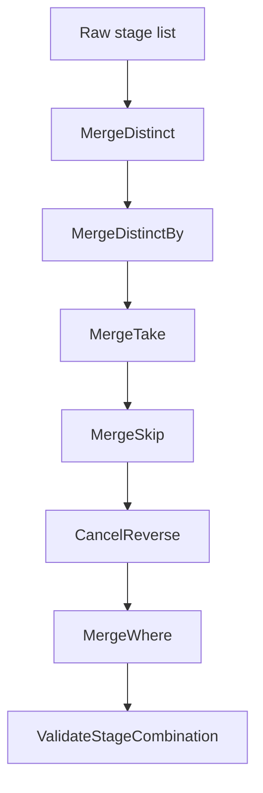

| 正規化 | 仕様 | Anchor |
| --- | --- | --- |
| `Distinct().Distinct()` | 同一 comparer なら 1 段へ削減 | Anchor 付きは削減しない |
| `DistinctBy(k).DistinctBy(k)` | keySelector/comparer/key type が同一なら 1 段へ削減 | Anchor 付きは削減しない |
| `Take(a).Take(b)` | `Take(Min(Max(0,a),Max(0,b)))` | Anchor 付きは merge しない |
| `Skip(a).Skip(b)` | `Skip(Max(0,a)+Max(0,b))` | Anchor 付きは merge しない |
| `Reverse().Reverse()` | cancel | Anchor 付き stage を考慮する仕様へ寄せる |
| `Where(a).Where(b)` | `Where(x => a(x)&&b(x))` | merged func に Anchor を伝播 |

## Pipeline stage 分類

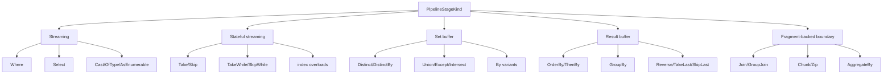

| stage | buffer | loop 方針 |
| --- | --- | --- |
| `Where`, `Select`, `Cast`, `OfType` | なし | 通常 streaming loop へ inline |
| index 付き `Where`/`Select` | int state | stateful streaming |
| `Skip`, `Take` | int state | counter branch |
| `SkipWhile`, `TakeWhile` | bool/int state | predicate branch |
| `Distinct`, `DistinctBy` | `HashSetSlim<TKey>` | set gate |
| `Union`, `Except`, `Intersect` 系 | second source + set | `BuildBinarySetLoop` |
| `OrderBy`, `ThenBy` | pooled values/index/key | `BuildOrderLoop` |
| `GroupBy` | dictionary/list | `BuildGroupByLoop` |
| `SelectMany` | inner enumerator or array index | `BuildSelectManyLoop` |
| `Reverse`, `TakeLast`, `TakeRange` | list/queue | dedicated buffering loop |
| `Join`, `GroupJoin` | lookup | Fragment-backed stage |

## Fragment-backed boundary 仕様

`Chunk`, `Zip`, `AggregateBy`, `Join`, `GroupJoin` は現在 Pipeline 内 stage ではなく Fragment-backed boundary として扱う。既に積まれた Pipeline stage があれば一度 `PipelineEnumerable` として flush し、その出力を次 Fragment の source にする。

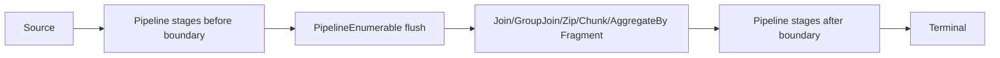

この仕様により、演算子ごとの複雑な状態機械は Fragment 側に閉じ込めつつ、前後の `Where.Select` などは Pipeline へ融合できる。

## Terminal fusion 仕様

Pipeline の終端が `ToList`, `ToArray`, `Count`, `Any`, `First`, `ToDictionary`, `Sum` の場合、`PipelineTerminal` が direct execution または scalar enumerator を生成する。

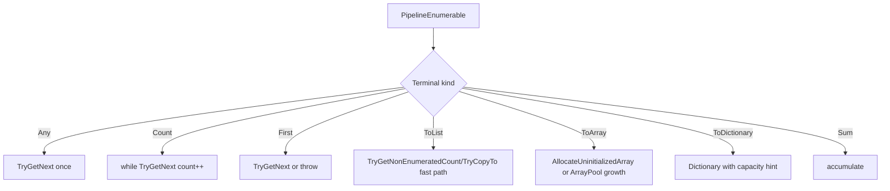

## BinarySet -> Order fusion 仕様

`Union/Except/Intersect` 系の後に `OrderBy/ThenBy` が続く場合、採用された値だけを Order の value buffer に積み、集合演算の結果 list と Order list を二重に作らない。

```mermaid
flowchart LR
    L[left source] --> G[Set gate]
    R[right source] --> G
    G -->|accepted| V[Order value array]
    V --> K1[primary key array]
    V --> K2[then key array]
    K1 --> S[index sort]
    K2 --> S
    S --> O[ordered yield]
```

制限は以下。

- BinarySet stage は 1 つまで。
- BinarySet と primary Order の間は streaming/set gate として処理できる stage に限る。
- equality comparer と order comparer/key は別物なので、sort 後 unique への置換は行わない。

## Range 特化仕様

`Range` root では一部 stage を source 自体へ畳む。

```mermaid
flowchart TD
    A[Enumerable.Range] --> B{Stage}
    B -->|identity Order| C[Range or DescendingRangeRoot]
    B -->|Distinct identity| D[no-op]
    B -->|Union same/trailing range| E[no-op]
    B -->|Except range| F[RangeExceptRoot]
    B -->|Intersect range| G[Range intersection]
    B -->|unsupported| H[normal Pipeline]
```

## SelectMany 仕様

`SelectMany` は Pipeline stage として扱える場合、outer item と inner enumerator/array index を持つ状態機械にする。collection selector が outer item に依存しない場合、かつ Anchor がない場合は hoist 可能である。

```mermaid
stateDiagram-v2
    [*] --> PullOuter
    PullOuter --> End: no outer
    PullOuter --> CreateInner: outer item read
    CreateInner --> PullInner
    PullInner --> Yield: inner item read
    PullInner --> PullOuter: inner exhausted
    Yield --> PullInner: next TryGetNext
    End --> [*]
```

配列を返す collection selector は `IEnumerator<T>` を介さず、array + index で走査する。

## InlinedScalarFunc 仕様

lambda 内に scalar LINQ がある場合、`InlinedScalarFunc` として再帰的に Fragment 化し、lambda の一部として statement inline する。

```mermaid
flowchart TD
    A[x => x + inner.Count()] --> B[Detect scalar LINQ inside lambda]
    B --> C[Build scalar Fragment]
    C --> D[Emit supporting member source]
    D --> E[Inline computed scalar into outer lambda]
```

## 未実装仕様の表示

<div style="border-left:4px solid #d97706;padding:10px 14px;background:#fffbeb;color:#3f3f46;">
<strong>未実装仕様:</strong> 追加候補セクションは、本文・表・コード・Mermaid 図を含む範囲全体に薄い網目背景を付ける。これは現行実装の保証ではなく、将来候補であることを示す。
</div>

以降の `## 追加候補:` セクションは、未実装または将来拡張として扱い、各セクションを `details open` の背景付き枠で囲む。

## 追加候補: Enumerator ネスト除去

<details open style="border-left:4px solid #d97706;padding:10px 14px;background:repeating-linear-gradient(135deg,#fffdf7 0,#fffdf7 12px,#fff7ed 12px,#fff7ed 24px);color:#3f3f46;">
<summary><strong>未実装仕様:</strong> この枠内の本文・表・コード・Mermaid 図全体は実装候補であり、現行実装の保証ではない。</summary>

`Select.Select` のような式合成そのものは、この仕様の最適化対象から外す。既に単一 Pipeline loop に載っている場合、`var temp = f(x); current = g(temp);` を `current = g(f(x));` に畳み込んでも、JIT が吸収できる範囲に収まりやすい。

この追加候補の主対象は、生成コード上で Enumerator が入れ子になり、外側 Enumerator の `TryGetNext` / `TryMoveValue` 内部から内側 Enumerator の `TryGetNext` / `TryMoveValue` を毎要素呼ぶ形を、単一 state machine または単一 Pipeline loop へ展開することである。

```mermaid
flowchart TD
    A[Generated chain] --> B{Nested Enumerator call remains?}
    B -->|no| C[Do not optimize further]
    B -->|yes| D{Streaming and single source?}
    D -->|yes| E[Flatten into one Pipeline loop]
    D -->|no| F{Specialized state machine possible?}
    F -->|yes| G[Inline child state machine into parent]
    F -->|no| H[Keep Fragment boundary]
```

判定は LINQ メソッド名ではなく、生成後の構造で行う。ただし `Select.Select` 専用の最適化は持たない。`Select.Select` は現状の Pipeline 正規化で単一 loop になる前提とし、式合成も専用 flatten も仕様対象外にする。将来、別経路で任意の generated Enumerator に nested call が残ることを検出した場合だけ、汎用 Enumerator flatten の入力として扱う。

### 現状の chain 展開と Enumerator flatten 仕様

現状は、連続する streaming operator を `PipelineEnumerable` の stage list として保持できる場合、1 つの `TryGetNext` loop 内で stage を順に評価する。この場合、runtime の enumerable/enumerator chain は既に融合済みなので、`Select.Select` や `Where.Where` を 1 つの `FuncFragment` へ代数的に合成することは仕様から外す。

```mermaid
flowchart LR
    A[Source Fragment] --> B[Pipeline stage: Where p1]
    B --> C[Pipeline stage: Where p2]
    C --> D[Pipeline stage: Select s1]
    D --> E[Pipeline stage: Select s2]
    E --> F[one generated TryGetNext state machine]
```

単一 Pipeline loop に正規化済みの `Select.Select` は、以下の現状概念形で十分とする。

```csharp
// 入力
source.Select(x => x + 1).Select(y => y * 2)

// 現状の概念形: 1 loop 内で stage を順に評価する
while(sourceEnumerator.TryGetNext(out var item0)) {
    var temp1 = item0 + 1;
    var current = temp1 * 2;
    yield return current;
}
```

この形をさらに `current = (item0 + 1) * 2;` へ式合成することは、v1 の仕様対象外にする。
`Select.Select` 由来の nested Enumerator 展開例は、この仕様から除外する。もし生成後検査で Select 由来の nested call が残る場合でも、それは `Select.Select` 固有の合成仕様ではなく、汎用の「nested Enumerator call が残っている」という診断として扱う。

`Where.Where` も、Pipeline loop に載っている場合は predicate 合成ではなく、単一 loop 維持を保証する。

```csharp
// 入力
source.Where(x => x > 0).Where(x => x % 2 == 0)

// 現状の概念形: 1 loop 内で predicate を順に評価
while(sourceEnumerator.TryGetNext(out var item0)) {
    if(!(item0 > 0)) {
        continue;
    }
    if(!(item0 % 2 == 0)) {
        continue;
    }

    yield return item0;
}
```

`Where.Where` が nested Enumerator として生成される場合は、内側の skip loop を外側に展開する。

```csharp
// 避けたい生成形
public bool TryGetNext(out int current) {
    while(this.innerWhere.TryGetNext(out var item0)) {
        if(!(item0 % 2 == 0)) {
            continue;
        }

        current = item0;
        return true;
    }

    current = default;
    return false;
}

// 望ましい生成形
public bool TryGetNext(out int current) {
    while(this.root.TryGetNext(out var item0)) {
        if(!(item0 > 0)) {
            continue;
        }
        if(!(item0 % 2 == 0)) {
            continue;
        }

        current = item0;
        return true;
    }

    current = default;
    return false;
}
```

現状実装では、`NormalizeStages` が連続 `Where` の一部を選択率ヒントに基づいて並べ替える可能性がある。`Anchor` を含む predicate は、評価順序・評価回数の変更を避けるため、flatten、複製、並べ替えの対象外にする。

`Where.Select.Select` の現状概念形:

```csharp
// 入力
source.Where(x => x.Active).Select(x => x.Price).Select(price => price * rate)

// 現状の概念形
while(sourceEnumerator.TryGetNext(out var item0)) {
    if(!item0.Active) {
        continue;
    }

    var temp1 = item0.Price;
    var current = temp1 * this.rate;
    yield return current;
}
```

追加候補では、`Select` 連鎖の式合成ではなく、この形が nested Enumerator を経由せず単一 loop として生成されることを完了条件にする。

### Enumerator ネストになりうる組み合わせ

以下は nested Enumerator が残ると、毎要素ごとに `TryGetNext` / `TryMoveValue` 呼び出し階層が増える可能性がある。可能な限り Pipeline stage 化、または親 Fragment への child state machine inline により展開する。`Select.Select` は式合成に議論が寄りやすいため、この対象表には含めない。

| chain shape | nested になりうる理由 | 対策 |
| --- | --- | --- |
| `Where.Where` | 外側 Where が内側 Where Enumerator を引く | predicate を順に評価する単一 skip loop へ展開 |
| `Where.Select`, `Select.Where` | filter/projection の前後で Enumerator が階層化する | stage list に正規化し、root pull + stage evaluation にする |
| `Take/Skip/TakeWhile/SkipWhile` と `Where/Select` | count/index/state を持つ streaming stage が wrapper 化する | index/count state を同一 Enumerator field として持つ |
| `Cast/OfType` と `Where/Select` | type filter/projection が別 Enumerator になる | type check と projection を同一 loop に置く |
| `Append/Prepend/DefaultIfEmpty` と streaming stage | source 前後に state transition が入り wrapper 化する | state enum を親 Pipeline に統合する |
| `Reverse/OrderBy/GroupBy` 後の streaming stage | buffering stage 後の result enumerator をさらに包む | buffer build loop と result projection/filter loop を同一 Fragment に持つ |
| `Join/GroupJoin` 後の `Where/Select/GroupBy` | lookup Fragment の出力を後段 Enumerator が包む | result selector/filter/grouping を Join Fragment 側へ吸収できる場合は吸収 |
| `SelectMany` 後の `Where/Select` | outer/inner の二層 state machine を後段が包む | outer/inner state machine 内に後段 stage を入れる |
| lambda 内 scalar LINQ | outer loop 内で別 Enumerator を毎回構築する | scalar Fragment を `InlinedScalarFunc` として statement inline する |

```mermaid
flowchart TD
    A[Candidate chain] --> B{All stages streaming?}
    B -->|yes| C[Normalize to Pipeline stages]
    C --> D[Emit one root-pull TryGetNext loop]
    B -->|no| E{Boundary stage can absorb following stages?}
    E -->|yes| F[Inline child stages into Fragment state machine]
    E -->|no| G[Keep boundary and avoid unsafe rewrite]
    F --> H{Contains Anchor?}
    H -->|yes| G
    H -->|no| I[Flatten nested Enumerator calls]
```

### Fragment boundary での展開方針

すべてを Pipeline stage にできない場合でも、Fragment boundary の前後で nested Enumerator を作らない余地がある。

- `Join.Where` は、片側依存 predicate なら outer/inner source 側へ葉移動する。両側依存は連言へ分解し、片側依存の連言だけ葉へ移す。分解できない連言だけ Join の probe 後に残す。
- `Join.Select` は、result selector と後段 selector が安全に連結できる場合だけ Join の `resultSelector` に吸収する。ただし単なる `Select.Select` 式合成を目的にしない。
- `Join.GroupBy` は、Join の lookup/probe は Fragment boundary として残し、GroupBy の buffer build を後段 Enumerator wrapper にしない。
- `SelectMany.Where` は、predicate が inner item だけに依存するなら inner collection 側へ移動できる。outer と inner の両方に依存する場合は inner pull 後の yield 直前で評価する。
- `OrderBy.Select` / `GroupBy.Select` は、buffering 後の result materialization loop に selector を入れ、別 Enumerator wrapper を作らない。
- `TakeWhile.Where` など短絡 state を持つ stage は、停止条件と filter 条件を同一 loop 内で順序通り評価する。

`Join.GroupBy` のように Fragment-backed stage を含む chain は、現状では boundary で一度 Pipeline を flush し、次の Fragment または buffering stage へ渡す。

```mermaid
flowchart LR
    A[outer.Where/Select Pipeline] --> B[flush as PipelineEnumerable]
    B --> C[Join Fragment builds lookup]
    C --> D[GroupBy stage buffers joined rows]
    D --> E[result selector / terminal]
```

`Join.GroupBy` の現状概念形:

```csharp
// 入力
outer
    .Where(o => o.Enabled)
    .Join(inner, o => o.Id, i => i.OwnerId, (o,i) => new { o, i })
    .GroupBy(x => x.o.Category, x => x.i.Value)

// 現状の概念形
var innerLookup = BuildLookup(innerEnumerator, i => i.OwnerId);
foreach(var o in outer) {
    if(!o.Enabled) {
        continue;
    }

    var outerKey = o.Id;
    if(!innerLookup.TryGetValue(outerKey, out var group)) {
        continue;
    }

    foreach(var i in group) {
        var joined = new JoinedRecord(o, i);
        var groupKey = joined.o.Category;
        var groupElement = joined.i.Value;
        groupByDictionary[groupKey].Add(groupElement);
    }
}
```

追加候補では、`Join` の result carrier が匿名型である場合は record struct carrier に置換しつつ、`GroupBy` の `keySelector` / `elementSelector` が片側のみへ分解できるなら carrier 生成前へ部分的に押し込む余地がある。ただし v1 では `Join` 自体は lookup を持つ Fragment boundary として残し、`GroupBy` は buffering stage として扱う。

</details>

## 追加候補: Where pushdown catalog

<details open style="border-left:4px solid #d97706;padding:10px 14px;background:repeating-linear-gradient(135deg,#fffdf7 0,#fffdf7 12px,#fff7ed 12px,#fff7ed 24px);color:#3f3f46;">
<summary><strong>未実装仕様:</strong> この枠内の本文・表・コード・Mermaid 図全体は実装候補であり、現行実装の保証ではない。</summary>

`Join.Where` 以外も、carrier shape と依存パラメータを解析できる場合は葉へ押し下げできる。

```mermaid
flowchart TD
    A[Where after operator] --> B{Operator}
    B -->|Select| C[Predicate lift through selector]
    B -->|SelectMany| D[Push to outer or collection selector]
    B -->|Join/LeftJoin| E[Push to outer or inner]
    B -->|Distinct/Order/Reverse| F[Push before unary source]
    B -->|Concat/Union| G[Duplicate to both sources]
    B -->|Unknown or both-side unsafe| H[Keep position]
```

候補仕様:

| operator | pushdown |
| --- | --- |
| `Select` | selector の carrier を展開して source predicate へ戻す |
| `SelectMany` | outer 依存なら outer source、inner 依存なら collection selector 内へ移動 |
| `Join` / `LeftJoin` | outer/inner 片側依存なら葉へ移動。両側依存は連言分割して部分押し下げ。`LeftJoin` は outer 側のみ |
| `Distinct`, `Reverse` | predicate が要素値だけを使うなら source 前へ移動 |
| `OrderBy` | source がスパンを出せる先頭 Order のときはソート済みスパン高速パスを守るため移動しない |
| `Concat`, `Union` | predicate を左右両 source へ複製(**実装済み**。詳細は「集合演算への `Where` 分配仕様」節) |
| `Except`, `Intersect` | first source 側にだけ安全に移動(**実装済み**。`ExceptBy`/`IntersectBy`/`UnionBy` は代表選択の不健全性のため対象外) |

Anchor を含む predicate は複製・順序変更を避ける。

</details>

## 追加候補: Fragment と Pipeline の責務分界

<details open style="border-left:4px solid #d97706;padding:10px 14px;background:repeating-linear-gradient(135deg,#fffdf7 0,#fffdf7 12px,#fff7ed 12px,#fff7ed 24px);color:#3f3f46;">
<summary><strong>未実装仕様:</strong> この枠内の本文・表・コード・Mermaid 図全体は実装候補であり、現行実装の保証ではない。</summary>

```mermaid
flowchart TD
    A[New LINQ operator] --> B{Can be expressed as per-element streaming?}
    B -->|yes| C[PipelineStageKind]
    B -->|no| D{Needs one specialized state machine?}
    D -->|yes| E[Fragment]
    D -->|needs terminal direct execution| F[PipelineTerminal or DirectExecutionFragment]
    D -->|provider-specific scan| G[Provider-specific Fragment]
```

分類ルール:

- 1 要素入力、0/1 要素出力、全件バッファなしなら Pipeline stage。
- 複数 source、lookup、grouping、複雑な inner state を持つなら Fragment。
- terminal で閉じることでだけ高速化できるなら Terminal fusion。
- Tsavorite/Persisted の storage scan など provider 固有 API を使うなら provider-specific Fragment。

</details>

## 追加候補: Provider-specific scan pipeline

<details open style="border-left:4px solid #d97706;padding:10px 14px;background:repeating-linear-gradient(135deg,#fffdf7 0,#fffdf7 12px,#fff7ed 12px,#fff7ed 24px);color:#3f3f46;">
<summary><strong>未実装仕様:</strong> この枠内の本文・表・コード・Mermaid 図全体は実装候補であり、現行実装の保証ではない。</summary>

Tsavorite/Persisted root は通常 `IEnumerable<T>` enumerator より storage scan へ近い場所で terminal fusion できる。

```mermaid
flowchart TD
    A[Root source] --> B{Provider/root type}
    B -->|System IEnumerable| C[PipelineEnumerable]
    B -->|Tsavorite HashSet concrete| D[Tsavorite scan terminal]
    B -->|Persisted Set concrete| E[Persisted scan terminal]
    B -->|abstract set interface| F[Generic Root path]
    D --> G[Where/Select/terminal fused into scan body]
    E --> G
```

初期対象:

- `Where` / `Select` / scalar terminal を scan body へ入れる。
- sequence-returning query は generic Pipeline/Fragment path に任せる。
- 未対応 storage operation は fallback で隠さず、未対応として検出可能にする。

</details>

## 追加候補: ループ内部相関サブクエリの Lookup 化

<details open style="border-left:4px solid #d97706;padding:10px 14px;background:repeating-linear-gradient(135deg,#fffdf7 0,#fffdf7 12px,#fff7ed 12px,#fff7ed 24px);color:#3f3f46;">
<summary><strong>未実装仕様:</strong> この枠内の本文・表・コード・Mermaid 図全体は実装候補であり、現行実装の保証ではない。</summary>

この最適化は未実装だが、既存 `JoinBase.BuildLookup` と同じ `Dictionary<TKey,List<TInner>>` 構築思想で実現可能である。対象は `Select` に限定せず、生成コード上の反復 loop 内で繰り返し評価される lambda の内部に出現する、outer 値へ相関した `Where` である。

既定は積極最適化とする。inner source の先行評価と 1 回評価を許容し、禁止したい場合は `.Anchor` を使う。

### 対象コンテキスト

```mermaid
flowchart TD
    A[Lambda body contains correlated Where] --> B{Lambda is evaluated inside generated loop?}
    B -->|yes| C{Contains Anchor?}
    B -->|no| D[Do not lookup-optimize]
    C -->|yes| D
    C -->|no| E{Equality-correlated pattern?}
    E -->|yes| F[Build lookup outside repeated lambda]
    E -->|no| D
```

対象になる lambda は LINQ メソッド名ではなく、生成コード上で反復 loop 内にあるかで判断する。例:

| loop 内 lambda | 対象 |
| --- | --- |
| `Select` selector | 対象 |
| `Where` predicate | 対象 |
| `SelectMany` collection selector / result selector | 対象 |
| `Join` outerKeySelector / innerKeySelector / resultSelector | 対象 |
| `GroupBy` keySelector / elementSelector / resultSelector | 対象 |
| `OrderBy` keySelector | 対象 |
| `DistinctBy` keySelector | 対象 |
| `ToDictionary` keySelector / elementSelector | 対象 |
| `Aggregate(...,resultSelector)` の最終 result selector 単体 | 非対象 |

`Aggregate` 自体が別の outer loop 内 lambda に含まれる場合、その lambda 内部の相関サブクエリは lookup 化対象にする。

```mermaid
flowchart LR
    A[Aggregate resultSelector only] --> B[Called once after aggregate]
    B --> C[Do not lookup-optimize]
    D[Select outer lambda] --> E[Contains Aggregate]
    E --> F[Aggregate body contains correlated Where]
    F --> G[Lookup-optimize because outer lambda repeats]
```

### 検出パターン

v1 は equality-correlated `Where` に限定する。

```csharp
S1.Where(s1 => innerKey(s1)==outerKey(s0))
S1.Where(s1 => outerKey(s0)==innerKey(s1))
```

検出条件:

- `Where` は単一 predicate lambda である。
- predicate body は `==` の単一比較である。
- 片側は inner lambda parameter のみに依存する。
- もう片側は outer loop 変数または outer lambda parameter に依存する。
- inner source は lookup 構築時に 1 回列挙できる。
- `AnchorAnalysis.ContainsAnchor` が source、key、predicate に対して false である。

対象外:

- 複合条件 `innerKey(s1)==outerKey(s0)&&p(s1)`
- 範囲条件 `innerKey(s1)<outerKey(s0)`
- index 付き `Where`
- statement lambda
- overloaded `==` やユーザー定義 operator が絡む比較
- 副作用ありと明示された `.Anchor` 式
- outer と inner の両側へ同時に依存する key 式

```mermaid
flowchart TD
    A[Where predicate] --> B{Single equality?}
    B -->|no| X[Not eligible]
    B -->|yes| C{One side inner-only?}
    C -->|no| X
    C -->|yes| D{Other side outer-dependent?}
    D -->|no| X
    D -->|yes| E{No Anchor and no unsafe form?}
    E -->|no| X
    E -->|yes| F[Eligible correlated lookup]
```

### 変換形

`SelectMany` では一致 group を flatten する。

```csharp
S0.SelectMany(s0 => S1.Where(s1 => innerKey(s1)==outerKey(s0)))
```

概念的な生成形:

```csharp
var lookup=BuildLookup(S1,s1 => innerKey(s1));
foreach(var s0 in S0) {
    if(lookup.TryGetValue(outerKey(s0),out var group)) {
        foreach(var s1 in group) {
            yield return s1;
        }
    }
}
```

`Select` では outer 要素ごとに一致 group enumerable を返す。未一致 key は例外ではなく empty sequence を返す。

```csharp
S0.Select(s0 => S1.Where(s1 => innerKey(s1)==outerKey(s0)))
```

概念的な生成形:

```csharp
var lookup=BuildLookup(S1,s1 => innerKey(s1));
foreach(var s0 in S0) {
    yield return lookup.TryGetValue(outerKey(s0),out var group)
        ? group
        : global::System.Array.Empty<TInner>();
}
```

`Where(...Any())` では lookup probe の有無判定へ置換できる。

```csharp
S0.Where(s0 => S1.Where(s1 => innerKey(s1)==outerKey(s0)).Any())
```

概念的な生成形:

```csharp
var lookup=BuildLookup(S1,s1 => innerKey(s1));
foreach(var s0 in S0) {
    if(lookup.ContainsKey(outerKey(s0))) {
        yield return s0;
    }
}
```

```mermaid
flowchart TD
    A[Build lookup from S1 once] --> B[Enumerate S0]
    B --> C[Compute outer key]
    C --> D{lookup hit?}
    D -->|SelectMany| E[Yield each item in group]
    D -->|Select| F[Yield group enumerable]
    D -->|Where.Any| G[Yield outer item]
    D -->|miss for SelectMany/Where.Any| H[Yield nothing]
    D -->|miss for Select| I[Yield empty enumerable]
```

### 順序と評価回数

順序は次のとおり維持する。

- lookup group 内の順序は `S1` の列挙順。
- outer 側の順序は `S0` の列挙順。
- `SelectMany` は outer 順、同じ outer 内では inner group 順。

評価回数は最適化により変わる。`S1` は outer 要素ごとではなく、対象 Enumerator construction 側で 1 回だけ列挙される。これは hoist と同じ積極最適化方針に含める。

```mermaid
sequenceDiagram
    participant Caller
    participant Lookup as Lookup builder
    participant Outer as S0 enumerator
    participant Inner as S1 enumerator

    Caller->>Lookup: BuildLookup(S1)
    Lookup->>Inner: enumerate once
    Caller->>Outer: enumerate S0
    Outer-->>Caller: s0
    Caller->>Lookup: probe outerKey(s0)
    Lookup-->>Caller: group or empty
```

### Anchor で禁止する理由

lookup 化は、inner source と inner key selector の評価回数・評価時期を大きく変える。したがって `.Anchor` を含む場合は変換しない。

```mermaid
flowchart LR
    A[S1.Where innerKey == outerKey] --> B[No Anchor]
    B --> C[Lookup allowed]
    D[S1.Where innerKey.Anchor == outerKey] --> E[Anchor detected]
    E --> F[Keep correlated repeated evaluation]
```

### 実装方針

- 公開 API は追加しない。
- 生成コード内 helper または supporting member source として閉じる。
- 新規内部 Fragment/helper 候補は `CorrelatedLookupSelect`、`CorrelatedLookupSelectMany`、`CorrelatedLookupPredicate`、`CorrelatedLookupFunc` とする。
- `FuncFragment` の lambda body 解析と Fragment/Pipeline 生成にまたがる内部最適化として扱い、構文書換だけに閉じない。
- lookup は対象 lambda の外側、かつその lambda を反復評価する Enumerator construction 側で構築する。
- 複数 lambda が同じ inner source/key/comparer を使う場合の lookup 共有は将来候補とし、v1 では必須にしない。

```mermaid
flowchart TD
    A[FuncFragment lambda body] --> B[Find correlated Where]
    B --> C[Create CorrelatedLookup plan]
    C --> D[Emit lookup helper source]
    D --> E[Add lookup constructor argument or field]
    E --> F[Replace repeated Where with lookup probe]
```

### テスト観点

- `SelectMany` の一致あり、未一致、複数一致、順序保持。
- `Select` が outer 要素ごとに empty/group enumerable を返す。
- `Where(...Any())` が lookup probe に変換される。
- `Join` outerKeySelector/resultSelector、`GroupBy` keySelector、`OrderBy` keySelector 内の相関サブクエリ。
- `Aggregate(...,resultSelector)` 単体では lookup 化されない。
- `Select(x=>Aggregate(...相関サブクエリ...))` のように Aggregate が outer loop 内にある場合は lookup 化される。
- inner source が outer 件数回ではなく 1 回だけ評価される。
- `.Anchor` 付きでは lookup 化されず、元の相関評価回数に残る。

</details>

## 失敗時仕様

展開できない LINQ は静かに元実装へ戻さない。intercept 対象として選ばれた以上、未対応は生成コード上の failure stub として見える化する。

```mermaid
flowchart TD
    A[Intercept target] --> B{Can generate optimized body?}
    B -->|yes| C[Emit optimized code]
    B -->|no| D[Emit LinqInterceptorFailure]
    D --> E[Runtime failure with diagnostic reason]
```

## 完了条件

この仕様に基づく実装またはレビューでは、少なくとも以下を確認する。

- `Where.Select` が全件 materialize せず streaming loop になる。
- `Join.Where` は片側依存 predicate を葉へ移動し、両側依存は連言分割して片側依存の連言だけ葉へ移す。分解できない連言は維持する。
- lambda が直接式として生成コードへ現れる。
- capture 変数が Enumerator constructor/field 経由で参照される。
- hoist 値が Enumerator construction 時に 1 回評価される。
- `.Anchor` 付き hoist 対象は hoist されない。
- 匿名型中間 carrier が record struct registry へ置換される。
- Anchor を含む stage を跨いで merge/reorder/remove しない。
- buffering stage は stage 特性どおりの buffer を 1 系統だけ持ち、不要な二重 list を作らない。
- Fragment-backed boundary では Pipeline を flush し、責務を Fragment 側へ渡す。

