# FLinq Intercept 最適化コード生成 Pipeline/Fragment 仕様

## 目的

`LinqInterceptAttribute` による intercept 対象メソッド内の LINQ チェーンを、コンパイル時に Fragment または Pipeline IR へ変換し、delegate 呼び出し、中間 iterator、中間 GC allocation を抑えた生成コードへ落とす仕様を定義する。

この文書では特に以下を明示する。

- `Where.Select` は 1 要素ずつ流す streaming pipeline として扱う。
- `Join.Where` は安全に逆解析できる場合、`Where` を outer/inner の葉へ移動する。
- lambda は可能な限り delegate として保持せず、式として `TryGetNext` や direct execution loop に埋め込む。
- lambda の capture 変数は Enumerator の constructor 引数/field として渡す。
- loop invariant な部分式は hoist して Enumerator construction 時に 1 回評価する。
- `.Anchor` は評価回数・評価順を変え得る hoist/merge/reorder の禁止境界にする。
- 匿名型は内部表現で `record struct` 化し、名指し不能な匿名型と GC allocation を避ける。
- 既存実装から自然に拡張できる Pipeline/Fragment 仕様候補を整理する。

## 根拠

主な根拠ファイルは以下。

| 領域 | ファイル |
| --- | --- |
| intercept 入口と source generation | `Seamless.FLinq/SourceGenerator/interceptor.cs` |
| 代数的構文変換 | `Seamless.FLinq/SourceGenerator/AlgebraicRewriter.cs` |
| query lowering / Where 押し下げ | `Seamless.FLinq/SourceGenerator/OptimizeVisitor.cs` |
| Anchor 判定 | `Seamless.FLinq/SourceGenerator/AnchorAnalysis.cs` |
| 匿名型 record struct registry | `Seamless.FLinq/SourceGenerator/AnonymousStructRecord.cs` |
| Pipeline IR / stage fusion | `Seamless.FLinq/SourceGenerator/Linq/Fragments/Pipeline.cs` |
| lambda inline / capture / hoist | `Seamless.FLinq/SourceGenerator/Linq/Fragments/Func.cs`, `Fragment.cs`, `LambdaFunc.cs` |
| buffer 特性 | `Seamless.FLinq/SourceGenerator/Linq/Fragments/PipelineBufferingCharacteristics.md` |
| hoist / Anchor テスト | `Test/System/Linq/Intercept/Optimization/InvariantHoisting.cs` |
| Join / anonymous / hashing テスト | `Test/System/Linq/Intercept/Optimization/JoinHashing.cs` |

## 用語

| 用語 | 意味 |
| --- | --- |
| Intercept target | `LinqInterceptAttribute` で最適化対象になった元メソッド。 |
| Generated interceptor | 元メソッド呼び出しを差し替える生成メソッド。 |
| Fragment | 1 つの LINQ 演算子または特殊 root/terminal のコード生成単位。 |
| Pipeline IR | 複数 stage を `PipelineStage[]` として保持し、1 つの `PipelineEnumerable` enumerator へ統合する中間表現。 |
| FuncFragment | predicate/selector/keySelector/resultSelector など lambda の生成表現。 |
| Streaming stage | 入力を 1 要素受け取り、全件バッファなしで次段へ渡す stage。 |
| Buffering stage | `OrderBy`, `GroupBy`, `Reverse`, `TakeLast` など、結果または補助状態を蓄積する stage。 |
| HoistedLocal | lambda 内の要素非依存部分式を Enumerator construction 時に評価して保持する値。 |
| Anchor | `.Anchor` で評価回数・評価順変更を禁止する identity marker。 |

## 全体像

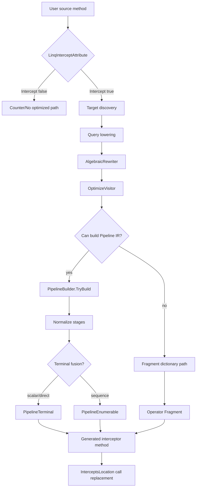

### 生成判断の基本原則

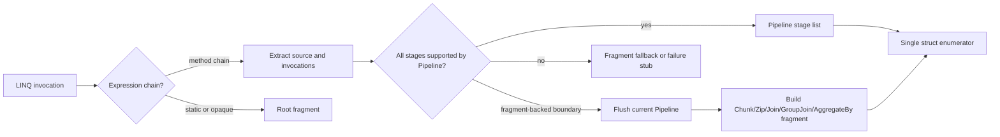

## 変換レイヤ

### 1. AlgebraicRewriter

`AlgebraicRewriter` は `System.Linq.Enumerable` の reduced extension call を対象に、構文上安全な代数変換を行う。

| 入力 | 出力 | 目的 |
| --- | --- | --- |
| `source.Where(p).Count()` | `source.Count(p)` | predicate terminal fusion |
| `source.Where(p).Any()` | `source.Any(p)` | predicate terminal fusion |
| `source.Where(p).First()` | `source.First(p)` | predicate terminal fusion |
| `source.Count()>0` | `source.Any()` | full count scan 回避 |
| `source.Count()==0` | `!source.Any()` | full count scan 回避 |
| `source.OrderBy(k).First()` | `source.MinBy(k)` | sort を scan へ変換 |
| `source.OrderByDescending(k).First()` | `source.MaxBy(k)` | sort を scan へ変換 |
| 中段 `Select(x=>x)` | 削除 | identity stage 削除 |
| 中段 `AsEnumerable()` | 削除 | redundant stage 削除 |
| 連続 `Where` | 選択性/コストで安定整列 | 早期 continue |

`Where` reorder は現在、Anchor を含まず、null-sensitive な member access を含まない predicate に限る。

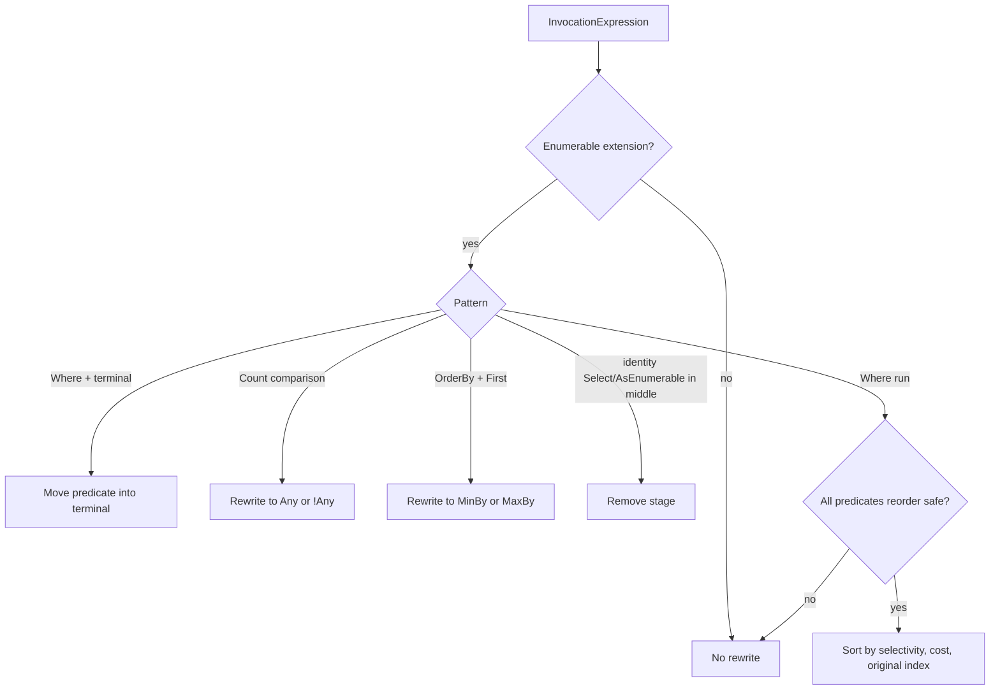

### 2. OptimizeVisitor

`OptimizeVisitor` は query syntax や anonymous carrier を、押し下げしやすい形へ変換する。

処理順は以下。

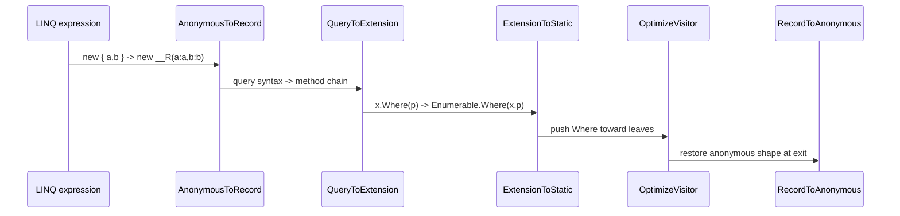

### 3. PipelineBuilder

`PipelineBuilder` は source と invocation list を取り出し、`PipelineStage` を積む。

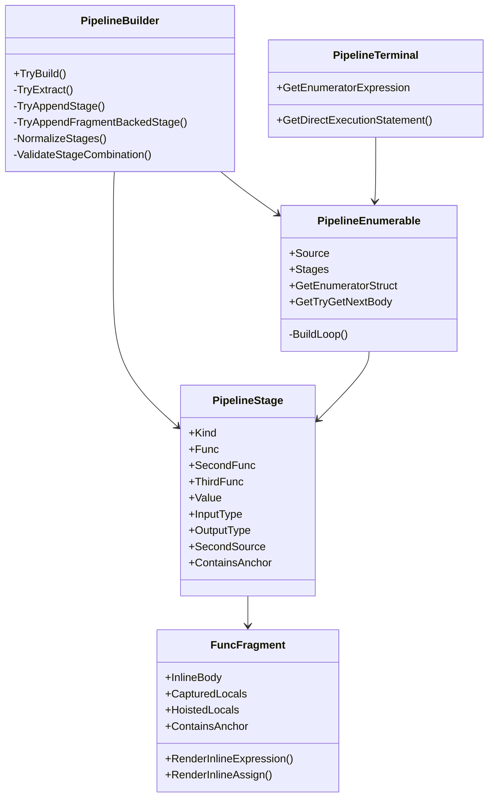

## `Where.Select` Streaming 仕様

`Where` と `Select` はどちらも全件バッファを持たない。`Where.Select` は source から 1 要素を取り、predicate が通れば selector を式として実行して 1 要素返す。

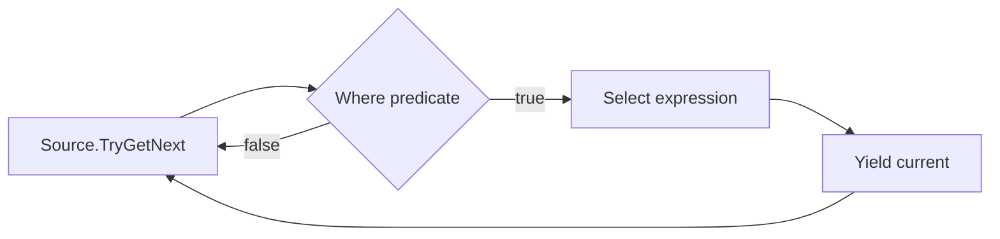

生成される loop の概念形は以下。

```csharp
while(source.TryGetNext(out var item0)) {
    if(!(item0>threshold)) {
        continue;
    }

    var item1=item0*scale;
    current=item1;
    return true;
}

current=default!;
return false;
```

`Where` と `Select` は `PipelineStageKind.Where` / `PipelineStageKind.Select` として保持され、通常 loop の中で順に `AppendStreamingStage` 相当の処理へ展開する。index 付き overload は `StateName(index)` を持つ stateful streaming として扱う。

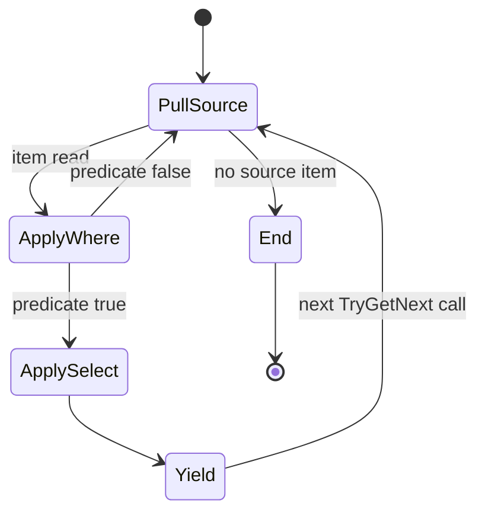

## `Join.Where` の `Where` 葉移動仕様

`Join(... resultSelector).Where(predicate)` は、`predicate` が `resultSelector` の carrier からどの入力へ依存しているかを解析し、片側だけに依存する場合に葉へ移動する。

### 依存分類

| predicate 依存 | 変換 |
| --- | --- |
| outer のみ | `outer.Where(pOuter).Join(inner,...)` |
| inner のみ | `outer.Join(inner.Where(pInner),...)` |
| outer と inner の両方 | 移動しない |
| carrier 逆解析不可 | 移動しない |
| Anchor を含む | 移動しない |

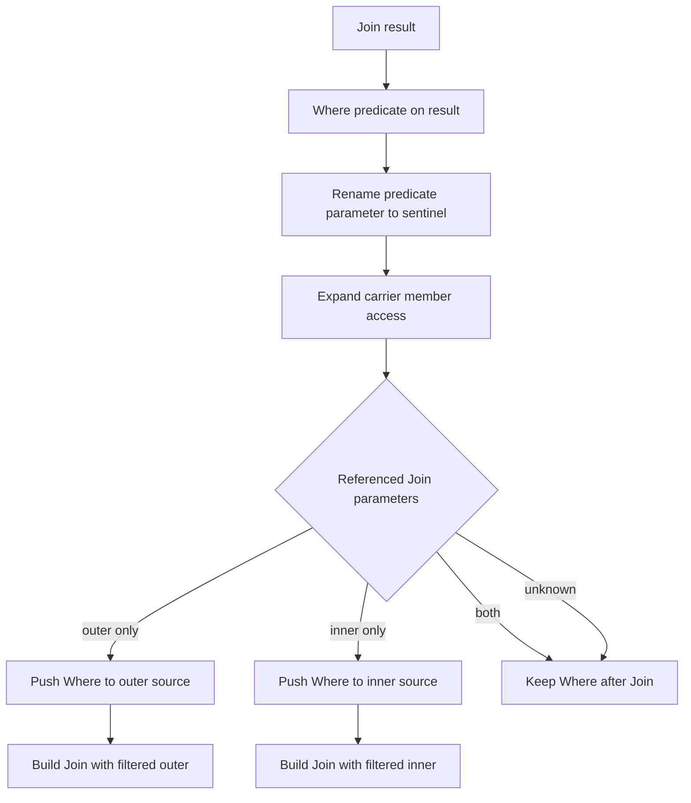

### 例

```csharp
outer.Join(inner,
    o => o.Key,
    i => i.Key,
    (o,i) => new { o,i })
    .Where(x => x.o.Enabled)
```

は概念的に以下へ変換できる。

```csharp
outer.Where(o => o.Enabled)
    .Join(inner,
        o => o.Key,
        i => i.Key,
        (o,i) => new { o,i })
```

一方で以下は両側依存なので、`Where` は Join 後に残す。

```csharp
.Where(x => x.o.Score>x.i.Score)
```

## lambda 直接式埋め込み仕様

`FuncFragment` は predicate/selector/keySelector/resultSelector を、可能な限り delegate field にせず、式または代入文として生成 loop に埋め込む。

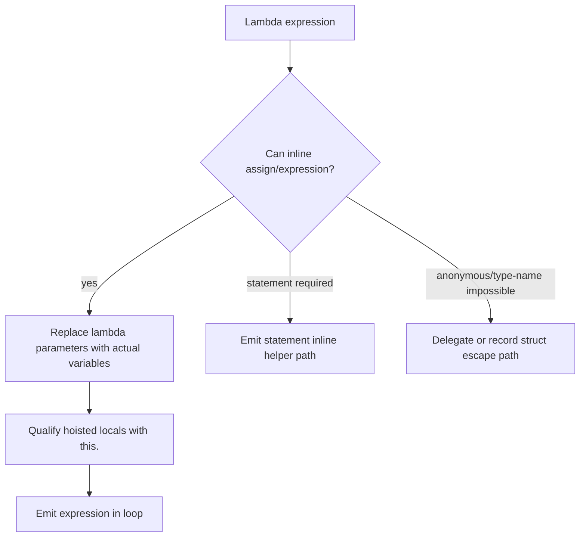

### 引数置換

| lambda | 実引数 | 生成式 |
| --- | --- | --- |
| `x => x+1` | `item0` | `item0+1` |
| `(x,i) => x*i` | `item0`, `index0` | `item0*index0` |
| `x => x+offset` | `item0` | `item0+this.offset` |

式埋め込み時の要点は以下。

- `FuncInvoke` / `FuncAssign` は `RenderInlineExpression` / `RenderInlineAssign` を使う。
- helper method 呼び出しや `Func<T>.Invoke` より、元 lambda body を通常式として JIT に見せる。
- 複雑な実引数は多重評価を避けるため一時変数へ退避する。
- `ContainsAnchor` は inline 後の text に `.Anchor` が残る場合も検出する。

## capture 変数を Enumerator 引数へ入れる仕様

Enumerator struct 内では元メソッドの local を直接参照できない。capture された値は Enumerator constructor の引数として渡し、field として保持する。

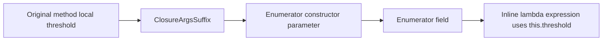

概念形は以下。

```csharp
var threshold=3;
return source.Where(v => v<threshold).ToList();
```

生成側では以下のようになる。

```csharp
new WhereEnumerator<TEnum>(source.GetEnumerator(),threshold);

private struct WhereEnumerator<TEnum> {
    private readonly int threshold;

    public bool TryGetNext(out int current) {
        while(this.e.TryGetNext(out var item)) {
            if(item<this.threshold) {
                current=item;
                return true;
            }
        }

        current=default;
        return false;
    }
}
```

## Hoist 仕様

Hoist は、lambda body のうち source 要素に依存しない部分式を Enumerator construction 時に評価し、`HoistedLocal` として持つ最適化である。

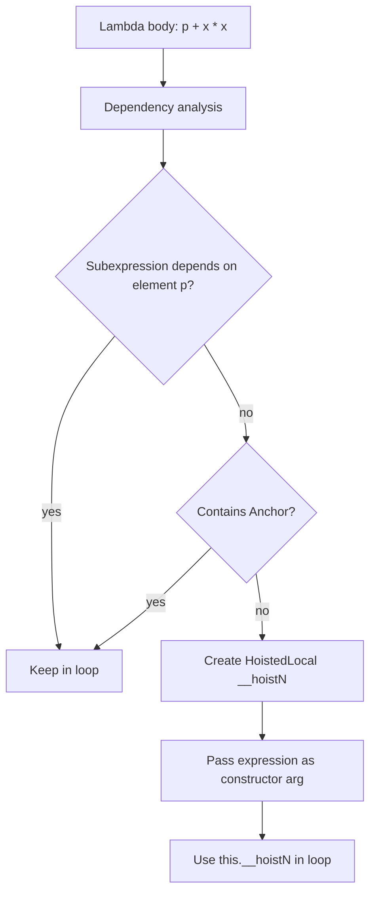

### 評価タイミング

Hoist した式は、source が空であっても Enumerator construction 時に評価され得る。これは意図した最適化仕様であり、既存テストでも `EmptySourceMutatingPartialInvariantOptimized` が 1 回評価されることを確認している。

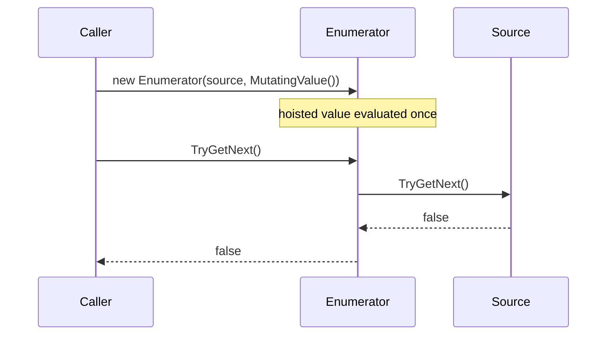

### Anchor で Hoist 禁止

`.Anchor` を含む式は identity として生成コード上では消せるが、評価回数・評価順変更を禁止する境界になる。

```mermaid
flowchart LR
    A[p + MutatingValue()] --> B[Hoist allowed]
    B --> C[MutatingValue evaluated once at construction]
    D[p + MutatingValue().Anchor] --> E[Hoist blocked]
    E --> F[MutatingValue evaluated only when element reaches lambda]
```

## Anchor policy

Anchor は「最適化全停止」ではなく「評価回数・評価順を変え得る変換の局所禁止」である。

| 変換 | Anchor なし | Anchor あり |
| --- | --- | --- |
| lambda inline | 可能 | 可能な範囲で継続 |
| `Where.Select` streaming | 可能 | 継続 |
| hoist | 可能 | 対象式は禁止 |
| `Where` merge/reorder | 可能 | 該当 stage を跨がない |
| `Distinct` / `DistinctBy` 冪等削減 | 可能 | 該当 stage は削減しない |
| `Take` / `Skip` merge | 可能 | 該当 stage は merge しない |
| `Reverse.Reverse` cancel | 可能 | Anchor 付き stage を cancel しない仕様へ寄せる |
| `OrderBy` direct consume | 可能 | 評価順変更を伴う場合は禁止 |

現在の `PipelineStage.ContainsAnchor` は、stage の `FuncFragment`、second/third func、value text から Anchor を集約する。

## 匿名型を record struct に変換する仕様

匿名型は生成コード上で型名を書けない。また通常の匿名型は class であり、中間 carrier として大量に作ると GC pressure が増える。内部最適化では匿名型 shape を `record struct` holder へ登録し、名指し可能な value type に変換する。

```mermaid
flowchart TD
    A[new { O=o.Id, I=i.Id }] --> B[AnonymousStructRecordRegistry]
    B --> C{Shape key: O|I exists?}
    C -->|no| D[Define record struct __Anon2_O_I<T0,T1>]
    C -->|yes| E[Reuse existing shape]
    D --> F[Render factory __New2_O_I(o.Id,i.Id)]
    E --> F
    F --> G[Pipeline/Fragment uses named struct type]
    G --> H{Escapes as anonymous result?}
    H -->|yes| I[Reconstruct new { O=rec.O, I=rec.I }]
    H -->|no| J[Keep record struct internally]
```

### 生成 holder の概念形

```csharp
internal static class __TsavoriteAnonRecords_FileToken {
    internal readonly record struct __Anon2_O_I<T0,T1>(T0 O,T1 I);

    internal static __Anon2_O_I<T0,T1> __New2_O_I<T0,T1>(T0 O,T1 I) =>
        new __Anon2_O_I<T0,T1>(O,I);
}
```

### GC 防止の扱い

内部 chain の carrier として record struct を使う場合、匿名 class instance の allocation を避けられる。最終的に public API として匿名型を返す必要がある出口では、元の匿名型へ再構成する。

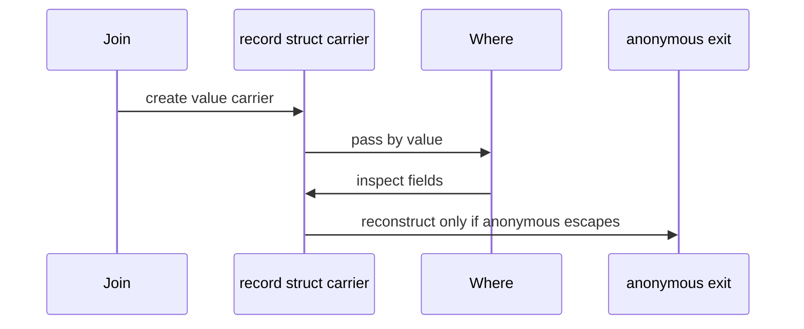

## Pipeline stage 正規化仕様

`NormalizeStages` は生成前に stage list を縮約する。

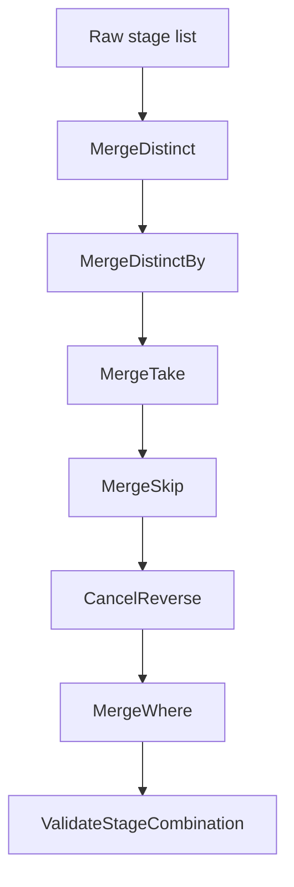

| 正規化 | 仕様 | Anchor |
| --- | --- | --- |
| `Distinct().Distinct()` | 同一 comparer なら 1 段へ削減 | Anchor 付きは削減しない |
| `DistinctBy(k).DistinctBy(k)` | keySelector/comparer/key type が同一なら 1 段へ削減 | Anchor 付きは削減しない |
| `Take(a).Take(b)` | `Take(Min(Max(0,a),Max(0,b)))` | Anchor 付きは merge しない |
| `Skip(a).Skip(b)` | `Skip(Max(0,a)+Max(0,b))` | Anchor 付きは merge しない |
| `Reverse().Reverse()` | cancel | Anchor 付き stage を考慮する仕様へ寄せる |
| `Where(a).Where(b)` | `Where(x => a(x)&&b(x))` | merged func に Anchor を伝播 |

## Pipeline stage 分類

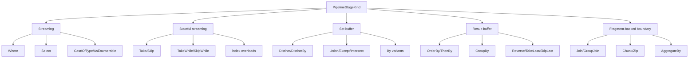

| stage | buffer | loop 方針 |
| --- | --- | --- |
| `Where`, `Select`, `Cast`, `OfType` | なし | 通常 streaming loop へ inline |
| index 付き `Where`/`Select` | int state | stateful streaming |
| `Skip`, `Take` | int state | counter branch |
| `SkipWhile`, `TakeWhile` | bool/int state | predicate branch |
| `Distinct`, `DistinctBy` | `HashSetSlim<TKey>` | set gate |
| `Union`, `Except`, `Intersect` 系 | second source + set | `BuildBinarySetLoop` |
| `OrderBy`, `ThenBy` | pooled values/index/key | `BuildOrderLoop` |
| `GroupBy` | dictionary/list | `BuildGroupByLoop` |
| `SelectMany` | inner enumerator or array index | `BuildSelectManyLoop` |
| `Reverse`, `TakeLast`, `TakeRange` | list/queue | dedicated buffering loop |
| `Join`, `GroupJoin` | lookup | Fragment-backed stage |

## Fragment-backed boundary 仕様

`Chunk`, `Zip`, `AggregateBy`, `Join`, `GroupJoin` は現在 Pipeline 内 stage ではなく Fragment-backed boundary として扱う。既に積まれた Pipeline stage があれば一度 `PipelineEnumerable` として flush し、その出力を次 Fragment の source にする。

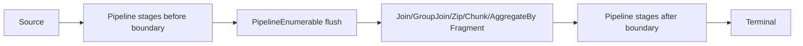

この仕様により、演算子ごとの複雑な状態機械は Fragment 側に閉じ込めつつ、前後の `Where.Select` などは Pipeline へ融合できる。

## Terminal fusion 仕様

Pipeline の終端が `ToList`, `ToArray`, `Count`, `Any`, `First`, `ToDictionary`, `Sum` の場合、`PipelineTerminal` が direct execution または scalar enumerator を生成する。

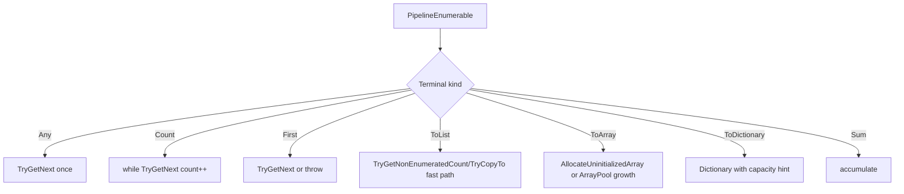

## BinarySet -> Order fusion 仕様

`Union/Except/Intersect` 系の後に `OrderBy/ThenBy` が続く場合、採用された値だけを Order の value buffer に積み、集合演算の結果 list と Order list を二重に作らない。

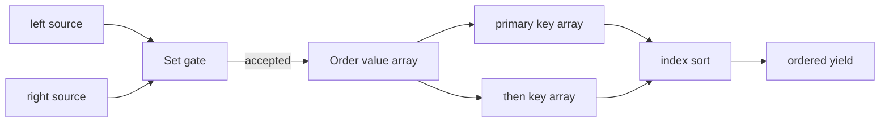

制限は以下。

- BinarySet stage は 1 つまで。
- BinarySet と primary Order の間は streaming/set gate として処理できる stage に限る。
- equality comparer と order comparer/key は別物なので、sort 後 unique への置換は行わない。

## Range 特化仕様

`Range` root では一部 stage を source 自体へ畳む。

```mermaid
flowchart TD
    A[Enumerable.Range] --> B{Stage}
    B -->|identity Order| C[Range or DescendingRangeRoot]
    B -->|Distinct identity| D[no-op]
    B -->|Union same/trailing range| E[no-op]
    B -->|Except range| F[RangeExceptRoot]
    B -->|Intersect range| G[Range intersection]
    B -->|unsupported| H[normal Pipeline]
```

## SelectMany 仕様

`SelectMany` は Pipeline stage として扱える場合、outer item と inner enumerator/array index を持つ状態機械にする。collection selector が outer item に依存しない場合、かつ Anchor がない場合は hoist 可能である。

```mermaid
stateDiagram-v2
    [*] --> PullOuter
    PullOuter --> End: no outer
    PullOuter --> CreateInner: outer item read
    CreateInner --> PullInner
    PullInner --> Yield: inner item read
    PullInner --> PullOuter: inner exhausted
    Yield --> PullInner: next TryGetNext
    End --> [*]
```

配列を返す collection selector は `IEnumerator<T>` を介さず、array + index で走査する。

## InlinedScalarFunc 仕様

lambda 内に scalar LINQ がある場合、`InlinedScalarFunc` として再帰的に Fragment 化し、lambda の一部として statement inline する。

```mermaid
flowchart TD
    A[x => x + inner.Count()] --> B[Detect scalar LINQ inside lambda]
    B --> C[Build scalar Fragment]
    C --> D[Emit supporting member source]
    D --> E[Inline computed scalar into outer lambda]
```

## 追加候補: Select chain 合成

現在 `Select.Select` は 1 つの Pipeline loop に載るため runtime loop は融合される。一方、stage list 上の `Select` 自体を 1 stage へ合成すると、stage dispatch と一時値をさらに減らせる。

```mermaid
flowchart LR
    A[Select f] --> B[Select g]
    B --> C[Compose]
    C --> D[Select x => g(f(x))]
```

仕様案:

- `FuncFragment.RenderInlineExpression()` で前段 select の出力式を作る。
- 後段 select の parameter を前段式に置換する。
- どちらかが `RequiresStatementInlining` または `ContainsAnchor` の場合は合成しない。
- capture/hoist/unsafe accessor/supporting member は両方から集約する。

## 追加候補: Where pushdown catalog

`Join.Where` 以外も、carrier shape と依存パラメータを解析できる場合は葉へ押し下げできる。

```mermaid
flowchart TD
    A[Where after operator] --> B{Operator}
    B -->|Select| C[Predicate lift through selector]
    B -->|SelectMany| D[Push to outer or collection selector]
    B -->|Join/LeftJoin| E[Push to outer or inner]
    B -->|Distinct/Order/Reverse| F[Push before unary source]
    B -->|Concat/Union| G[Duplicate to both sources]
    B -->|Unknown or both-side unsafe| H[Keep position]
```

候補仕様:

| operator | pushdown |
| --- | --- |
| `Select` | selector の carrier を展開して source predicate へ戻す |
| `SelectMany` | outer 依存なら outer source、inner 依存なら collection selector 内へ移動 |
| `Join` / `LeftJoin` | outer/inner 片側依存なら葉へ移動 |
| `Distinct`, `OrderBy`, `Reverse` | predicate が要素値だけを使うなら source 前へ移動 |
| `Concat`, `Union` | predicate を左右両 source へ複製 |
| `Except`, `Intersect` | first source 側にだけ安全に移動 |

Anchor を含む predicate は複製・順序変更を避ける。

## 追加候補: Fragment と Pipeline の責務分界

```mermaid
flowchart TD
    A[New LINQ operator] --> B{Can be expressed as per-element streaming?}
    B -->|yes| C[PipelineStageKind]
    B -->|no| D{Needs one specialized state machine?}
    D -->|yes| E[Fragment]
    D -->|needs terminal direct execution| F[PipelineTerminal or DirectExecutionFragment]
    D -->|provider-specific scan| G[Provider-specific Fragment]
```

分類ルール:

- 1 要素入力、0/1 要素出力、全件バッファなしなら Pipeline stage。
- 複数 source、lookup、grouping、複雑な inner state を持つなら Fragment。
- terminal で閉じることでだけ高速化できるなら Terminal fusion。
- Tsavorite/Persisted の storage scan など provider 固有 API を使うなら provider-specific Fragment。

## 追加候補: Provider-specific scan pipeline

Tsavorite/Persisted root は通常 `IEnumerable<T>` enumerator より storage scan へ近い場所で terminal fusion できる。

```mermaid
flowchart TD
    A[Root source] --> B{Provider/root type}
    B -->|System IEnumerable| C[PipelineEnumerable]
    B -->|Tsavorite HashSet concrete| D[Tsavorite scan terminal]
    B -->|Persisted Set concrete| E[Persisted scan terminal]
    B -->|abstract set interface| F[Generic Root path]
    D --> G[Where/Select/terminal fused into scan body]
    E --> G
```

初期対象:

- `Where` / `Select` / scalar terminal を scan body へ入れる。
- sequence-returning query は generic Pipeline/Fragment path に任せる。
- 未対応 storage operation は fallback で隠さず、未対応として検出可能にする。

## 追加候補: ループ内部相関サブクエリの Lookup 化

この最適化は未実装だが、既存 `JoinBase.BuildLookup` と同じ `Dictionary<TKey,List<TInner>>` 構築思想で実現可能である。対象は `Select` に限定せず、生成コード上の反復 loop 内で繰り返し評価される lambda の内部に出現する、outer 値へ相関した `Where` である。

既定は積極最適化とする。inner source の先行評価と 1 回評価を許容し、禁止したい場合は `.Anchor` を使う。

### 対象コンテキスト

```mermaid
flowchart TD
    A[Lambda body contains correlated Where] --> B{Lambda is evaluated inside generated loop?}
    B -->|yes| C{Contains Anchor?}
    B -->|no| D[Do not lookup-optimize]
    C -->|yes| D
    C -->|no| E{Equality-correlated pattern?}
    E -->|yes| F[Build lookup outside repeated lambda]
    E -->|no| D
```

対象になる lambda は LINQ メソッド名ではなく、生成コード上で反復 loop 内にあるかで判断する。例:

| loop 内 lambda | 対象 |
| --- | --- |
| `Select` selector | 対象 |
| `Where` predicate | 対象 |
| `SelectMany` collection selector / result selector | 対象 |
| `Join` outerKeySelector / innerKeySelector / resultSelector | 対象 |
| `GroupBy` keySelector / elementSelector / resultSelector | 対象 |
| `OrderBy` keySelector | 対象 |
| `DistinctBy` keySelector | 対象 |
| `ToDictionary` keySelector / elementSelector | 対象 |
| `Aggregate(...,resultSelector)` の最終 result selector 単体 | 非対象 |

`Aggregate` 自体が別の outer loop 内 lambda に含まれる場合、その lambda 内部の相関サブクエリは lookup 化対象にする。

```mermaid
flowchart LR
    A[Aggregate resultSelector only] --> B[Called once after aggregate]
    B --> C[Do not lookup-optimize]
    D[Select outer lambda] --> E[Contains Aggregate]
    E --> F[Aggregate body contains correlated Where]
    F --> G[Lookup-optimize because outer lambda repeats]
```

### 検出パターン

v1 は equality-correlated `Where` に限定する。

```csharp
S1.Where(s1 => innerKey(s1)==outerKey(s0))
S1.Where(s1 => outerKey(s0)==innerKey(s1))
```

検出条件:

- `Where` は単一 predicate lambda である。
- predicate body は `==` の単一比較である。
- 片側は inner lambda parameter のみに依存する。
- もう片側は outer loop 変数または outer lambda parameter に依存する。
- inner source は lookup 構築時に 1 回列挙できる。
- `AnchorAnalysis.ContainsAnchor` が source、key、predicate に対して false である。

対象外:

- 複合条件 `innerKey(s1)==outerKey(s0)&&p(s1)`
- 範囲条件 `innerKey(s1)<outerKey(s0)`
- index 付き `Where`
- statement lambda
- overloaded `==` やユーザー定義 operator が絡む比較
- 副作用ありと明示された `.Anchor` 式
- outer と inner の両側へ同時に依存する key 式

```mermaid
flowchart TD
    A[Where predicate] --> B{Single equality?}
    B -->|no| X[Not eligible]
    B -->|yes| C{One side inner-only?}
    C -->|no| X
    C -->|yes| D{Other side outer-dependent?}
    D -->|no| X
    D -->|yes| E{No Anchor and no unsafe form?}
    E -->|no| X
    E -->|yes| F[Eligible correlated lookup]
```

### 変換形

`SelectMany` では一致 group を flatten する。

```csharp
S0.SelectMany(s0 => S1.Where(s1 => innerKey(s1)==outerKey(s0)))
```

概念的な生成形:

```csharp
var lookup=BuildLookup(S1,s1 => innerKey(s1));
foreach(var s0 in S0) {
    if(lookup.TryGetValue(outerKey(s0),out var group)) {
        foreach(var s1 in group) {
            yield return s1;
        }
    }
}
```

`Select` では outer 要素ごとに一致 group enumerable を返す。未一致 key は例外ではなく empty sequence を返す。

```csharp
S0.Select(s0 => S1.Where(s1 => innerKey(s1)==outerKey(s0)))
```

概念的な生成形:

```csharp
var lookup=BuildLookup(S1,s1 => innerKey(s1));
foreach(var s0 in S0) {
    yield return lookup.TryGetValue(outerKey(s0),out var group)
        ? group
        : global::System.Array.Empty<TInner>();
}
```

`Where(...Any())` では lookup probe の有無判定へ置換できる。

```csharp
S0.Where(s0 => S1.Where(s1 => innerKey(s1)==outerKey(s0)).Any())
```

概念的な生成形:

```csharp
var lookup=BuildLookup(S1,s1 => innerKey(s1));
foreach(var s0 in S0) {
    if(lookup.ContainsKey(outerKey(s0))) {
        yield return s0;
    }
}
```

```mermaid
flowchart TD
    A[Build lookup from S1 once] --> B[Enumerate S0]
    B --> C[Compute outer key]
    C --> D{lookup hit?}
    D -->|SelectMany| E[Yield each item in group]
    D -->|Select| F[Yield group enumerable]
    D -->|Where.Any| G[Yield outer item]
    D -->|miss for SelectMany/Where.Any| H[Yield nothing]
    D -->|miss for Select| I[Yield empty enumerable]
```

### 順序と評価回数

順序は次のとおり維持する。

- lookup group 内の順序は `S1` の列挙順。
- outer 側の順序は `S0` の列挙順。
- `SelectMany` は outer 順、同じ outer 内では inner group 順。

評価回数は最適化により変わる。`S1` は outer 要素ごとではなく、対象 Enumerator construction 側で 1 回だけ列挙される。これは hoist と同じ積極最適化方針に含める。

```mermaid
sequenceDiagram
    participant Caller
    participant Lookup as Lookup builder
    participant Outer as S0 enumerator
    participant Inner as S1 enumerator

    Caller->>Lookup: BuildLookup(S1)
    Lookup->>Inner: enumerate once
    Caller->>Outer: enumerate S0
    Outer-->>Caller: s0
    Caller->>Lookup: probe outerKey(s0)
    Lookup-->>Caller: group or empty
```

### Anchor で禁止する理由

lookup 化は、inner source と inner key selector の評価回数・評価時期を大きく変える。したがって `.Anchor` を含む場合は変換しない。

```mermaid
flowchart LR
    A[S1.Where innerKey == outerKey] --> B[No Anchor]
    B --> C[Lookup allowed]
    D[S1.Where innerKey.Anchor == outerKey] --> E[Anchor detected]
    E --> F[Keep correlated repeated evaluation]
```

### 実装方針

- 公開 API は追加しない。
- 生成コード内 helper または supporting member source として閉じる。
- 新規内部 Fragment/helper 候補は `CorrelatedLookupSelect`、`CorrelatedLookupSelectMany`、`CorrelatedLookupPredicate`、`CorrelatedLookupFunc` とする。
- `FuncFragment` の lambda body 解析と Fragment/Pipeline 生成にまたがる内部最適化として扱い、構文書換だけに閉じない。
- lookup は対象 lambda の外側、かつその lambda を反復評価する Enumerator construction 側で構築する。
- 複数 lambda が同じ inner source/key/comparer を使う場合の lookup 共有は将来候補とし、v1 では必須にしない。

```mermaid
flowchart TD
    A[FuncFragment lambda body] --> B[Find correlated Where]
    B --> C[Create CorrelatedLookup plan]
    C --> D[Emit lookup helper source]
    D --> E[Add lookup constructor argument or field]
    E --> F[Replace repeated Where with lookup probe]
```

### テスト観点

- `SelectMany` の一致あり、未一致、複数一致、順序保持。
- `Select` が outer 要素ごとに empty/group enumerable を返す。
- `Where(...Any())` が lookup probe に変換される。
- `Join` outerKeySelector/resultSelector、`GroupBy` keySelector、`OrderBy` keySelector 内の相関サブクエリ。
- `Aggregate(...,resultSelector)` 単体では lookup 化されない。
- `Select(x=>Aggregate(...相関サブクエリ...))` のように Aggregate が outer loop 内にある場合は lookup 化される。
- inner source が outer 件数回ではなく 1 回だけ評価される。
- `.Anchor` 付きでは lookup 化されず、元の相関評価回数に残る。

## 失敗時仕様

展開できない LINQ は静かに元実装へ戻さない。intercept 対象として選ばれた以上、未対応は生成コード上の failure stub として見える化する。

```mermaid
flowchart TD
    A[Intercept target] --> B{Can generate optimized body?}
    B -->|yes| C[Emit optimized code]
    B -->|no| D[Emit LinqInterceptorFailure]
    D --> E[Runtime failure with diagnostic reason]
```

## 完了条件

この仕様に基づく実装またはレビューでは、少なくとも以下を確認する。

- `Where.Select` が全件 materialize せず streaming loop になる。
- `Join.Where` は片側依存 predicate だけ葉へ移動し、両側依存は維持する。
- lambda が直接式として生成コードへ現れる。
- capture 変数が Enumerator constructor/field 経由で参照される。
- hoist 値が Enumerator construction 時に 1 回評価される。
- `.Anchor` 付き hoist 対象は hoist されない。
- 匿名型中間 carrier が record struct registry へ置換される。
- Anchor を含む stage を跨いで merge/reorder/remove しない。
- buffering stage は stage 特性どおりの buffer を 1 系統だけ持ち、不要な二重 list を作らない。
- Fragment-backed boundary では Pipeline を flush し、責務を Fragment 側へ渡す。
