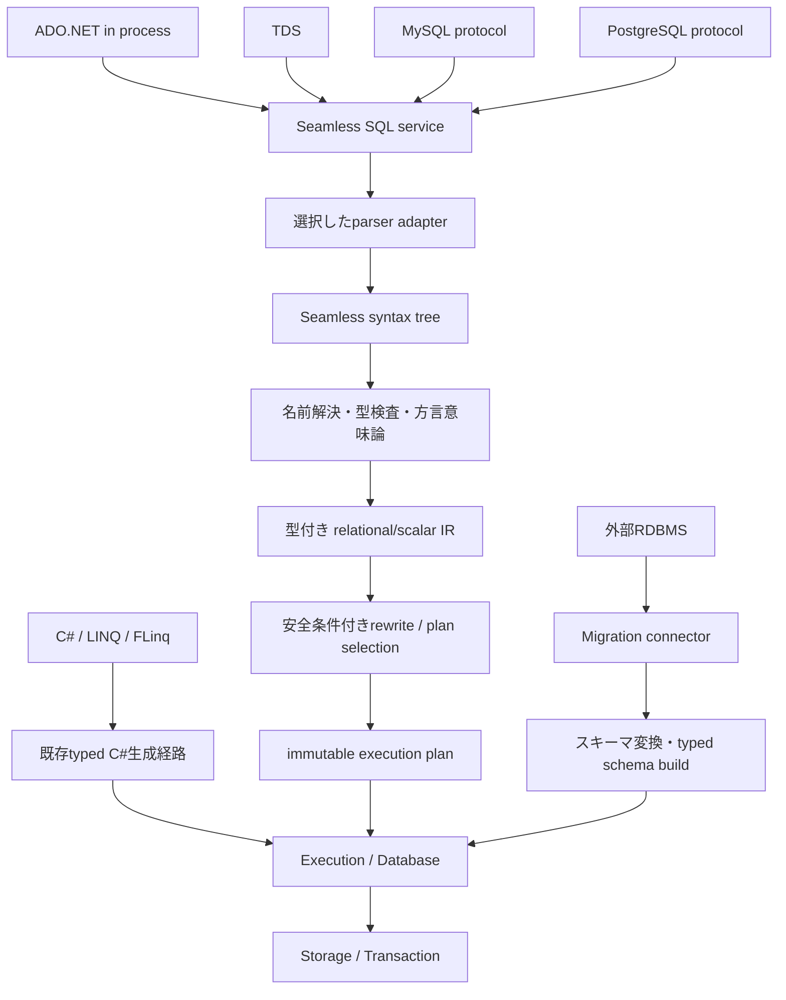

# 汎用SQLアーキテクチャ仕様（提案API・P1以降）

## 背景・過去設計から引き継ぐ仕様
C#・LINQ・FLinqを主力とし、既存Execution/Database/Storage/Transactionの契約を再利用する。取り込みスキーマはビルド済み型付きモデル。追加合意でSSMSからの実行時DDLも実装対象とし、[DDL契約](runtime-ddl.md)に従う。SQL文字列化をnativeに強制しない。

## 変更後の経路

## 共通契約（名称は提案、まだ実装されていない）
| 契約 | 入出力・所有権 |
|---|---|
| ISqlParser | SQL文字列、方言ID、parser設定からSeamless syntax treeと位置付き診断。外部ASTを返さない |
| ISqlBinder | syntax tree、catalog snapshot、semantic profile、parameter型からbound IR。DB/列/型の未解決を残さない |
| SQL service | PrepareとExecuteを分離。SQL、方言、semantic設定、schema世代、引数型をcache keyへ。値とsession/iterator/transactionはcacheしない |
| Catalog snapshot | DB/schema/objectの安定ID、元名/引用・case規則、論理SQL型/物理CLR表現、列順/NULL/照合、世代 |
| Execution context | 既存ExecutionScopeのbudget/cancellation、既存DBの取引/read session。実行ごとに新規作成 |
| SQL diagnostics | Syntax / Binding / Unsupported / Constraint / ResourceLimit / Cancelledを区別し、位置・対象・理由を持つ。方言別番号やSQLSTATEは境界で写す |
| Protocol request | SQLまたはprepared ID、方言、session設定、引数型/値、取消/期限。通信フレームを実行層へ渡さない |
| Migration connector | Discover/CaptureSchema/StreamRows/Complete。能力と一貫性の方法を申告、server protocol実装とは独立 |

IRはScan/Filter/Project/Join/Aggregate/Sort/Distinct/Limit/SetOperationと初期CRUD、定数/列/引数/演算/関数/CASTを持つ。ノードごとに型、NULL可否、比較規則、順序性、決定性・副作用・例外性を保持する。Schema世代と方言意味論をplanへ固定する。IR/planは当初プロセス内契約とし、未版管理のバイナリ永続化を提供しない。

最適化はprojection pruning等の条件が明示されたルールから始める。外部結合のfilter移動、評価回数を変えるvolatile関数、例外順序、TOP/ORDER、集計NULLに影響する変換を無条件に行わない。既存join/sort/退避をlowering先として再利用し、SQL optimizer完成や速度向上は実測前に主張しない。

## native高速経路
既存Roslyn/FLinq生成器を維持し、通常のnative呼出しで実行時IR生成・解釈・式木解析を増やさない。共有するのはcatalog identity、演算能力、codec、資源・取引契約、計測descriptorから始める。型付きnativeがIRを利用する場合も生成時loweringとし、SQL意味論を適用するか通常.NET意味論かをdescriptorで区別する。全件object[]変換をnativeの共通必須経路にしない。

## 方言と意味論
新ADO.NETはDialect=Portableを既定、SqlServer/MySql/PostgreSqlを明示可能。既存TDSはSqlServer、将来wireは対応方言が既定。SQL文字列の自動方言推測・失敗時の他parser再試行はしない。Portableは共通部分の契約であり、すべてのDBの既定挙動が同じという意味ではない。

| 差異 | 規範 |
|---|---|
| NULL | SQL三値論理、WHEREはtrueのみ、GROUPのNULL同値、空SUM/AVG等とCOUNTを区別。nativeの既定比較へ代用しない |
| 型・暗黙変換 | SQL論理型とCLRを分離。方言別precedence/丸め/overflowをbindingで確定。表現不能なnumeric精度はUnsupported、黙ってdecimalへ狭めない |
| 文字列・識別子 | 値比較のcollationと名前解決のcase/引用を別管理。未対応collationは明示拒否。portable比較ケースはDB別設定も記録 |
| 日時 | date/time/local timestamp/instant/offsetを区別。session timezoneをplan設定へ。無指定timezoneをOS既定へ暗黙固定しない |
| 採番・UPSERT | IDENTITY/AUTO_INCREMENT/sequence、ON CONFLICT等を能力別に申告。初期に未対応のものは書込前に拒否 |
| TOP/LIMIT/OFFSET | 方言lowering後もORDERと件数評価を保持。同順位の行選択を決定的とみなさない |
| 関数 | 方言providerでsignature・戻り型・NULL/決定性を宣言。未知関数をNULL固定や既定値へ置換しない |
| 取引・分離 | 実提供能力と要求を照合し、未対応分離レベルを黙って下げない。別WALを作らない |
| DDL | 移行時解析と実行時変更を分離。SSMSのCREATE/ALTER/DROPは取引・永続化・世代更新・再起動回復を伴う。取り込み型のhot swapを既存APIが保証すると仮定しない。実装前の構文は副作用前に明示拒否し、受け入れ済みと扱わない |

## ADO.NET・通信の寿命
SeamlessConnection/Command/Parameter/DataReader/Transaction/ProviderFactoryをSeamless.AdoNetに設ける提案。既存構築済みDBとschema manifestを開き、assembly/hash/fingerprint不一致を拒否する。DBインスタンスを借用する入口は接続DisposeでDBをDisposeしない。ファイルから開く場合の共有hostは参照カウントと排他を明示する。

Readerは逐次読み取りで実行scopeを所有し、Dispose/Cancel/切断で確実に解放する。接続の未確定取引はDispose/resetでrollbackする。初期は1接続1実行中Readerを既定としMARSを偽装しない。Prepare/引数は値連結せず型と値を分離。非同期APIを提供し、同期CPU仕事を無条件Task.Runして非同期I/O完成と表記しない。

認証はhost/protocolでidentityを確定し、sessionにDB・方言・timezone・collation・prepared状態を持つ。TDSのテスト用認証をMySQL/PGへコピーしない。GUI固有のsys/pg_catalog等は互換provider、受信/送信・認証handshakeはwire adapter、実行はSQL serviceに分ける。
