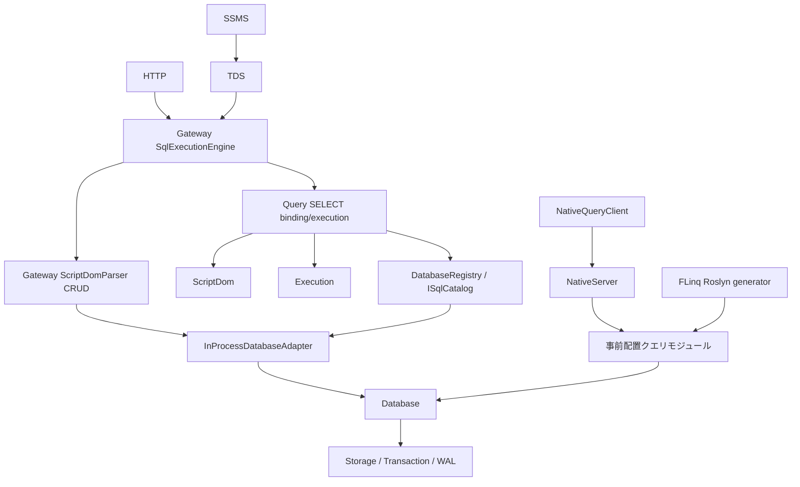
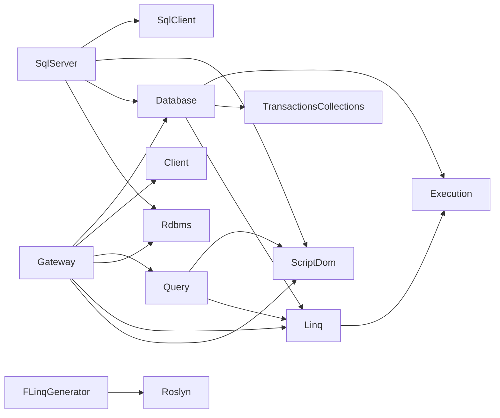

# 現状分析

## 観察と検証限界
調査はevidence.jsonの作業ツリーを対象とする。staged/unstaged/未追跡が混在する。ソースの存在、文書の過去結果、今回の実行結果を区別する。今回は製品テスト・GUI操作・性能測定を実行していない。

## 現在の経路

## 4分類
| 分類 | 対象・根拠 | 設計判断 |
|---|---|---|
| 再利用 | Seamless.Execution/ExecutionScope.cs、Budget、Codec、退避、取消 | 資源契約を共用、別budget実装を作らない |
| 再利用 | Seamless.DatabaseのTable、DatabaseTransactions、永続化 | 既存取引・read session・復旧契約を利用 |
| 再利用 | Seamless.Linq、FLinq生成器、Database生成器 | 既存高速経路・生成型を維持 |
| 条件付き再利用 | RdbmsのDatabaseCatalog、DatabaseType、CSharpDatabaseGenerator | SQL Server残存結合だけ分離 |
| SQL Server固有 | Gateway/Tds、SystemCatalogEmulator、SqlServerのcatalog/import/型 | SQL Server互換・移行の専用境界へ |
| 再設計 | QueryBinder.Expressions、SqlValues、AggregateState | ScriptDomのenum/ASTが実行delegateにも残る |
| 再設計 | DatabaseRegistry、SessionContext、Gateway SqlExecutionEngine | 保管庫・sysカタログ・セッション・実行を分ける |
| 再設計 | SELECTとGateway CRUDの別経路 | 同一のbinding/transaction/error契約に収束 |
| 未実装・未発見 | DbConnection/Command/Reader/Transaction派生、DbProviderFactory | 新ADO.NET境界を作る |
| 未実装・未発見 | MySQL/PG方言・通信・移行、Oracle/SQLite互換 | 現在利用するSQLite履歴保存と混同しない |

## 重要な実装事実
- [SqlQueryEngine](../../../Seamless.Database.Query/SqlQueryEngine.cs)のBoundQuery/BoundScalarはFuncとobject?[]による実行表現。型付きの交換可能IRやコストベースoptimizerが完成しているとは扱えない。
- QueryBinder.Expressionsの閉包はScriptDom ASTの演算種別を参照し、SqlValues/AggregateStateもScriptDom enumを使う。Parseだけのインターフェース化では分離できない。
- QueryBinder.Joinにはmerge join、QueryBinderにはnested loop等がある。既存の実行アルゴリズムを再利用するが、統計・候補探索・コスト推定optimizerの存在は確認できていない。
- Queryのcacheは世代・DB・SQL・引数型で分離する容量制限付きFIFO。LRUとは記述しない。
- RdbmsのGeneratedSqlViewReaderにはSqlServer.Types.Bitの型名判定、CSharpDatabaseGeneratorには角括弧引用のビュー照会が残る。完全な方言非依存とはいえない。
- GatewayServerはTDS/HTTP/nativeサーバーをまとめるcomposition root。InProcessDatabaseAdapterはADO.NET Providerではない。
- QueryModuleWriterと手書きテンプレートは普通のC#入口を生成しFLinqをビルド時適用する。NativeQueryClientはTCP/MemoryPack。任意SQLをnativeへ自動変換する機能ではない。

## 現行依存

全対象csprojの直接参照とPackageReferenceはevidence.jsonに記録する。

## 公開面と既存仕様の差
SqlQueryEngine.Prepare、SqlQueryPlan.Execute、ISqlCatalog、SqlType/Column/Table/Parameter/Result、IDatabaseAdapter、NativeQueryClient/NativeTransactionが公開されている。公開されていることと外部リリース済みであることを分け、配布履歴が不明な型は未公開と決め付けない。

旧比較仕様の「共通SQL」は通信からの分離を指す現状があり、複数方言の意味論を実装済みという意味ではない。旧仕様の19DB・171ビュー全実データ検証、SSMS実UIは未完了。FLinqの過去テスト結果も、その時のsource/configの証拠であり今回全体への保証ではない。

## 保護対象
Database/Transactions、生成器、Gateway、Rdbms、SqlServer、FLinq、ソリューション、CIの既存変更を保全する。P0では製品ファイル、index、保存DB、起動プロセスを変更しない。既存テスト失敗は先に再現し、新設計のためだけに期待値を書き換えない。
