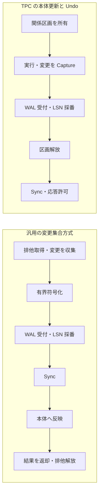

# C12 汎用トランザクション基盤

## 背景
2026-10-29、利用者が承認した改訂計画の実装設計。汎用基盤と型付きAPIを実装し、TPC-C/TPC-Eを接続する。HTTP/TDS Gateway、他の分離レベル、同一表の取引並列化、TPC-E区画並列化は後続。

## 現状の観察
DatabaseContainerはDB全体のwriter排他、AsyncLocal、変更集合、JSON WALを持つ。同期Commitは要求を立て、Disposeが確定する。TPCは本体更新とTxnLog Undoを使う。Store.Saveはmanifestを確定点とする。主checkoutとTPC専用worktreeのDatabaseには差分がある。

## 過去設計から引き継ぐ仕様
20261026-three-chat-orchestration.md、tpcc-sut-contract-review.mdを継承する。Core43/Exp9の旧証跡を新機能の合格へ流用しない。既存Redo v1、C10、単一Store入口、既存データ、Gatewayの未コミット変更を保全する。

## 目的
Serializable、型付き明示ビュー、合流型ネスト、更新Commitの永続結果照会、区画WAL、所有者によるハンドル管理、TPC adapterを提供する。

## 非目的
自動データ移行、要求自動再実行、業務要求の重複排除、分散2PC、実電源断の認定、TPC公式認定、SQL比較、クエリ内部アルゴリズムの全面改修。

## 提案設計
Seamless.TransactionsはBenchmark非依存のWAL/取引/所有権/結果契約。Seamless.Transactions.Collectionsは変更集合と保存先接続。Databaseは宣言/生成ビューを持ち、TPC adapterは既存Frames/Queries/TxnLogを利用する。

### 公開契約
新APIはBeginTransactionAsync、Id、型付きCollectionビュー、CommitAsync、RollbackAsync、DisposeAsync。ネストは親から開始し同じId/状態を共有する。内側CommitはVoted、最外側はCommitted/NoChanges。未終了の子を持つ親の操作を拒否する。未Commit破棄または子Rollbackは全体中止。新APIでdatabase直アクセスや同期取引混在を拒否する。
更新Commitのみ結果を永続保存する。不存在はUnknown。明示forget watermarkより古い結果を復旧で復活させない。保持は無期限/予算内。WAL durable後の適用失敗はCommittedだが復旧必要。受付後はキャンセルで確定を撤回しない。

### WAL形式の固定
LE。segment headerは4096 bytes。magic SLWAL002、format=2、header長、WalId(Guid)、epoch(int64)、ordinal(int64)、baseLSN(int64)、sector(int32)、segmentBytes(int64)、catalog SHA256、header CRC32。末尾予約領域は0。
frame headerは32 bytes: magic(uint32)、type(int32: transaction=1/PAD=2)、totalBytes(int32)、bodyBytes(int32)、LSN(int64)、bodyCRC(uint32)、headerCRC(uint32)。CRCはIEEE CRC32。transaction payloadは取引ID、区画列、metadata、entry列を有界length framingする。entryは区画/表/操作/codec identity/キー/nullable行。LSNはtransactionのみ消費する。
既定segment=64MiB、frame上限=4MiB、sector=4096（deviceの要求が大きければそれに合わせる）。batch末尾はPADでsectorを完結し、応答済sectorを再利用しない。全長frameのCRC不一致は末尾でもCorrupt。short header/bodyは最後のsegmentだけIncompleteTail。再開は検証済prefixを再Syncし、新epoch/new segmentへ進む。旧torn suffixは応答済sectorを避けて修復する。

### 追記と復旧
queue最大256件かつ64MiB以下、maxBatch=64、追加収集待ち0ms。LSN採番とqueue投入を同一順序境界で行う。専用threadがWrite/Sync後だけDurableLsnとreceiptを公開。failure latchは受付/応答許可/checkpointと共有。正常終了は排出/Sync/join/dispose。
区画昇順取得/逆順解放。read/正常rollbackは先行更新fenceだけ待つ。監査モードは全要求を記録。checkpointは対象区画のappliedLSNまでdurable後に保存。復旧再停止時は確定checkpointからやり直す。outcomeとretention metadataを確定してから一世代遅延で旧segmentを削除する。

### 保存先
Tsavorite通常/並列handleをownerが所有し、切替え/保存/拡張は静止境界で行う。初版汎用取引は全DB排他。TPC-Cは独立区画を並列化。Persisted作業領域はquery/transaction-localと予算を維持し業務WALへ載せない。

## 影響範囲
新製品2project、Database/Generator、新共通テスト、TPC専用worktreeの新adapterとテスト。shared sourceを追加/移動する場合はprojitems/shproj/slnxを同時更新。

## 移行手順
主checkoutの製品実装を正本としTPC専用worktreeへ対象manifest/hash付きで同期する。TPC sourceは専用worktreeを正本とする。旧形式は既定維持、新形式は新規領域への明示opt-in。旧DBの自動変換なし。

## テスト計画
失敗先行。fake Sync前未完了、失敗全伝播、背圧、排出、CRC/LSN/世代/PAD/末尾/不再書込。送金保存、Rollback、ネスト、迂回拒否、ID照会/forget/再起動。TPC-C4変種P1/P2とTPC-E新単一経路、実Store部分保存/復旧再停止/全行索引照合、v1/C10回帰。Debug/Releaseを区別。EGen不足はUnavailable。BGO経由で実行する。

## リスクと対策
WALとStoreの保存境界の不一致をcheckpoint coverageで検出する。callback/observer失敗後のlive保存を禁止する。mutable payloadを受付後に共有しない。性能上の主張は測定前に行わない。

## 未決事項
製品仕様は承認済み。実装で必要な局所調整は本書と試験へ反映する。

## 合意状態
2026-10-29、利用者が本改訂計画を実装するよう明示指示。実装・試験の完了とは別。

## 実装時に固定した追加契約

- `SharedV2` は新規領域への opt-in。最初の取引受付より前に全生成表を登録し、LSN=0 の Store checkpoint を確定する。旧領域の自動変換はしない。
- 実体化ビューは従来の読取専用契約を保ち、取引ビューも読取専用とする。既存 import は同期取引の変更集合を共通基盤へ接続して保存する。
- `outcomes.snapshot` は 44-byte header（magic、WalId、forget watermark、件数、header CRC）と 28-byte record（Guid、LSN、CRC）。`retention.v2` は 64-byte 固定長（SLRET002、WalId、最初の区切り、base LSN、候補起動世代、候補区切り、予約 0、CRC）。削除途中の旧ファイル残留を復旧対象へ戻さない。
- 正常 Rollback の確認は運転中の有限キャッシュに置く。永続更新履歴の保持契約と区別し、再起動後の不在は Unknown。更新結果の記録に必要な資源は WAL 受付前に予約する。
- WAL の追記・Sync・ストリーム読込み・整理は同じ装置排他を使用する。区画 checkpoint と別区画の追記が競合しても FileStream の位置や保持対象が競合しない。
- Windows の物理 sector と alignment は OS API で検査する。設定が不足する場合は起動を拒否し、4096 bytes の保証を仮定して続行しない。
- TPC-E の NEWS_ITEM でページを拡大するときはセグメントもページ以上にする。Core43 の最小既定へ変更された環境で、旧サイズ指定が不整合となることを実 EGen 試験で再現して修正した。
- 起動時は checkpoint LSN の上限だけでなく、保持 WAL の最初の LSN による下限も検査する。削除済み prefix を必要とする古い Store checkpoint、整理済み WAL に対する結果台帳の欠落を拒否する。
- 終了時は実行要求と受付済み checkpoint の両方を排出する。停止開始後の新規 checkpoint と、所有権待ちから戻った新規読取りを拒否する。
- 永続取引の変更集合を符号化する際も残りフレーム容量を渡して制限し、符号化済み行の所有メモリを共通予算へ計上する。複数表の合計も WAL 受付前に検査する。
- 監査モードは WAL の catalog identity に含め、通常運転の履歴を監査用の全要求履歴へ混ぜない。TPC-E のネイティブ要求には codec 名と使用 DLL の SHA256 を記録する。

### 確定順序

汎用方式で Sync 後の本体反映が失敗した場合は Committed を保って障害停止する。TPC 方式の障害後は live 状態を保存せず、確定 checkpoint から開き直す。正常 Rollback は Undo を終えてから先行更新の durable fence を待つ。
