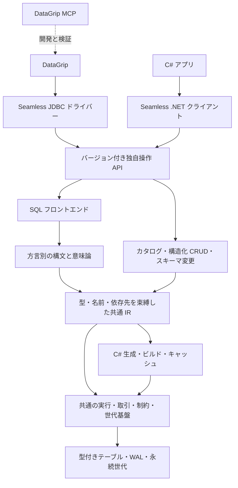

# DataGrip を主対象にする Seamless 固有接続・SQL 実行基盤の計画

## 合意状態

2026-11-02 の利用者指示に基づく実装用計画である。同日の後続チャットで本計画に沿った実装指示を受け、段階1の専用接続試験を開始した。以下の API 名・モジュール分割・通信方式の詳細は提案であり、実装済みの範囲は末尾の実装状況と `tools/Seamless.DataGrip/README.md` で区別する。

確定した要求:

- SeamlessDB を操作する汎用ツールは **DataGrip を必須対象**とする。DBeaver は任意とする。
- 可能な操作は SQL 文字列を介さず、独自の抽象化 API と効率のよい通信で行う。
- Microsoft の TDS、SSMS、SMO、管理用システムカタログの互換性は必須にしない。
- AdventureWorks を使う場合、同じ SQL を SQL Server と Seamless の両方で実行して比較する。
- ストアドプロシージャ・関数の C# 変換、実行時に決まる動的 SQL の解釈実行、SQL の複数方言を扱う。
- 既存 SSMS 実装で得た型・SQL・取引・永続化の知見を活かす。代替経路の受け入れ後に SSMS 固有処理を削除できる。
- DataGrip の MCP を開発・検証に利用する。MCP を通常のデータ通信経路にはしない。

## 背景と責務の分離

「SQL Server というサーバーを再現すること」と「T-SQL の実行結果を比較できること」を別の要求にする。DataGrip の接続に SQL Server 製品名や管理用カタログを偽装しない。SQL は、利用者が記述する言語および比較試験の入力として引き続き受け付ける。

DataGrip は通常 JDBC を通して SQL を発行する。独自 JDBC ドライバーを入れるだけで GUI 内部の SQL 生成までなくなるとは扱わない。メタデータ・取引・登録済み操作は構造化要求にし、SQL コンソールや GUI が発行する SQL は同じ独自接続から SQL フロントエンドへ送る。SQL Server の互換通信を通す必要はない。

## 現状の観測事実

| 対象 | 確認した内容 | 実装計画への意味 |
| --- | --- | --- |
| Native 接続 | `Seamless.Database.Client/NativeProtocol.cs` は登録済み module/query ID と MemoryPack 引数・結果を扱う | 接続所有取引と登録済み C# 呼出の基盤として再利用する。Java が任意の生成型をそのまま解釈できる契約ではない |
| Native の世代追従 | `GatewayTransactionManager.Native.cs` はソース登録、再ビルド、保存点、共通公開を持つ | C# ルーチンと SQL 計画の寿命管理へ活かす |
| 型付き DDL | `GatewayDdlCompiler` は ScriptDom の文と SQL テキストからスキーマ差分を作る | SQL 解析と、言語非依存のスキーマ変更検証を分離する |
| 複数方言の構文 | `SqlParserCsAdapter` は SQL Server／MySQL／PostgreSQL のパーサー選択を持つ | 方言フロントエンドの境界として活かす |
| 複数方言の実行 | `PrepareBasic` は SQL Server 以外の実行意味論を拒否する | 構文を読めることを方言の実行対応済みと数えない |
| C# ルーチン生成 | `SqlServerRoutineCompiler` は限定的な tinyint／CASE／nvarchar の形を生成する | 汎用ストアド／関数コンパイラーとしては未完成 |
| SQL に依存する共通処理 | DEFAULT・制約検証等に内部で SQL クエリを作る経路がある | 外向き API だけを変更しても内部の文字列生成は残る。共通 IR へ段階的に移す |
| DataGrip 実機 | インストール先のディレクトリ名と異なり、MCP は **2026.1.4.1** と応答した | 実際のバージョンと公開ツールを基準にする |
| DataGrip MCP | `http://127.0.0.1:64342/stream` の初期化・ツール列挙・接続一覧取得に成功 | 新規接続、SQL、メタデータの検証へ利用できる |
| 開いているプロジェクト | `G:/GitHub/Seamless`。既存接続は `Benchmark.db`（SQLite） | 既存接続を編集せず、専用接続を追加する |

MCP で確認した主な DB ツールは `list_database_connections`、`test_database_connection`、`execute_sql_query`、`list_database_schemas`、`list_schema_objects`、`get_database_object_description`、`preview_table_data`、`cancel_sql_query`。この実機で接続作成・編集ツールが公開されているとは確認していない。新しいバージョンのオンライン資料だけを根拠に呼び出さず、実装時に `tools/list` を再取得する。

## 過去設計から引き継ぐ仕様

`20261101-gateway-typed-ddl.md` のうち、次を維持する。

- 接続・取引 ID に結び付く所有権、ネスト、保存点、取消・切断処理。
- 複数 DB の共通 WAL による一括確定、checkpoint、確定不明時の受付停止。
- DB・表・列の永続 ID、非公開の候補世代、型付き全表移行、情報を失う変更の取消。
- 遅延列挙中の世代保持、古い計画の検査、collectible ALC、必要な旧世代の保持。
- DynamicMethod による直接 getter／変換関数／constructor の呼出と、型付き列挙・投入。
- 管理対象メモリと一時領域の上限、大量データの逐次処理、比較元 DB の保護。

同設計の SSMS・TDS 出力に依存する受け入れ条件は、DataGrip・独自接続・SQL Server 比較へ置き換える。型・NULL・丸め・照合・制約・取引の振る舞いから得た回帰条件は保持する。

## 提案する構成

### 独自操作 API

`DbConnection` の接続・取引という考え方を借り、言語中立の要求・応答を定義する。ADO.NET の実装だけで SQL がなくなるとは扱わない。

| 操作群 | 要求・応答の主な内容 |
| --- | --- |
| 接続 | protocol version、機能一覧、接続 ID、DB ID、認証情報、既定 DB |
| メタデータ | DB・表・列・索引・制約・ルーチンの ID と定義、スキーマ世代 |
| 読取 | 表 ID、列 ID、型付き条件・並び順、取得範囲、継続トークン |
| 更新 | 対象行の識別情報、変更列と値、期待する行状態、取引 ID、期待スキーマ世代 |
| スキーマ変更 | CreateTable／AddColumn／AlterColumn／AddConstraint 等の構造化操作集合 |
| SQL | 方言、SQL テキスト、型付き引数、準備済み計画 ID、実行オプション |
| C# 呼出 | 登録済みルーチン／query ID、引数・結果の契約 ID、依存世代 |
| 取引・制御 | begin／commit／rollback／savepoint、実行取消、確定結果照会、接続終了 |

主キーを持たない表は、サーバーが発行する内部行 ID／不透明な行識別トークンを利用する。全列の値だけで行を特定して重複行をまとめて更新しない。編集中の世代変更や他接続の更新を検出し、黙って違う行・列へ書き込まない。

DEFAULT・CHECK・計算列の式も、共通の式表現または明示した言語・方言付き定義として管理する。構造化スキーマ操作を SQL 文字列へ逆変換してから再解析する設計を中心にしない。

### DataGrip 接続

Seamless 専用 JDBC ドライバーを第一案にする。`Connection`、`Statement`、`PreparedStatement`、`ResultSet`、`DatabaseMetaData`、取引・保存点を実装する。製品名は SeamlessDB とする。

- `DatabaseMetaData` は独自メタデータ API を使い、`sys.*` や `INFORMATION_SCHEMA` の SQL を組み立てない。
- SQL コンソールと GUI が発行した SQL は、独自接続の SQL 操作へ渡す。
- JDBC の標準機能だけで成立するグリッド編集・テーブル編集の範囲を、最初の実機試験で確認する。
- Generic 接続で必要なスキーマ編集ができない場合は、DataGrip の DBMS／方言・編集拡張を検討する。SQL Server プロファイルを偽装して成立させることは必須策にしない。
- 読取・編集を構造化要求へ直接接続できる拡張点があれば利用する。任意の SQL を正規表現だけで CRUD へ変換しない。
- 任意の ADO.NET 互換アダプターは、この API の上に追加できる。DataGrip の必須経路とはしない。

### 通信と性能

通信契約は Java と .NET から使える版管理済みの形式とする。CLR の型名、delegate、生成 DLL の型レイアウトを汎用ツールの永続契約にしない。既存 MemoryPack の登録済み C# クエリ経路は独立して活かせる。

独自バイナリフレームと既存の RPC／シリアライズ方式を小さい比較で評価してから固定する。試作の手書きプロトコルを無条件に採用しない。必要な性質は次の通り。

- NULL、整数、38 桁を含む数値の表現範囲、文字列、バイナリ、日時精度・offset、GUID 等を契約に明記する。
- 行／列のバッチ取得、結果セットの逐次取得、backpressure、フレーム上限、大きい値の扱い。
- 引数付きの準備と計画 ID による再実行。型・方言・オプション・スキーマ世代でキャッシュを分離する。
- 接続・要求 ID と取消の対応、応答途中の障害、取引の確定結果の識別、切断後の解放。
- 認証・権限・暗号化を配備条件に応じて定義する。ローカル専用の試作をそのまま外部公開しない。
- 受信・送信・複製・バッチ容量の確保を共通予算へ算入し、上限を検査してから大きな割当を行う。

SQL を使わないことだけで速いとは断定しない。解析・準備・コンパイルの初回費用と、計画再実行・転送・GUI 表示の時間を分け、独自 CRUD、準備済み SQL、未準備 SQL、既存 Native の時間と割当を比較する。

## SQL・C# ルーチン・動的 SQL

SQL と構造化操作が、型・制約・取引・世代の同じ実行基盤へ到達するようにする。共通 IR は、関係演算、式、変更、スキーマ操作、制御フロー、ルーチン呼出、動的 SQL 呼出を区別する。

ストアド／関数は SQL 定義を解析し、名前・型・依存先を束縛してから C# を生成する。変数、分岐、ループ、SELECT、DML、複数結果、出力引数、戻り値、エラー処理、一時表と取引の必要範囲を、AdventureWorks の定義と既存試験から抽出する。文字列置換で SQL を C# にする方式にはしない。

生成 C# も共通の型変換・NULL・照合・算術・エラー helper を呼ぶ。CLR の cast／比較だけで SQL の規則を代用しない。UDF の副作用制約は方言の意味論として検証する。未対応の定義は、診断・解釈経路・実行拒否を明示し、変換済みと報告しない。

動的 SQL は、実行時の SQL テキスト、型付き引数、方言、接続・取引、変数スコープ、名前解決・一時表の可視性を実行コンテキストから受け取る。T-SQL の `EXEC(...)`／`sp_executesql` に必要な言語上の動作は、TDS の RPC 互換とは別に扱う。一定文字列は事前準備でき、実行時文字列は同じフロントエンドで解析・束縛する。

動的 DDL 後に同じルーチンを続行する場合、古い生成型・古い計画を使い続けない。文の境界で再束縛する仕組み、または共通 IR の解釈経路への切替を設計する。ソースの hash、コンパイラー版、方言・意味論の版、依存スキーマで成果物を識別し、世代所有の ALC／計画とともに解放する。

## 方言対応

方言ごとに構文と意味論を分離する。現コードにある SQL Server／MySQL／PostgreSQL を初期の設計・検証対象として整理し、SQLite 等の追加も同じ拡張境界に入る構成にする。初期対象以外の実装優先順は別途確定する。

引用符、パラメーター、TOP／LIMIT 等の構文だけでなく、整数除算、文字列連結、NULL、型優先度、丸め、照合、識別子の大小文字、日時、IDENTITY／sequence、DDL の取引、ルーチンと動的 SQL のスコープを方言別に検証する。構文の受理、式、SELECT、DML、DDL、ルーチンの対応表を持ち、単一の「対応済み」フラグにしない。サポート済みの意味へ安全に束縛できない構文は実行前に拒否する。

## AdventureWorks と SQL Server の比較

比較ランナーが、同じ SQL テキスト・型付き入力・セッション条件を次へ送る。

1. SQL Server の専用 AdventureWorks コピーへ、SQL Server 用クライアントで実行する。
2. 同じ初期データを取り込んだ Seamless へ、独自接続の SQL 操作で実行する。
3. ルーチンは、元定義の SQL Server 実行、Seamless の解釈実行、生成 C# 実行を比較する。

結果の値・SQL 型相当のメタデータ、NULL、精度、複数結果、更新件数、出力引数・戻り値、変更後のデータ・スキーマ、エラーと取引状態を比較する。ORDER BY がなければ順序を前提にせず、重複を保持した比較を行う。日時・GUID 等は固定可能な入力と非決定的な性質の検証を分ける。比較の正規化で桁あふれ・精度差・型の欠落を隠さない。

元の業務 DB・比較元 AdventureWorks は変更しない。更新・DDL 試験用のコピー、初期化、バックアップ、後始末を明示する。他方言は原則として対応する DBMS を比較元にする。PostgreSQL の意味論の正解を SQL Server だけで決めない。

## 実装順序と受け入れ

| 段階 | 実装内容 | 次へ進む判断 |
| --- | --- | --- |
| 1 | 独自 API 契約と DataGrip の小さい接続試験 | SQL Server 偽装なしで接続、表・列・主キー表示、型・NULL の取得が成立する。GUI 編集の拡張可否を確認する |
| 2 | 共通操作基盤と JDBC の実用化 | データ追加・更新・削除、キーなし表、パラメーター、複数結果、取引・保存点、取消・切断、エラー回復が成立する |
| 3 | スキーマ操作と型付き移行 | 表・列・制約の変更、非公開世代、取消、再起動、DataGrip のスキーマ再取得と編集継続が成立する |
| 4 | SQL フロントエンドの共通 IR 化 | AdventureWorks の同一 SQL、DDL／DML／取引と結果・状態の差分試験が成立する |
| 5 | ストアド／関数の C# 生成と動的 SQL | 解釈・C#・SQL Server の一致、動的文字列、スコープ、依存変更・再準備、資源解放が成立する |
| 6 | 複数方言の意味論と回帰 | 方言別の受理・拒否・実行結果を対応 DBMS と比較し、既存対象を壊さない |
| 7 | 運用・性能・SSMS 固有処理の撤去 | 大量データ、予算超過、故障復旧、DataGrip 実利用、配布物、不要経路削除後の回帰が成立する |

MCP による SQL 実行の成功だけで、グリッド編集・テーブル編集の実画面確認を代用しない。DataGrip の直接操作または IDE 内の該当操作を通る試験を別途記録する。MCP 操作は専用接続に限定し、既存の Benchmark.db に対して更新 SQL を実行しない。

## 段階2の着手範囲

段階2は、段階1の専用ホストを使い、まずJDBCの外部契約（パラメーター、保存点の接続所有、結果・statementの寿命、CRUDと取引の回帰）を失敗先行で修正する。DataGripの公開DBMS・DML生成拡張点を実機SDKと照合し、SQL文字列の置換ではなく生成側でT-SQLに合うDMLを作れる専用プラグインを分離して検証する。既存IDEへの導入・再起動は自動実行せず、互換性を確認した成果物を先に作る。独自通信の安定版、取消・要求所有権、キーなし行トークン等は別途受け入れが必要であり、この局所修正から実用化済みと推定しない。

2026-11-02の継続指示後、JDBCの未設定引数・位置検査、型指定付きsetObject、結果／Statementの所有・寿命、保存点の接続・取引世代・失効、タイムアウト設定、未対応機能の広告を修正した。13ケースの修正前はCRUD以外の12ケースが失敗し、修正後はDebug／Release × 初回／明示再オープンの4条件で全成功。段階1の2試験も各条件で成功し、4回の正常停止・2回の再初期化拒否を確認した。共有エンジン・比較元DB・SQL Serverサービスは変更していない。

専用DBMS・DML生成プラグインはDataGrip 2026.1.4.1（261.27258.144）のSDKへビルドし、独立した製品識別とUPDATE/DELETEの別名設定をCLI確認した。DMLを実際に生成する分離headless検証は `No valid license found` で起動を完了できず未受け入れ。既存IDEへの導入許可はまだ得ておらず、新プラグインによる実画面の編集は未検証である。詳細は `tools/Seamless.DataGrip/plugin/README.md`。

成果物は `D:/CodexTemp/datagrip-stage1-20261102-03/`、証跡は `F:/CodexTemp/datagrip-stage1-20261102-05/` と `F:/CodexTemp/datagrip-stage1-20261102-07/`。この段階2の着手結果を、段階2全体や計画全体の完成と扱わない。

## SSMS 処理の整理

再利用するものは、型変換・TDS 検証から得た型の境界条件、SQL の意味論、取引・保存点、制約・DEFAULT・UDF、共通 WAL と復旧、世代移行・再準備・ALC 解放の実装と回帰条件である。

削除候補は、SSMS 初期化・SMO・Object Explorer の要求に合わせた固定応答、SQL Server の製品／サーバー設定の偽装、専用の SQL 本文照合、TDS の接続・パケット処理、不要になる SSMS 画面試験と配布設定である。実スキーマに基づくカタログ機能や SQL 自体の必要な動作を、同じファイルにあるという理由だけで削除しない。

各ファイルを「共通機能」「SQL 言語機能」「SSMS 固有」に分類し、共通側へ移すべきものを移してから削除する。独自接続の受け入れ、SQL Server 比較、依存元検索、配布物確認が完了するまで撤去完了としない。

## 参考試作の由来と扱い

計画専用へ切り替える前に追加した試作は `design-prototypes/datagrip-native/` へ退避した。C#／Java とビルドスクリプトは `.txt` にし、通常ビルド・ソリューションの実装には含めない。正式な API や完成品として使用せず、別チャットで監査して採否を決める。

- `NativeToolsServer.cs.txt`／`NativeToolsServer.Metadata.cs.txt`／`ToolsWire.cs.txt`：未ビルドのバイナリ接続・メタデータ・取引の試作。
- `SeamlessDriver.java.txt`：JDBC 動的 proxy の試作。Java 21 のコンパイルと JAR 作成だけ成功した。接続・データ編集・DDL・DataGrip 実機は未受け入れ。
- `Server.Program.cs.txt`／`Server.csproj.txt`／`Build-Jdbc.ps1.txt`／`java.sql.Driver.txt`：試作用の起動・ビルド資料。退避後のパスへ対応する完成スクリプトではない。
- `Invoke-DataGripMcp.ps1`：今回、初期化・ツール一覧・接続一覧の読み取りに使用した補助スクリプト。主通信の実装ではない。

試作には、JDBC の契約網羅、準備済みメタデータと引数、複数結果の終了状態、未設定引数、型変換、バッチ失敗、カタログ絞り込み・ワイルドカード、UNIQUE 索引・ルーチン表示、取消・切断と送信バッファの予算・状態管理等の監査が必要である。受け入れ試験の代わりに「コードが存在する」ことを完成の根拠にしない。

参考試作時点の証跡は `F:/CodexTemp/datagrip-native/`、Java の試作成果物は `D:/CodexTemp/datagrip-native/jdbc/`。これらを現在の実装受け入れの証拠として使わない。後続の実装・専用接続・試験DBと最新の検証結果は、以下の段階1実装状況を参照する。既存SSMS実装と比較元DBは保持する。

## 別チャットでの開始手順

1. 最新の共有ルール、AGENTS、現在の変更と他の作業状況を確認する。親チャットの結果を無条件に現在の事実としない。
2. この計画と `20261101-gateway-typed-ddl.md` を読み、必要な不変条件を引き継ぐ。
3. まず段階 1 の受け入れを実行可能な小さい単位にする。試作の監査と通信方式の選択を行い、試作ファイルを一括で製品へ戻さない。
4. DataGrip MCP の endpoint・公開ツール・対象プロジェクトを再確認し、専用接続を作る。公開されない機能をあると仮定しない。
5. 作業・実データは D、キャッシュ・ログは F、計算処理は全子孫共通で最大 8 論理 CPU。`TestSeamless/Invoke-LocalProcess.ps1` を使い、既存の未コミット変更・ファイル lock・所有者の異なるプロセスを保護する。
6. 段階ごとに実装・外部観測の試験・関連文書を整合させる。DataGrip 連携、SQL、C# ルーチン、全方言、SSMS 撤去の完了を混同しない。

## 段階1の実装状況（2026-11-02）

実装入口は `tools/Seamless.DataGrip/`。参考試作を監査し、実験用のホストとJDBCに限定して骨格を採用した。試作サーバー・codecは製品Gateway DLLへ組み込まず、専用の `DataGrip.Stage1.Server` に置く。Gateway側は既存のsession・世代lease境界を利用するためのfriend assembly宣言だけを追加した。

確認済み:

- 現在の `G:/GitHub/Seamless` のDataGrip接続一覧は開始時に空だった。計画時の `Benchmark.db` 接続を復元せず、専用の `Seamless Native Stage1` 接続だけを追加した。
- DataGripの実画面とMCPの双方で接続が成功。製品名は `SeamlessDB`、ドライバー名は `Seamless Native JDBC`。DataGripの分類は `UNKNOWN`（汎用JDBC）であり、SQL Serverを偽装していない。
- 分離後の最終コードはDebug・Releaseとも警告0・エラー0でビルド成功。Debug・Release × 初回・明示再オープン × 基本試験・更新比較の8件と正常停止、既存runの再初期化拒否が成功した。構成別のreceiptは証跡ディレクトリに保持する。
- JDBC試験は表種別、catalog・table type・column patternの絞り込み、列のNULL属性、主キー、整数・日本語・decimal・bit・binary・datetime2(7)・NULL、結果終了の繰り返し、SQLエラー後の再利用、引数付きSQLを確認した。試作の `getTableTypes()` 未実装は修正前失敗のログを残して修正した。
- MCPの接続診断は `hasProblems: NO`。`DataGripStage1.dbo` のスキーマ列挙が成功した。
- 利用者の手動許可後にDataGripをリフレッシュし、実画面で `Stage1Items`、6列の型、`PK_Stage1Items(Id)`、型・NULLを含む2行のデータグリッドを確認した。
- 表構造編集ダイアログは開けるが、`Name` の `nvarchar(80)` → `nvarchar(81)` のドラフトは `don't know how to alter type of dbo.Stage1Items.Name` となる。80へ戻して取消し、DDLは実行していない。
- グリッド更新のプレビューは `UPDATE dbo.Stage1Items t SET t.Name='GUI確認' WHERE t.Id=1`。送信はエラー102となり、同じSQLでCLIでも再現した。現在のT-SQLフロントエンドはこの汎用SQLの表別名構文を受理しない。GUIの未送信値を元へ戻し、独立接続でDBの値が維持されていることを確認した。別名を使わないパラメーター付きT-SQL更新とrollbackは成功した。
- 更新比較では試作サーバーの二重 `SessionContext.Run` による取引コンテキスト上書きを再現した。SQL経路を既存エンジンのコンテキスト管理へ委ねる最小修正後、取引内の更新・読取・rollbackが両構成で成功した。共有SQLエンジンは変更していない。
- 小さいメモリcodec比較ではbinary 75 bytes/row・約13.9ms・約7.36MB割当、タグなしJSON 80 bytes/row・約6.9ms・約1.04MB割当（各1万回）だった。この比較は型契約・decode・通信・GUIを揃えておらず、binaryが速い根拠にはしない。正式な通信方式は未確定。

段階1の判断と後続の未受け入れ:

- 独自接続によるDataGripの読取・メタデータ表示は成立し、段階1のGUI能力調査を完了した。グリッド更新と表構造変更は実機で未対応を確認したため、段階2ではDataGrip側のDBMS／方言・SQL生成拡張と、言語を明示したSQLフロントエンドを必須の検討対象にする。任意SQLの正規表現置換やSQL Serverプロファイルの偽装を採用しない。
- 段階2以降のCRUDの実用化、キーなし行識別、取消・確定結果照会、スキーマ世代操作、共通IR、ルーチン・動的SQL、複数方言の意味論、SSMS撤去。

証跡は `F:/CodexTemp/datagrip-stage1-20261102-01/`（開始時ハッシュ、初回接続）、`F:/CodexTemp/datagrip-stage1-20261102-02/`（ビルド・codec比較・オフラインバックアップのハッシュ）、`F:/CodexTemp/datagrip-stage1-20261102-03/`（GUI調査・修正前のタイムアウト）、`F:/CodexTemp/datagrip-stage1-20261102-04/`（修正後8件・再オープン・正常停止・再初期化拒否）。有効なバックアップは `D:/CodexTemp/datagrip-stage1-20261102-01/backup-before-gui-offline-02/`。作業・試験DB・成果物はDの専用領域に置く。比較元DB・SQL Serverサービス・他者のプロセスは操作していない。DataGripが作成した今回専用のRemoteJdbcServerはPIDと生成時刻・親PID・ドライバー名を照合してaffinity 0xFFへ制限したが、既存IDEから起動直後の制限前区間は受け入れ証跡に含めない。GUI能力の実機確認以外の再現・検証はCLIを優先する。
