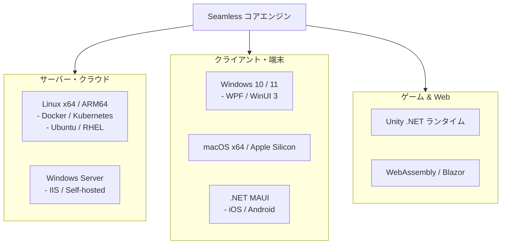

# マルチプラットフォーム展開 (Cross-Platform Deployment)

Seamless は、最新の .NET（.NET 10 / 11）が動作するあらゆる環境で動作するよう、OS 非依存のポータブルなアーキテクチャで設計されています。

---

## 1. サポート環境

### プラットフォーム固有機能の抽象化
CPU トポロジ検出、ファイルロック、共有メモリ等の OS 固有機能は、すべて内部の抽象レイヤー（`OperatingSystem.IsWindows()`, `IsLinux()`, `IsMacOS()`）によって安全に分岐・フォールバックされます。

- **Windows**: `GetLogicalProcessorInformationEx` による正確なコア・NUMA 判定、`CreateFile` の共有ロック。
- **Linux**: `/sys/devices/system/cpu` からのトポロジ走査、`fcntl` / `flock` によるファイル排他制御。
- **macOS / iOS / Android**: 標準 POSIX インターフェースおよび .NET 標準 API への自動フォールバック。

---

## 2. クラウド・コンテナ環境（Docker / Kubernetes）での利用

クラウドコンテナ環境では、CPU コア数やメモリ上限（cgroups 制約）が厳密に制限されます。

- **`ResourceBudget` との親和性**:
  Kubernetes のメモリリミット（例: `limit: 1Gi`）に合わせて `DatabaseContainerOptions.ManagedMemoryLimitBytes` を設定することで、Pod が OOMKilled（OOM による強制終了）されるのを完全に防ぐことができます。
- **ARM64（AWS Graviton / Ampere）へのネイティブ対応**:
  .NET の ARM64 JIT 最適化および NEON ベクトル命令に完全対応しており、低コスト・高効率なクラウドインフラで最大のパフォーマンスを発揮します。

---

## 3. ゲームエンジン（Unity）での活用

ゲーム開発において、GC ポーズは最も忌避される現象です。
Seamless は、Unity の最新 .NET サポート環境（.NET Standard 2.1 / .NET 8+ ランタイム）に対応しています。

- **60fps / 120fps を維持するローカルデータストア**:
  大量のゲーム内アイテム、クエスト進行状況、マップデータをヒープアロケーションなしにローカル保存・超高速検索。
- **サーバーとのプロトコル統一**:
  ゲームサーバーと Unity クライアントで同一の型・シリアライズロジックを共有でき、ネットワーク同期の開発工数を劇的に削減します。

---

## 関連項目

- [サーバー・クライアント共通アーキテクチャ](../guides/universal-architecture.md) : 設計の実践
- [将来的な可能性](future-possibilities.md) : 次世代の分散・AI 連携
