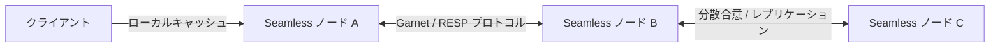

# 将来的な可能性と次世代データストア像 (Future Possibilities)

Seamless のアーキテクチャ（コンパイル時コード生成 × 超高速ハイブリッドストレージ）は、単なる現在のライブラリにとどまらず、次世代の分散システムや AI 時代における新しいデータ基盤としての大きな拡張性を秘めています。

---

## 1. 分散 KVS / クラスタ連携への拡張

現在、単一プロセス内のローカル SSD と RAM を統合している Tsavorite バックエンドは、ネットワーク層を介した **超分散キャッシュ・データベースクラスタ** へとスケールアウト可能です。

- **Microsoft Garnet プロトコルとの統合**:
  Tsavorite の上位ネットワークプロトコルである Garnet（Redis 互換の高スループット KVS エンジン）と直接接続し、ローカルインメモリ DB の延長線上で分散クラスタを操作する未来像。
- **マルチリージョン・アクティブ/アクティブ同期**:
  WAL（先行書き込みログ）のストリームをネットワーク経由で別ノードへレプリケーションし、ゼロダウンタイムのフェイルオーバーを実現。

---

## 2. AI エージェント駆動の組込みナレッジストア

自律型 AI エージェントやローカル LLM アプリケーションが普及する中で、エージェントがミリ秒単位で自身のコンテキスト、長期記憶（Long-term Memory）、ツール実行履歴を読み書きできる「ローカルの超高速データストア」が求められています。

Seamless は、その理想的な基盤となり得ます：

1. **ベクトル検索（Vector Search）の統合**:
   Blittable なベクトル埋め込み（`ReadOnlySpan<float>`）と SIMD（AVX-512）を活用した超高速な類似度検索（Cosine / Dot Product）を、既存の `Table` や LINQ クエリにネイティブ統合。
2. **AI エージェント向け自己整合性チェック**:
   エージェントが生成したデータモデルの不整合や矛盾を、コンパイル時およびトランザクション境界で厳密にバリデーション。
3. **完全オフラインのプライベートナレッジ**:
   端末内の Tsavorite / Persisted ストレージに、外部へ漏洩しない安全なローカル暗号化ストアを構築。

---

## 3. 次世代の「コード中心（Code-Centric）」データベース像

これまでのソフトウェア開発では、「まず RDBMS の SQL スキーマがあり、それをプログラム側へマッピングする」という外部中心のパラダイムが主流でした。

Seamless が切り拓くのは、**「C# のコードそのものがスキーマであり、ストレージであり、クエリ実行エンジンである」** という完全なコード中心のパラダイムです。

- **インピーダンスミスマッチの完全消滅**:
  プログラム言語とデータベース言語の間の翻訳コストが物理的に存在しない世界。
- **開発者体験の極致**:
  IDE の完全な型補完、リファクタリング支援、コンパイル時エラー検出の恩恵を、データベースのあらゆる操作において 100% 享受できる開発環境。

Seamless は、これからも .NET の最前線でハイパフォーマンスコンピューティングの可能性を追求し続けます。

---

## 関連項目

- [全体アーキテクチャ](../architecture/overview.md) : 現在の 2層構造設計
- [マルチプラットフォーム展開](cross-platform.md) : 各環境での実行
- [C# の性能限界を引き出す](../performance/csharp-to-the-metal.md) : 最新ランタイム技術
