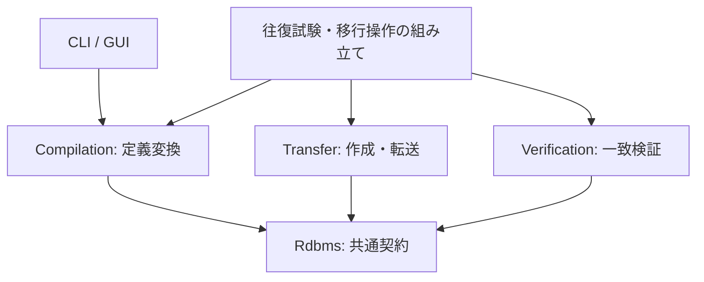

# 定義変換・データ転送・一致検証

この3機能は別の責務として実装する。変換を呼んだだけではDB接続や検証を開始しない。

| 責務 | 実装 | 入出力 |
| --- | --- | --- |
| 定義の双方向変換 | `Seamless.Database.Compilation` | C#スナップショット / SQL定義 → 共通モデル、生成コード / SQL、変換診断 |
| 共通の定義契約 | `Seamless.Database.Rdbms/NativeDatabaseDefinition.cs` | 型、列、キー、式、クエリ段階、生成SQL、診断 |
| DB構築・データ転送 | `Seamless.Database.Transfer` | 明示された接続と生成物・逐次行 → 適用数・転送数 |
| 一致検証 | `tools/Database.Verification` | 元DB・ネイティブ行・再構築DB → データ比較結果 |
| 往復試験の組み立て | `Tests/Database.Verification.Tests` | 上記の独立機能を組み合わせて確認 |



CompilationからTransferとVerificationを参照しない。TransferからCompilationとVerificationを参照しない。VerificationもCompilationやTransferへ依存せず、構築済みの接続と行の供給元を受け取る。`ModuleBoundaries`テストでこの境界を確認する。変換診断とデータ比較結果は独立し、片方の成功で他方の成功を代用しない。

## 変換専用CLI

ビルド済みの`seamless`で次を実行する。出力先は未作成の絶対パスを使う。

```powershell
seamless database sql convert --sql D:/definitions/shop.sql --name Shop --vendor sqlserver --output D:/exports/shop-csharp
seamless database csharp export --snapshot D:/exports/shop-csharp/snapshot.json --type <manifest.jsonのTypeName> --vendor sqlserver --output D:/exports/shop-sql
```

`--vendor`は`sqlserver`または`mysql`。`csharp export`には必要に応じて`--reference <assembly>`を繰り返し指定できる。入力スナップショットは`Sources: [{Path,Content}]`または管理側の`Files: [{Path,Text}]`に対応する。C#14 / net10.0 / nullable有効を使用し、参照アセンブリ内容、ソース、define、overflow設定、版をフィンガープリントへ含める。

変換結果は生成物・`diagnostics.json`・`manifest.json`へ保存する。終了コードは0が変換済み、3が未対応を含む部分変換、1が失敗。これらの終了コードは元DBとの一致を表さない。SQL入力の原文も保持するが、C#からのSQL生成に元SQLの再出力は使わない。

## 現在の対応範囲

- SQL定義→C#: 基本的なCREATE TABLE、列、NULL、直接列の主キー、整数・文字列型。未対応のオブジェクト・句・型は診断し、入力SQLを残す。
- C#→SQL: 選択したDatabaseContainerと到達するスキーマ、表、直接列のキー、Where、Select、OrderBy / ThenBy、順序指定付きTake、Distinct、Count / LongCount、Sumの初期実装。任意のC#、算術のoverflow、Min / Max / Average等は未対応診断を返す。
- 生成ルーチンは初期実装では読み取り用ストアド。元の関数種別・ビュー・トリガー・更新処理を全て再現する実装ではない。
- 取り込み済みのidentity、default、computed、unique / foreign key / check / triggerは`SourceFeatures`として保持する。SQL再生成が未対応の表は診断し、黙ってそれらを落とした表を完成品として出さない。
- 数値・日時をSQLの型へ合わせるためにネイティブ表現を縮小しない。decimal、浮動小数点、日時の正確なSQL出力は未対応診断を返す。
- 固定容量文字列はUTF-16の16 / 32 / 64 / 128 / 256要素。既定の埋め込み上限512バイト、行の概算上限4096バイト。論理的なSQLの最大長と物理バッファ容量を分ける。長文はstringを保持する。速度優位は未測定。
- Ordinal文字列の等価比較はSQL出力で明示する。元DBの全照合順序、文字列キー、末尾空白、文字コード、日付・実数・例外・トランザクションの一致を保証する段階ではない。
- 一致検証は全表の値・NULL・件数・重複を比較する。クエリは順序あり / 順序なしを明示して比較できる。複数結果セットは未対応として拒否し、一つへ連結して成功扱いにしない。
- 未対応の値型、1行のメモリ予算超過、一時ディスク予算超過、実行エラーは検証成功にしない。全スキーマの意味・制約・例外の一致判定と性能測定は未実装。

## 実行と証拠

```powershell
./tools/sql-migration/Invoke-RoundtripTests.ps1 -Configuration Debug
./tools/sql-migration/Invoke-RoundtripTests.ps1 -Configuration Release
./tools/sql-migration/Invoke-RoundtripTests.ps1 -Suite Conversion
./tools/sql-migration/Invoke-RoundtripTests.ps1 -Suite Verification
./tools/sql-migration/Invoke-RoundtripTests.ps1 -Suite Tool
./tools/sql-migration/Test-ConversionCli.ps1 -Configuration Release
./tools/sql-migration/Invoke-RoundtripTests.ps1 -Suite Verification -Filter 'Category=LiveSqlServer'
```

通常の実行はSQL Server実機試験を除外する。実機試験は`ConnectionStrings__Source`（未設定時はlocalhostのWindows認証）を使い、GUIDを含む専用の元DBと再構築DBを作成する。既存のD/G上のSQL Serverデータディレクトリを利用し、共有サービス設定は変更しない。検証用DBと保存領域は証拠として残す。所有情報は`D:/CodexTemp/Seamless/RoslynRoundtrip/tmp/SqlServerRoundtrip/<GUID>/owner.json`に記録する。

実機fixtureは2表、NULL・Unicode・大文字小文字・重複行を使用する。生成C#をコンパイルして実際に取り込み、C#から生成したDDLと読み取りストアドをSQL Serverに適用し、転送後のデータを比較する。これは小さなfixtureの検証であり、AdventureWorks全体やMySQL実機の移行完了を示さない。

成果物・実データはD、キャッシュ・ログ・TRX・PID/開始時刻/affinityのreceiptはFへ保存し、共通の8論理CPU内で実行する。MySQL実機と公開サンプルの完全往復、更新動作、DataGrip GUI、ネイティブ性能比較は今後の検証範囲となる。
